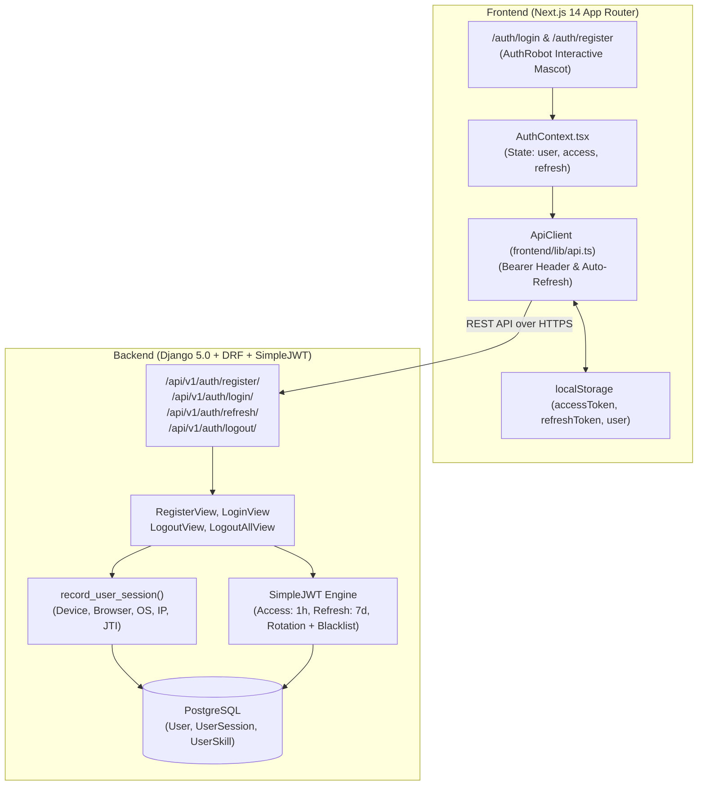
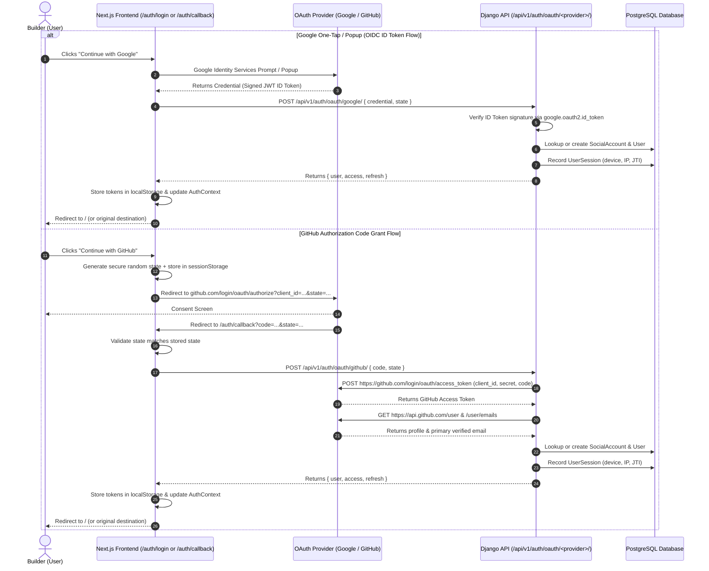
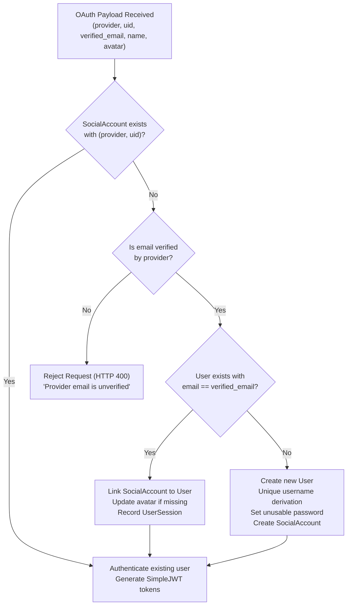
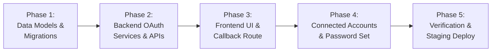

# ENQUEbet Google & GitHub OAuth 2.0 Authentication Architecture Audit

**Status:** COMPLETE (READ-ONLY AUDIT)  
**Date:** October 20, 2026  
**Auditor:** Senior Frontend Engineer, UI/UX Designer, Product Designer & AI SaaS Design Architect  
**Project:** ENQUEbet MVP  
**Repository:** `c:\workflow\enquebet-mvp`  
**Target:** Safe, seamless integration of Google and GitHub OAuth 2.0 preserving 100% of existing authentication flows.

---

## 1. Executive Summary & Objective

This document provides a comprehensive, read-only architectural audit of ENQUEbet's authentication system. The goal is to determine exactly how Google and GitHub OAuth 2.0 can be integrated safely, reliably, and beautifully without removing, replacing, or breaking existing email/password authentication, JWT lifecycle behavior, user session tracking, permission models, or user profile schemas.

### Primary Directives Verified
1. **Strictly Read-Only:** Zero application code, configuration files, database schemas, or migrations were modified during this audit.
2. **Backward Compatibility:** Existing email/password login, registration, JWT refresh rotation, device session tracking, and profile endpoints will remain 100% functional.
3. **No Mock Authentication in Production:** Architectural designs forbid mock authentication pathways in production environments (`DEBUG=False`).
4. **Standard-Compliant Architecture:** Integrates OAuth 2.0 and OpenID Connect (OIDC) through headless REST APIs, decoupling authentication tokens from insecure browser redirect query strings.

---

## 2. Current Authentication Architecture

The ENQUEbet platform operates a decoupled architecture consisting of a **Next.js 14 App Router** frontend and a **Django 5.0.1 + Django REST Framework 3.14.0** backend, backed by PostgreSQL (Supabase/Neon), Redis (Upstash/local), and Cloudinary media storage.



### 2.1 Backend Architecture
- **User Model (`apps.users.models.User`):** Extends `django.contrib.auth.models.AbstractUser`.
  - `id`: `models.UUIDField(primary_key=True, default=uuid.uuid4, editable=False)`.
  - `USERNAME_FIELD = 'email'`.
  - `REQUIRED_FIELDS = ['username', 'full_name']`.
  - Uniqueness constraints: `email` is `unique=True` (case-insensitive checks enforced in views/serializers), and `username` is `unique=True`.
  - Additional builder profile fields: `headline`, `bio`, `profile_image`, `cover_image`, `location`, `college`, `city`, `latitude`, `longitude`, `campus_domain`, `is_private`, `verification_level`, `reputation_score`, `availability_status`, `pinned_proof_ids`, `education`, `projects`, `experience`, `certifications`, `collaboration_preferences`, `resume_file`, `linkedin_url`, `github_url`, and `portfolio_url`.
- **JWT Configuration (`rest_framework_simplejwt`):**
  - Configured in `backend/config/settings.py` (lines 288–293):
    - `ACCESS_TOKEN_LIFETIME = timedelta(hours=1)`
    - `REFRESH_TOKEN_LIFETIME = timedelta(days=7)`
    - `ROTATE_REFRESH_TOKENS = True`
    - `BLACKLIST_AFTER_ROTATION = True`
  - Outstanding tokens stored in `rest_framework_simplejwt.token_blacklist.models.OutstandingToken`.
- **Session & Device Tracking (`apps.users.models.UserSession`):**
  - Created during registration (`RegisterView`) and login (`LoginView`) via `record_user_session(request, user, refresh)` in `backend/apps/users/views.py:79-106`.
  - Captures `device_name`, `device_type` (`desktop`, `mobile`, `tablet`), `browser`, `os`, `ip_address`, `refresh_jti`, and `is_current`.
  - Supports granular revocation (`DELETE /api/v1/users/me/sessions/<session_id>/`) and remote bulk logout (`POST /api/v1/users/me/sessions/revoke-others/`).
- **Throttling & Security Controls:**
  - `REST_FRAMEWORK` settings: `AnonRateThrottle` (100/hour) and `UserRateThrottle` (1000/hour).
  - CORS controls: `CORS_ALLOWED_ORIGINS` and regex for preview branches `^https://.*\.vercel\.app$`.
  - `SECURE_PROXY_SSL_HEADER = ('HTTP_X_FORWARDED_PROTO', 'https')` with `SECURE_SSL_REDIRECT = True` in production.

### 2.2 Frontend Architecture
- **Global Auth State (`frontend/lib/contexts/AuthContext.tsx`):**
  - Manages `user: User | null`, `loading: boolean`, `isAdmin: boolean`, `isStaff: boolean`.
  - Actions: `login(email, password)`, `register(data)`, `logout()`, `updateUser(data)`.
  - Persists `accessToken`, `refreshToken`, and serialized `user` in `localStorage`.
  - On application mount, verifies existing tokens by calling `api.getProfile()` (`GET /api/v1/auth/profile/`).
- **HTTP Client (`frontend/lib/api.ts`):**
  - Encapsulated singleton `ApiClient`.
  - Attaches `Authorization: Bearer <accessToken>` to authenticated requests.
  - Automated transparent token refresh: If an authenticated request encounters HTTP 401, `refreshAccessToken()` issues `POST /api/v1/auth/refresh/` using stored `refreshToken` with in-flight deduplication (`refreshPromise`).
  - Configured with an `AbortController` timeout (`NEXT_PUBLIC_API_TIMEOUT_MS`, default 15s).
- **Route Protection:**
  - Client-side navigation guard via `useRequireAuth()` hook (`frontend/lib/hooks/useRequireAuth.ts`). If `!auth.loading && !auth.user`, redirects user to `/auth/login`.
- **UI Design & Mascot Integration:**
  - Login (`frontend/app/auth/login/page.tsx`) and Register (`frontend/app/auth/register/page.tsx`).
  - Interactive 3D CSS/Canvas mascot `AuthRobot` (`frontend/components/auth/AuthRobot.tsx`) synchronized with focus states, text entry typing length, password visibility peeking, validation error shakes, and success celebrations.

---

## 3. Relevant Files, Classes, Endpoints, and Models

| Layer | File / Location | Class / Symbol | Purpose & Role |
|---|---|---|---|
| **Model** | `backend/apps/users/models.py:9` | `class User(AbstractUser)` | Primary identity entity with email as `USERNAME_FIELD`, unique username, and builder profile fields. |
| **Model** | `backend/apps/users/models.py:172` | `class UserSession(models.Model)` | Multi-device session tracker with IP, User-Agent parsing, JTI, and revocation flags. |
| **Serializer** | `backend/apps/users/serializers.py:68` | `class UserSerializer` | Profile representation, completeness scoring, private lock filtering, and profile updates. |
| **Serializer** | `backend/apps/users/serializers.py:247` | `class UserRegistrationSerializer` | Validates registration fields, password confirmation, and unique email/username. |
| **Serializer** | `backend/apps/users/serializers.py:279` | `class UserLoginSerializer` | Validates login identifier (email or username) and password. |
| **View** | `backend/apps/users/views.py:109` | `class RegisterView(APIView)` | Accepts registration payload, creates user, generates JWT, records `UserSession`. |
| **View** | `backend/apps/users/views.py:132` | `class LoginView(APIView)` | Case-insensitive identifier authentication, checks active status, generates JWT, records `UserSession`. |
| **View** | `backend/apps/users/views.py:275` | `class MePasswordView(APIView)` | Password modification endpoint requiring `current_password` and `new_password`. |
| **View** | `backend/apps/users/views.py:571` | `class LogoutView(APIView)` | Blacklists individual refresh token via simplejwt blacklist. |
| **View** | `backend/apps/users/views.py:590` | `class LogoutAllView(APIView)` | Blacklists all outstanding tokens belonging to the authenticated user. |
| **URL Route** | `backend/apps/users/urls.py:8-17` | `urlpatterns` | Routes for `/register/`, `/login/`, `/refresh/`, `/logout/`, `/logout-all/`, `/ws-ticket/`, `/profile/`. |
| **URL Route** | `backend/config/urls.py:39,56` | `include('apps.users.urls')` | Mount points for `/api/v1/auth/` and legacy alias `/api/auth/`. |
| **Config** | `backend/config/settings.py:288` | `SIMPLE_JWT` | Token lifetime (1h access / 7d refresh), rotation, and blacklist configuration. |
| **Dependencies**| `backend/requirements.txt` | Package manifest | Already includes `google-auth==2.52.0`, `requests==2.32.5`, `requests-oauthlib==2.0.0`, `oauthlib==3.3.1`, `PyJWT==2.11.0`, `cryptography==46.0.5`. |
| **Frontend State**| `frontend/lib/contexts/AuthContext.tsx` | `AuthProvider, useAuth` | React context providing `user`, `login`, `register`, `logout`, `updateUser`. |
| **Frontend API**| `frontend/lib/api.ts:7` | `class ApiClient` | HTTP client with automatic JWT bearer attachment, refresh token deduplication, error handling. |
| **Frontend UI** | `frontend/app/auth/login/page.tsx` | `LoginPage` | Email/password sign-in page integrated with `AuthRobot`. |
| **Frontend UI** | `frontend/app/auth/register/page.tsx`| `RegisterPage` | Builder registration page integrated with `AuthRobot`. |
| **Frontend Guard**| `frontend/lib/hooks/useRequireAuth.ts` | `useRequireAuth` | Route protection hook redirecting unauthenticated users to `/auth/login`. |
| **Settings UI**| `frontend/components/settings/SecuritySection.tsx`| `SecuritySection` | Password change form and active device sessions table with remote revocation. |

---

## 4. Existing Functionality That Must Be Preserved

1. **Email / Password Authentication:** Existing builders who registered with email and password must be able to log in without interruption.
2. **Case-Insensitive Identifier Lookup:** `LoginView` must continue accepting either username or email in any case (e.g., `user@domain.com` or `User@Domain.Com`).
3. **SimpleJWT Lifecycle:**
   - 1-hour access tokens, 7-day refresh tokens.
   - Token rotation on every refresh call.
   - Immediate blacklisting of rotated refresh tokens.
   - Ephemeral WebSocket tickets (`POST /api/v1/auth/ws-ticket/`).
4. **Device & Session Audit Trail:** Every OAuth login must execute `record_user_session(request, user, refresh)` so that OAuth sessions appear in `/settings?tab=security` and can be remotely revoked.
5. **Private Profile & Field Privacy Rules:** The email address must never be leaked to public endpoints; `UserSerializer.to_representation` must continue stripping sensitive attributes unless `request.user.id == instance.id`.
6. **Reputation & Verification Integrity:** Non-staff users must not be permitted to modify `verification_level` or `reputation_score` through profile updates or social logins.
7. **Interactive Mascot Experience:** `AuthRobot` on `/auth/login` and `/auth/register` must maintain its animations, reactions, and UX without visual glitches or displacement when social buttons are introduced.

---

## 5. Architectural Findings & Classification

Each component is classified under standard audit terminology: **WORKING**, **INCOMPLETE**, **DEFECTIVE**, **MISSING**, or **NEEDS CONFIRMATION**.

| Component / Area | Status | Evidence & Actual Findings |
|---|---|---|
| **Email/Password Login** | **WORKING** | Verified in `apps/users/views.py:132-169`. Case-insensitive lookup, active status check, password verification, JWT generation, device session recording. |
| **Email/Password Registration** | **WORKING** | Verified in `apps/users/views.py:109-130`. Full validation, password confirmation check, unique email/username checks, 201 response. |
| **JWT Token Management** | **WORKING** | Verified in `config/settings.py:288-293`. Access lifetime 1h, refresh lifetime 7d, rotation and blacklist active. |
| **Session Tracking (`UserSession`)** | **WORKING** | Verified in `apps/users/views.py:79-106`. Tracks client device, browser, OS, IP address, and JTI. |
| **Frontend Token Auto-Refresh** | **WORKING** | Verified in `frontend/lib/api.ts:77-113`. Deduplicates refresh promises and retries requests seamlessly. |
| **OAuth Social Account Model** | **MISSING** | No database model exists to store social identities, provider UIDs, or provider connection timestamps. |
| **OAuth Backend Endpoints** | **MISSING** | No endpoints exist under `/api/v1/auth/oauth/` for exchanging GitHub authorization codes or verifying Google ID tokens. |
| **OAuth Frontend Callback Route** | **MISSING** | No Next.js route exists at `/auth/callback` to handle redirects, verify CSRF state, and exchange credentials. |
| **Social Login UI Elements** | **MISSING** | Neither `/auth/login` nor `/auth/register` contains Google or GitHub authentication buttons. |
| **OAuth Passwordless Account Password Setting** | **DEFECTIVE** | `MePasswordView` (`apps/users/views.py:275-302`) requires `current_password` and checks `user.check_password()`. Since OAuth-created accounts have unusable passwords (`user.set_unusable_password()`), OAuth builders cannot set a password in `/settings?tab=security`. |
| **GitHub Private / Unverified Email Handling** | **MISSING** | GitHub accounts often have unlisted or private emails (`@users.noreply.github.com`). The OAuth service must explicitly query `GET https://api.github.com/user/emails` and filter for primary verified emails. |
| **OAuth State CSRF Protection** | **MISSING** | No mechanism exists to generate, sign, and verify cryptographic state parameters during authorization redirects. |
| **Connected Accounts Management in Settings** | **MISSING** | `SecuritySection.tsx` and `AccountSection.tsx` have no UI to view connected providers (Google, GitHub) or disconnect them. |
| **OAuth Environment Variables** | **MISSING** | Neither `backend/.env.example` nor `frontend/.env.example` contains OAuth client IDs, secrets, or redirect URIs. |
| **Google ID Token Validation Library** | **WORKING** | `google-auth==2.52.0` is already installed in `backend/requirements.txt` and available for zero-dependency ID token verification. |
| **GitHub OAuth HTTP Client Library** | **WORKING** | `requests==2.32.5` and `requests-oauthlib==2.0.0` are already installed in `backend/requirements.txt`. |

---

## 6. Proposed OAuth 2.0 Architecture

To achieve world-class security, performance, and UX, ENQUEbet will implement a **Headless OAuth 2.0 & OIDC Pattern**. 

Instead of traditional full-page Django server-side redirects that pass access tokens in browser URL query parameters (which violate security best practices and leak tokens into browser history and referrer headers), the frontend coordinates provider authorization and hands verification tokens/codes to the backend over HTTPS REST APIs.

### 6.1 Architectural Workflow



---

## 7. Account Creation and Linking Policy

Account linking requires a rigorous, defense-in-depth policy to prevent account takeover while providing a seamless user experience.



### 7.1 Linking Rules
1. **Existing Social Connection:** If a record matches `(provider, uid)`, immediately authenticate the associated user.
2. **Email Match with Verified Email:** If no social record exists, but a `User` exists whose `email.lower()` matches the provider's verified email:
   - **Requirement:** Provider MUST confirm the email is verified (`email_verified == True` for Google; `verified == True` on primary email for GitHub).
   - **Action:** Atomically create the `SocialAccount` row linking to this existing `User`. Automatically populate empty builder fields (e.g., set `github_url` if linking GitHub and currently blank; set `profile_image` if currently blank).
3. **Unverified Email Rejection:** If the provider cannot guarantee that the email is verified, automatic account linking is **strictly forbidden**. This prevents pre-account takeover attacks.
4. **New User Creation:** If no user exists with that email:
   - Generate an alphanumeric username from the provider name or email prefix (e.g., `kumar_sanu` or `ksanu`).
   - If collision occurs against existing usernames, append unique deterministic/random digits (e.g., `kumar_sanu_1`, `kumar_sanu_2`).
   - Call `user.set_unusable_password()` so the user has no empty/guessable password.
   - Populate `full_name`, `email`, `profile_image`, and `github_url` (for GitHub).
   - Set `availability_status = 'open_to_collaborate'`.

---

## 8. Database and Migration Considerations

### 8.1 New Model: `SocialAccount`
To maintain clean separation of concerns and avoid polluting the `User` model with third-party tokens, a new model `SocialAccount` will be created in `apps.users.models`.

```python
class SocialAccount(models.Model):
    """
    Connected third-party OAuth provider identities (Google, GitHub).
    """
    PROVIDER_GOOGLE = 'google'
    PROVIDER_GITHUB = 'github'
    PROVIDER_CHOICES = [
        (PROVIDER_GOOGLE, 'Google'),
        (PROVIDER_GITHUB, 'GitHub'),
    ]

    id = models.UUIDField(primary_key=True, default=uuid.uuid4, editable=False)
    user = models.ForeignKey(User, on_delete=models.CASCADE, related_name='social_accounts')
    provider = models.CharField(max_length=30, choices=PROVIDER_CHOICES)
    uid = models.CharField(max_length=255, help_text="Provider's unique subject or user ID")
    provider_email = models.EmailField(blank=True, default='')
    display_name = models.CharField(max_length=255, blank=True, default='')
    avatar_url = models.URLField(max_length=500, blank=True, default='')
    extra_data = models.JSONField(default=dict, blank=True)
    created_at = models.DateTimeField(auto_now_add=True)
    updated_at = models.DateTimeField(auto_now=True)

    class Meta:
        db_table = 'social_accounts'
        unique_together = [
            ('provider', 'uid'),        # One provider ID maps to exactly one user
            ('user', 'provider'),       # A user can only link one account per provider
        ]
        indexes = [
            models.Index(fields=['provider', 'uid']),
            models.Index(fields=['user', 'provider']),
        ]

    def __str__(self):
        return f"{self.user.username} ({self.provider}:{self.uid})"
```

### 8.2 Migration Safety
- **Additive Migration:** Adding `SocialAccount` is 100% additive and zero-downtime compatible.
- **Migration Sequence:** Will be `0009_socialaccount.py` following existing migration `0008_user_certifications_user_collaboration_preferences.py`.
- **Foreign Key:** `user` references `User(id)` with `on_delete=models.CASCADE`. If an account is deleted, social links are safely cleaned up.

---

## 9. Frontend Integration Approach

### 9.1 UI Layout on `/auth/login` and `/auth/register`
In compliance with the project's **anti-slop, premium SaaS design standards** (inspired by Linear and Vercel):
- Position the social authentication buttons cleanly below the form or between the robot mascot and primary fields, separated by a crisp divider:
  ```text
  [ Continue with Google ]   [ Continue with GitHub ]
  ──────────────────  OR CONTINUE WITH EMAIL  ──────────────────
  ```
- Use custom SVG brand icons for Google and GitHub with subtle hover glows matching the `#1864ff` cyber-blueprint theme.
- **Mascot Sync:** When a user hovers or clicks Google/GitHub buttons, `AuthRobot` reacts with an interested look or nod, without triggering keyboard typing gestures.
- Maintain full accessibility: `aria-label`, proper keyboard focus rings, and high-contrast labels.

### 9.2 Callback Route: `frontend/app/auth/callback/page.tsx`
- Dedicated route to receive OAuth redirect redirects (e.g. `?code=...&state=...`).
- Shows a high-end cyber loading card with an animated loader and progress indicator: *"Verifying your builder identity with GitHub..."*.
- Validates CSRF `state` from `sessionStorage`.
- Dispatches `POST /api/v1/auth/oauth/github/`.
- On success, updates `AuthContext`, saves tokens to `localStorage`, and performs an animated router push to `/` or the `returnTo` redirect target.
- On error, displays a structured error card with a retry CTA and redirect to `/auth/login`.

### 9.3 Settings Integration: `frontend/components/settings/SecuritySection.tsx`
- Add a **Connected Accounts** sub-card under Security Settings.
- Lists Google and GitHub with status badges: `Connected as kumar@gmail.com` or `Not connected`.
- Allows users to connect an account while authenticated, or disconnect if they have a usable password set.
- **Password Setting Modal:** For OAuth users who do not have a usable password, provide a "Set Master Password" modal calling a new endpoint `POST /api/v1/users/me/set-password/` (bypassing `current_password` when `has_usable_password() == False`).

---

## 10. Security Threats & Mitigations

| Threat | Description | Mitigation Strategy |
|---|---|---|
| **Account Takeover via Pre-Creation** | Attacker registers an account with victim's email, or uses an unverified GitHub email to match victim's account. | Require strict provider email verification (`email_verified=True` on Google, `verified=True` on GitHub primary email). Never link unverified emails. |
| **CSRF in Authorization Redirect** | Attacker tricks victim into completing an OAuth callback with attacker's credentials, linking attacker's social profile. | Generate a cryptographically random `state` (32 bytes urlsafe) stored in client `sessionStorage` or HttpOnly cookie, verified strictly before code exchange. |
| **Token Exposure in URL Query Params** | Passing JWT tokens in browser redirects leaks tokens to browser history, proxy logs, and `Referer` headers. | All JWT issuance occurs over direct POST request payloads. No JWT is ever passed in browser query strings. |
| **Token Replay Attacks** | Replaying an intercepted authorization code or ID token. | GitHub codes are single-use by GitHub specification. Google ID tokens are verified using `google.oauth2.id_token.verify_oauth2_token` with audience (`aud`), issuer (`iss`), and expiration (`exp`) checks. |
| **Mock Auth in Production** | Dangerous test bypasses left active in production code. | Absolutely no mock authentication endpoints or bypass flags in application code. Tests use standard `unittest.mock.patch` in isolated test runners. |
| **Session Hijacking / Stale Tokens** | Rogue OAuth session left open. | OAuth logins generate a tracked `UserSession` with User-Agent parsing and IP address. Revocation is immediately available in Security Settings. |
| **Rate Limiting & Abuse** | Brute-force submission of fake tokens. | Protected by Django REST Framework's `AnonRateThrottle` (100/hour) and dedicated provider exchange error handling. |

---

## 11. Test Plan & Regression Risks

### 11.1 Test Coverage Plan
1. **Unit Tests (`backend/apps/users/tests_oauth.py`):**
   - Test Google ID token verification with mocked valid/invalid tokens.
   - Test GitHub authorization code exchange with mocked GitHub API responses.
   - Test primary verified email extraction when GitHub user has multiple or private emails.
   - Test new user creation: slug generation, unique username fallback, unusable password.
   - Test account linking when email matches and is verified.
   - Test account linking rejection when email is unverified.
   - Test unique constraint enforcement: duplicate social accounts raise integrity error.
   - Test password setting endpoint for users with `has_usable_password() == False`.
2. **Regression Tests (`backend/apps/users/tests.py`):**
   - Run entire existing test suite: email/password registration, login, token refresh, profile update, session revocation.
3. **Frontend E2E / Integration Verification:**
   - Verify Google One-Tap / Button render and payload dispatch.
   - Verify GitHub redirect and callback exchange.
   - Verify `AuthRobot` state reactions.
   - Verify localStorage and `AuthContext` state preservation across page reloads.

---

## 12. Production Environment Requirements

### 12.1 Required Environment Variables

#### Backend (`backend/.env` / Render Dashboard)
```env
# Google OAuth 2.0
GOOGLE_OAUTH_CLIENT_ID=your-google-client-id.apps.googleusercontent.com
GOOGLE_OAUTH_CLIENT_SECRET=your-google-client-secret

# GitHub OAuth 2.0
GITHUB_OAUTH_CLIENT_ID=your-github-client-id
GITHUB_OAUTH_CLIENT_SECRET=your-github-client-secret
GITHUB_OAUTH_REDIRECT_URI=https://enquebet.vercel.app/auth/callback

# Allowed Frontend Origins (already supported)
CORS_ALLOWED_ORIGINS=http://localhost:3000,http://127.0.0.1:3000,https://enquebet.vercel.app
CSRF_TRUSTED_ORIGINS=http://localhost:3000,http://127.0.0.1:3000,https://enquebet.vercel.app,https://*.vercel.app
```

#### Frontend (`frontend/.env.local` / Vercel Project Settings)
```env
# Backend API Base (already supported)
NEXT_PUBLIC_API_URL=https://enquebet-mvp-534x.onrender.com/api/v1

# OAuth Client Identifiers (Public)
NEXT_PUBLIC_GOOGLE_CLIENT_ID=your-google-client-id.apps.googleusercontent.com
NEXT_PUBLIC_GITHUB_CLIENT_ID=your-github-client-id
```

### 12.2 External Console Configurations
1. **Google Cloud Console (APIs & Services > Credentials):**
   - Authorized JavaScript origins: `http://localhost:3000`, `https://enquebet.vercel.app`.
   - Authorized redirect URIs: `http://localhost:3000/auth/callback`, `https://enquebet.vercel.app/auth/callback`.
2. **GitHub Developer Settings (OAuth Apps):**
   - Homepage URL: `https://enquebet.vercel.app` (or `http://localhost:3000` for local dev app).
   - Authorization callback URL: `https://enquebet.vercel.app/auth/callback` (or `http://localhost:3000/auth/callback`).

---

## 13. Phased Implementation Sequence



- **Phase 1: Database Architecture & Migration**
  - Create `SocialAccount` model with unique constraints and indexes.
  - Run migration safely in local environment (`0009_socialaccount.py`).
- **Phase 2: Backend OAuth Endpoints & Services**
  - Implement `OAuthService` in `backend/apps/users/oauth_services.py` handling token validation, GitHub email queries, and user linking.
  - Implement `GoogleOAuthView` and `GitHubOAuthView` at `/api/v1/auth/oauth/google/` and `/api/v1/auth/oauth/github/`.
  - Implement `SetPasswordView` (`/api/v1/users/me/set-password/`) allowing OAuth users to set their first password.
  - Add comprehensive unit tests in `backend/apps/users/tests_oauth.py`.
- **Phase 3: Frontend Social Login UI & Callback Handler**
  - Add Google and GitHub buttons to `/auth/login` and `/auth/register` with `AuthRobot` interaction.
  - Build `/auth/callback` page with CSRF state verification and loading animations.
  - Add `setAuthSession(access, refresh, user)` method to `AuthContext.tsx`.
- **Phase 4: Security Settings & Connected Accounts**
  - Add Connected Accounts table to `frontend/components/settings/SecuritySection.tsx`.
  - Add "Set Password" flow for OAuth users without passwords.
- **Phase 5: Automated Verification & Production Deployment**
  - Run full backend regression suite and frontend build.
  - Deploy migration and backend updates to Render.
  - Update Vercel environment variables and Google/GitHub developer credentials.
