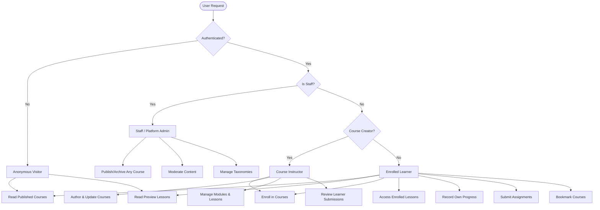

# ENQUEbet Academy — Security, QA & DevOps Master Specification
**Document ID:** `docs/academy/03-security-qa-devops-specification.md`  
**Authors:** Agent E (Security Engineer), Agent F (QA & Test Automation Architect), Agent G (DevOps & SRE)  
**Status:** Canonical Engineering Specification  
**Version:** 1.0.0  
**Target Subsystems:** `apps.courses`, `frontend/app/courses`, `frontend/e2e/academy.spec.ts`

---

## Executive Summary & Non-Negotiable Tenets

ENQUEbet Academy is designed to bridge the gap between educational learning and verifiable real-world project execution. To preserve the high signal-to-noise ratio and institutional trust of the ENQUEbet ecosystem, Academy enforces strict architectural separation between **educational learning progress** and **reputation/proof-of-work minting**.

```
┌──────────────────────────────────────────────────────────────────────────────┐
│                         TRUST BOUNDARY ARCHITECTURE                          │
├──────────────────────────────────────┬───────────────────────────────────────┤
│         ACADEMY EDUCATIONAL ZONE     │        CANONICAL REPUTATION ZONE      │
│  (apps.courses)                      │  (apps.collaboration)                 │
├──────────────────────────────────────┼───────────────────────────────────────┤
│ • Course & Module Discovery          │ • Workspaces & Team Governance        │
│ • Lesson Consumption & Checkpoints   │ • Kanban Tasks & Milestone Delivery   │
│ • Practical Assignment Submissions   │ • Formal Deliverable Peer Review      │
│ • Educational Certificates           │ • Cryptographic ProofOfWork Minting   │
│   (`CourseCompletion` ENQ-ACAD-XXXX) │ • System-Wide Reputation Score        │
│                                      │                                       │
│    [ISOLATED: NO REPUTATION MINTING] │    [MANDATORY VERIFICATION PIPELINE]  │
└──────────────────────────────────────┴───────────────────────────────────────┘
```

### Three Core Invariants
1. **Zero Educational Reputation Inflation:** Completing an Academy course awards a verifiable completion credential (`CourseCompletion`), but **never** directly increments `User.reputation_score` or mints an `apps.collaboration.ProofOfWork`. To earn reputation, students must take their acquired skills into collaborative workspaces via the "Launch Build Project" bridge.
2. **Strict Identity & Ownership Verification (Anti-IDOR):** All progress checkpoints, submission payloads, and enrollment records are bound to the authenticated `request.user` on the server. Client-provided user IDs are discarded.
3. **Defense-in-Depth Sanitization:** All Markdown curricula and student project submission URLs undergo strict server-side validation and sanitization to prevent XSS, CSRF, and SSRF attacks.

---

# Part 1: Comprehensive Threat Modeling & Security Architecture (Agent E)

## 1.1 STRIDE Threat Modeling Analysis

| Category | Threat Scenario | Impact | Severity | Mitigation Architecture |
|---|---|---|---|---|
| **Spoofing** | Attacker spoofs identity to mark another user's lesson complete or submit assignments on their behalf. | User progression corrupted; false certification issued. | **CRITICAL** | All write endpoints resolve identity strictly via `request.user` from validated JWT session. Enrollment foreign key lookup enforces `user=request.user`. |
| **Spoofing** | Attacker counterfeits a `CourseCompletion` certificate code to pose as a graduate. | Academic credentials falsified. | **HIGH** | Certificates issue a unique cryptographic verification identifier (`ENQ-ACAD-<UUID>-<HASH>`) computed from `(user_id, course_id, completed_at, secret_salt)` verifiable via public endpoint `/api/v1/courses/certificates/verify/<code/`. |
| **Tampering** | User submits altered completion percentages directly via API payloads to skip lessons. | Learners bypass coursework. | **CRITICAL** | `progress_percentage` is a server-calculated derivative field. Client payloads cannot set progress percentages or completion timestamps. |
| **Tampering** | Attacker embeds malicious `<script>` or event handlers (`onload`, `onerror`) in assignment notes or course comments. | Stored XSS leading to session hijacking. | **HIGH** | Strict HTML/Markdown sanitization using `markdown-it-py` and AST attribute stripping. All URLs validated against strict protocol and domain regexes. |
| **Repudiation** | Learner claims an assignment was submitted before a deadline or disputes instructor review notes. | Academic disputes and grading inconsistency. | **MEDIUM** | Immutable audit logs on `AssignmentSubmission` and `SubmissionReview` tracking exact timestamps, reviewer UUID, revision counter, and status transitions. |
| **Information Disclosure** | Unauthenticated user accesses draft/unpublished courses or premium proprietary lesson code. | Intellectual property theft and premature exposure. | **HIGH** | Server-side QuerySet filtering restricts courses: `Q(status='published') | Q(creator=request.user)`. Premium lessons reject requests without active verified entitlement with `403 Forbidden`. |
| **Denial of Service** | Bot loops over `/api/v1/courses/<slug>/lessons/<id>/progress/` to trigger database write saturation. | Degraded system performance and DB connection exhaustion. | **MEDIUM** | Idempotent DB writes using `update_or_create` or selective caching, guarded by Django REST Framework's `UserRateThrottle` (1000/hour) and `AnonRateThrottle` (100/hour). |
| **Elevation of Privilege** | Learner attempts to grade their own assignment or publish a custom course without instructor approval. | Unauthorized platform administrative actions. | **CRITICAL** | Custom DRF permission classes (`IsCourseCreatorOrAdmin`, `IsAssignedReviewerOrAdmin`) enforce that review endpoints reject non-staff / non-creator actors with `403 Forbidden`. |
| **Integrity Bypass** | Educational course completion attempts to invoke `ReputationService` or mint `ProofOfWork`. | Ecosystem trust breakdown; reputation farming exploit. | **CRITICAL** | Structural decoupling: `apps.courses` has **zero** imports from `reputation_service.py` or `models.ProofOfWork`. Progress is purely tracked in `apps.courses.models.CourseCompletion`. |

---

## 1.2 Access Control & RBAC Matrix

The system implements a four-tier Role-Based Access Control model enforced at both the view layer and object level:



### RBAC Permission Matrix

| Capability / Resource | Anonymous | Enrolled Learner | Non-Enrolled User | Course Creator | Staff / Admin |
|---|:---:|:---:|:---:|:---:|:---:|
| **List Published Courses** | ✅ Allowed | ✅ Allowed | ✅ Allowed | ✅ Allowed | ✅ Allowed |
| **List Draft / Archived Courses** | ❌ 401 | ❌ 403 | ❌ 403 | ✅ (Own courses) | ✅ (All) |
| **View Course Syllabus** | ✅ Allowed | ✅ Allowed | ✅ Allowed | ✅ Allowed | ✅ Allowed |
| **View Preview Lessons** | ✅ Allowed | ✅ Allowed | ✅ Allowed | ✅ Allowed | ✅ Allowed |
| **View Non-Preview Lessons** | ❌ 401 | ✅ Allowed | ❌ 403 (Enroll Req) | ✅ (Own courses) | ✅ (All) |
| **Enroll in Course** | ❌ 401 | ✅ (Already Enrolled) | ✅ Allowed | ✅ Allowed | ✅ Allowed |
| **Update Lesson Progress** | ❌ 401 | ✅ (Own enrollment) | ❌ 403 | ❌ (Own enrollment only) | ❌ (Own enrollment only) |
| **Submit Assignment** | ❌ 401 | ✅ (Own enrollment) | ❌ 403 | ❌ (Own enrollment only) | ❌ (Own enrollment only) |
| **Grade / Review Submission** | ❌ 401 | ❌ 403 | ❌ 403 | ✅ (Own courses) | ✅ (All) |
| **Bookmark Course** | ❌ 401 | ✅ Allowed | ✅ Allowed | ✅ Allowed | ✅ Allowed |
| **Create / Edit Course Curriculum** | ❌ 401 | ❌ 403 | ❌ 403 | ✅ (Own courses) | ✅ (All) |
| **Publish Course to Platform** | ❌ 401 | ❌ 403 | ❌ 403 | ❌ 403 (Requires Review) | ✅ Allowed |

### Concrete DRF Permission Classes

```python
# backend/apps/courses/permissions.py
from rest_framework.permissions import BasePermission, SAFE_METHODS

class IsPublishedOrCreatorOrAdmin(BasePermission):
    """
    Public read access for published courses.
    Draft, pending, or archived courses require course creator or staff privileges.
    """
    def has_object_permission(self, request, view, obj):
        course = obj if hasattr(obj, 'status') else getattr(obj, 'course', None)
        if not course:
            return True
        if course.status == 'published':
            return True
        return (
            request.user.is_authenticated and
            (request.user.is_staff or course.creator == request.user)
        )

class IsEnrolledInCourse(BasePermission):
    """
    Allows lesson content access only to learners actively enrolled in the course,
    unless the lesson has is_preview=True or the user is creator/staff.
    """
    def has_object_permission(self, request, view, obj):
        # Lesson or CourseModule check
        course = obj.module.course if hasattr(obj, 'module') else obj.course
        if getattr(obj, 'is_preview', False) and request.method in SAFE_METHODS:
            return True
        if not (request.user and request.user.is_authenticated):
            return False
        if request.user.is_staff or course.creator == request.user:
            return True
        return course.enrollments.filter(user=request.user, status='active').exists()

class IsSubmissionOwnerOrCourseStaff(BasePermission):
    """
    Learners can only view/edit their own submissions.
    Course creators and staff can view and review submissions.
    """
    def has_object_permission(self, request, view, obj):
        if not (request.user and request.user.is_authenticated):
            return False
        if obj.enrollment.user == request.user:
            return True
        course = obj.assignment.course
        return request.user.is_staff or course.creator == request.user
```

---

## 1.3 Entitlement Enforcement Engine

Academy courses support access tiers:
- `free`: Open to any registered learner upon clicking Enroll.
- `premium`: Requires active entitlement verification (e.g. verified student status, subscription tier, or explicit enrollment grant).
- `invite_only`: Requires explicit creator invite or token.

### Server-Side Entitlement Guard
Access control **must never** rely on frontend masking. The backend view verifies entitlement before returning lesson content, streaming video URLs, or code solutions:

```python
def check_course_entitlement(user: User, course: Course) -> bool:
    """
    Verifies that the user has legitimate access rights to the course tier.
    """
    if course.access_tier == 'free':
        return True
    if user.is_staff or course.creator == user:
        return True
    
    # Campus verified students obtain free access to academic partner courses
    if course.access_tier == 'campus_only' and getattr(user, 'verification_level', 0) >= 1:
        return True

    # Check verified user subscription or entitlement record
    has_active_subscription = hasattr(user, 'subscription') and user.subscription.is_active
    has_explicit_grant = course.enrollments.filter(
        user=user, 
        status='active', 
        entitlement_verified=True
    ).exists()

    return has_active_subscription or has_explicit_grant
```

When an unentitled user attempts to retrieve non-preview lesson data for a premium course, the server returns:
```json
{
  "error": "ENTITLEMENT_REQUIRED",
  "detail": "This lesson requires an active premium entitlement or campus verification.",
  "access_tier": "premium",
  "enrollment_url": "/courses/fullstack-saas-nextjs-django/enroll"
}
```

---

## 1.4 Input Sanitization & Anti-Injection Architecture

### Markdown Sanitization (Stored XSS Defense)
Curriculum content written by instructors and notes written by students in assignment submissions must be sanitized before persistence and HTML conversion:

1. **Backend Sanitization Filter:**
   - Whitelist tags: `p`, `h1`, `h2`, `h3`, `h4`, `h5`, `h6`, `strong`, `em`, `ul`, `ol`, `li`, `code`, `pre`, `blockquote`, `hr`, `table`, `thead`, `tbody`, `tr`, `th`, `td`, `a`, `img`.
   - Whitelist attributes: `href`, `title`, `alt`, `src`, `class` (restricted to syntax highlighting classes like `language-*`).
   - Disallow all JavaScript protocols (`javascript:`, `data:`, `vbscript:`).
   - Links must force `rel="noopener noreferrer nofollow"` and `target="_blank"`.

2. **Video Embed Sanitization:**
   - If embedded videos are permitted in markdown, iframe sources must match strict CSP domain filters:
     - `https://www.youtube-nocookie.com/embed/*`
     - `https://player.vimeo.com/video/*`
   - All other iframe embeds are stripped.

### Repository & PR URL Validation (SSRF & Injection Defense)
Assignment submissions accept repository and pull request URLs. These URLs must conform to strict structural rules:

```python
import re
from rest_framework.exceptions import ValidationError

SAFE_REPO_REGEX = re.compile(
    r'^https:\/\/(github\.com|gitlab\.com|bitbucket\.org)\/[a-zA-Z0-9_\-\.]+\/[a-zA-Z0-9_\-\.]+(\/.*)?$'
)

def validate_submission_url(value: str) -> str:
    """Validates that a submission URL is a genuine, safe Git repository or PR link."""
    if not value or not isinstance(value, str):
        return value
    clean_val = value.strip()
    if not SAFE_REPO_REGEX.match(clean_val):
        raise ValidationError(
            "Invalid submission URL. Must be a secure HTTPS link to GitHub, GitLab, or Bitbucket."
        )
    return clean_val
```

*SSRF Rule:* The backend **never** performs automatic outbound HTTP requests (`requests.get(url)`) directly inside the synchronous request-response cycle. Any automated repository metadata checks or code scans must be deferred to an isolated, sandboxed background worker with network egress controls.

---

## 1.5 Integrity Boundary: Educational Progress vs. Reputation System

To protect the integrity of ENQUEbet's reputation economy, a strict architectural firewall separates Academy completion from Proof of Work:

```
[Student Completes 100% of Lessons & Assignments]
                    │
                    ▼
       ┌────────────────────────┐
       │ Create CourseCompletion│
       │ (Code: ENQ-ACAD-XXXX)  │
       └────────────────────────┘
                    │
                    ├──> Emits CourseCompleted Notification
                    ├──> Appends Certificate to Learner Profile
                    │
                    ▼
  [REPUTATION SYSTEM: HARD WALL - NO EVENT EMITTED]
  (user.reputation_score remains unchanged)
  (No apps.collaboration.ProofOfWork minted)
                    │
                    ▼
       ┌────────────────────────┐
       │ "Launch Build Project" │ (Optional learner action)
       └────────────────────────┘
                    │
                    ▼
       ┌────────────────────────┐
       │ apps.collaboration:    │
       │ Workspace Deliverable  │ ──> Peer Review ──> Lead Approval ──> Mint ProofOfWork
       └────────────────────────┘                                        & Award Reputation
```

### Architectural Guarantees:
1. `apps/courses` has **zero** imports of `ReputationService` or `reputation_config.py`.
2. `CourseCompletion` is a read-only credential entity with fields:
   - `id`: UUID
   - `enrollment`: OneToOneField(Enrollment)
   - `user`: ForeignKey(User)
   - `course`: ForeignKey(Course)
   - `completion_code`: Unique cryptographic verification string
   - `issued_at`: DateTime
   - `final_score`: Decimal
3. The only way an Academy student gains platform reputation is by using the **"Launch Build Project"** bridge, forming a team, completing milestones in an actual `Workspace`, submitting real code deliverables, passing lead code review, and having a canonical `ProofOfWork` minted through `apps.collaboration`.

---

# Part 2: Comprehensive QA & Test Automation Strategy (Agent F)

## 2.1 Backend Unit & Integration Test Matrix (`apps.courses`)

The test suite is structured into dedicated test cases in `backend/apps/courses/tests.py`, executed against SQLite for instant sub-3-second CI runs and Postgres for production parity.

### Test Matrix Breakdown

| Test Suite Class | Focus Area | Test Count | Key Invariants Verified |
|---|---|:---:|---|
| `CourseCatalogAndDiscoveryTestCase` | Catalog Filtering & Taxonomy | 6 | Public read on published; draft hidden from anonymous; category and difficulty filters; full-text search. |
| `CourseCurriculumHierarchyTestCase` | Modules, Lessons & Previews | 5 | Module sequence ordering; preview lesson accessible to anonymous; non-preview returns 401/403. |
| `EnrollmentStateMachineTestCase` | Lifecycle & Idempotency | 5 | Duplicate enrollment returns existing 200 without duplicate row; drop & resume; entitlement verification. |
| `LessonProgressAndCalculationTestCase` | Progress Math & Completion | 6 | Idempotent lesson marking; completion % calculation (`round(done/total * 100)`); auto-mint `CourseCompletion` at 100%. |
| `AssignmentSubmissionTestCase` | Deliverables & Code Review | 7 | Learner submission lifecycle (`draft` → `submitted`); URL validation; reviewer feedback; grade assignment. |
| `SecurityAndIDORProtectionTestCase` | Identity & Cross-Tenant Guards | 6 | User A cannot mark User B's lessons complete; User A cannot edit User B's submissions; non-creator cannot review. |
| `IntegrityBoundaryTestCase` | Reputation System Decoupling | 3 | Complete course, assert `user.reputation_score` unchanged; assert `ProofOfWork.objects.count() == 0`. |
| `CourseBookmarkTestCase` | Learner Bookmarking & Pinning | 3 | Bookmark, unbookmark, list bookmarked courses. |

### Concrete Test Implementation Blueprint

```python
# backend/apps/courses/tests.py
from django.test import TestCase
from django.urls import reverse
from rest_framework.test import APIClient
from apps.users.models import User
from apps.collaboration.models import ProofOfWork
from .models import CourseCategory, Course, CourseModule, Lesson, Enrollment, LessonProgress, Assignment, AssignmentSubmission, CourseCompletion

class AcademyBaseTestCase(TestCase):
    def setUp(self):
        self.client = APIClient()
        self.student_a = User.objects.create_user(username='student_a', email='a@enquebet.com', password='password123')
        self.student_b = User.objects.create_user(username='student_b', email='b@enquebet.com', password='password123')
        self.instructor = User.objects.create_user(username='instructor', email='inst@enquebet.com', password='password123')
        
        self.category = CourseCategory.objects.create(name='Software Engineering', slug='software-engineering')
        self.course = Course.objects.create(
            title='Full-Stack SaaS Engineering',
            slug='fullstack-saas',
            category=self.category,
            creator=self.instructor,
            status='published',
            access_tier='free',
            estimated_hours=20
        )
        self.module = CourseModule.objects.create(course=self.course, title='Module 1', order=1)
        self.lesson_preview = Lesson.objects.create(
            module=self.module, title='Overview', order=1, is_preview=True, content_type='markdown'
        )
        self.lesson_private = Lesson.objects.create(
            module=self.module, title='Deep Dive', order=2, is_preview=False, content_type='markdown'
        )
        self.assignment = Assignment.objects.create(
            course=self.course, title='Deploy SaaS', max_score=100, passing_score=70
        )

class SecurityAndIDORProtectionTestCase(AcademyBaseTestCase):
    def test_prevent_user_a_marking_user_b_lesson_complete(self):
        """User A must NOT be able to alter User B's enrollment progress."""
        enrollment_b = Enrollment.objects.create(user=self.student_b, course=self.course)
        
        self.client.force_authenticate(user=self.student_a)
        url = reverse('lesson-progress', kwargs={'slug': self.course.slug, 'lesson_id': self.lesson_private.id})
        
        # Student A is NOT enrolled, must receive 403 or 404
        response = self.client.post(url, {'completed': True})
        self.assertIn(response.status_code, [403, 404])
        
        # Verify enrollment B remains unaffected
        self.assertEqual(LessonProgress.objects.filter(enrollment=enrollment_b).count(), 0)

    def test_prevent_tampering_with_progress_percentage(self):
        """Learners cannot pass client-manipulated progress percentage."""
        Enrollment.objects.create(user=self.student_a, course=self.course)
        self.client.force_authenticate(user=self.student_a)
        
        url = reverse('lesson-progress', kwargs={'slug': self.course.slug, 'lesson_id': self.lesson_private.id})
        response = self.client.post(url, {'completed': True, 'progress_percentage': 100}) # Spoofed 100%
        self.assertEqual(response.status_code, 200)
        
        # True progress should only be 50% (1 of 2 lessons)
        enrollment = Enrollment.objects.get(user=self.student_a, course=self.course)
        self.assertEqual(enrollment.progress_percentage, 50.0)

class IntegrityBoundaryTestCase(AcademyBaseTestCase):
    def test_course_completion_does_not_mint_reputation_or_proof_of_work(self):
        """Completing a course must NEVER touch ProofOfWork or award reputation points."""
        initial_rep = self.student_a.reputation_score
        initial_pow_count = ProofOfWork.objects.count()

        enrollment = Enrollment.objects.create(user=self.student_a, course=self.course)
        self.client.force_authenticate(user=self.student_a)

        # Complete both lessons
        self.client.post(reverse('lesson-progress', kwargs={'slug': self.course.slug, 'lesson_id': self.lesson_preview.id}), {'completed': True})
        self.client.post(reverse('lesson-progress', kwargs={'slug': self.course.slug, 'lesson_id': self.lesson_private.id}), {'completed': True})

        enrollment.refresh_from_db()
        self.assertEqual(enrollment.status, 'completed')
        self.assertEqual(enrollment.progress_percentage, 100.0)
        
        # Course completion record exists
        self.assertTrue(CourseCompletion.objects.filter(user=self.student_a, course=self.course).exists())
        
        # Hard check: Reputation and ProofOfWork MUST be untouched
        self.student_a.refresh_from_db()
        self.assertEqual(self.student_a.reputation_score, initial_rep)
        self.assertEqual(ProofOfWork.objects.count(), initial_pow_count)
```

---

## 2.2 Frontend & End-to-End Test Automation (Playwright)

The E2E suite lives in `frontend/e2e/academy.spec.ts` and uses standard Playwright locators with accessibility attributes (`role`, `aria-label`).

```typescript
// frontend/e2e/academy.spec.ts
import { test, expect } from '@playwright/test';

test.describe('ENQUEbet Academy User Journeys', () => {
  test.beforeEach(async ({ page }) => {
    // Navigate to courses discovery
    await page.goto('/courses');
  });

  test('TC-ACAD-01: Course Catalog Discovery & Category Filtering', async ({ page }) => {
    // Assert title & hero
    await expect(page.locator('h1')).toContainText(/Academy|Courses/i);

    // Filter by Software Engineering
    const categoryPill = page.locator('button', { hasText: 'Software Engineering' });
    await categoryPill.click();

    // Verify course cards render
    const courseCard = page.locator('[data-testid="course-card"]').first();
    await expect(courseCard).toBeVisible();
    await expect(courseCard).toContainText(/Software Engineering|Next\.js|Full-Stack/i);
  });

  test('TC-ACAD-02: Course Detail & Preview Lesson Access', async ({ page }) => {
    // Click on first course
    await page.locator('[data-testid="course-card"]').first().click();
    await expect(page).toHaveURL(/\/courses\/[a-z0-9\-]+/);

    // Syllabus accordion check
    const moduleHeader = page.locator('[data-testid="module-accordion-trigger"]').first();
    await moduleHeader.click();

    // Click preview lesson
    const previewLesson = page.locator('[data-testid="lesson-preview-link"]').first();
    await previewLesson.click();

    // Verify lesson player loads
    await expect(page.locator('[data-testid="lesson-player"]')).toBeVisible();
  });

  test('TC-ACAD-03: Lesson Progress Tracking & Next Navigation', async ({ page }) => {
    // Assume user is logged in
    await page.goto('/courses/fullstack-saas-nextjs-django/lessons/lesson-1');

    // Complete lesson toggle
    const completeButton = page.locator('button[data-testid="mark-complete-btn"]');
    if (await completeButton.isVisible()) {
      await completeButton.click();
      await expect(page.locator('[data-testid="progress-toast"]')).toContainText(/Progress saved|Completed/i);
    }

    // Next lesson navigation
    const nextBtn = page.locator('a[data-testid="next-lesson-btn"]');
    await expect(nextBtn).toBeVisible();
  });

  test('TC-ACAD-04: Practical Assignment Submission Workflow', async ({ page }) => {
    await page.goto('/courses/fullstack-saas-nextjs-django/assignments/saas-mvp');

    // Fill repository URL
    await page.fill('input[name="repository_url"]', 'https://github.com/enquebet-builder/fullstack-saas-starter');
    await page.fill('textarea[name="submission_notes"]', 'Completed authentication, stripe integration, and next.js dashboard.');

    // Submit assignment
    await page.click('button[type="submit"]');
    await expect(page.locator('[data-testid="submission-status"]')).toContainText(/Submitted|Under Review/i);
  });

  test('TC-ACAD-05: Bridge to ENQUEbet Workspace Collaboration', async ({ page }) => {
    await page.goto('/courses/fullstack-saas-nextjs-django');

    const launchProjectBtn = page.locator('[data-testid="launch-project-btn"]');
    if (await launchProjectBtn.isVisible()) {
      await launchProjectBtn.click();
      // Should route to /collaboration or /create with query parameters
      await expect(page).toHaveURL(/\/collaboration|\/create/);
    }
  });

  test('TC-ACAD-06: Mobile Ergonomics & Responsive Drawer', async ({ page }) => {
    // Set viewport to mobile standard
    await page.setViewportSize({ width: 375, height: 812 });
    await page.goto('/courses/fullstack-saas-nextjs-django/lessons/lesson-1');

    // Drawer button must be accessible
    const curriculumDrawerBtn = page.locator('button[aria-label="Toggle Curriculum Outline"]');
    await expect(curriculumDrawerBtn).toBeVisible();
    await curriculumDrawerBtn.click();

    // Verify slide-out syllabus appears
    await expect(page.locator('[data-testid="mobile-curriculum-drawer"]')).toBeVisible();
  });
});
```

---

## 2.3 Regression Prevention Runbook

To ensure that introducing `apps.courses` causes zero regression across ENQUEbet's existing workspaces, posts, chats, notifications, and user profiles, engineers must execute the regression gate:

```powershell
# 1. Set fast local SQLite mode
$env:USE_SQLITE = "1"

# 2. Run existing core test suites to confirm 100% green baseline
python backend/manage.py test apps.collaboration.tests
python backend/manage.py test apps.posts.tests
python backend/manage.py test apps.notifications.tests
python backend/manage.py test apps.chats.tests

# 3. Run new academy test suite
python backend/manage.py test apps.courses.tests

# 4. Frontend lint & type check
cd frontend
npm run lint
npx tsc --noEmit
```

---

# Part 3: DevOps, Migration Safety & Deployment Operations (Agent G)

## 3.1 Django Configuration Update (`INSTALLED_APPS`)

Update `backend/config/settings.py` to register the new domain app:

```python
# backend/config/settings.py
INSTALLED_APPS = [
    'daphne',
    'django.contrib.admin',
    'django.contrib.auth',
    'django.contrib.contenttypes',
    'django.contrib.sessions',
    'django.contrib.messages',
    'django.contrib.staticfiles',
    
    # Third party
    'rest_framework',
    'rest_framework_simplejwt',
    'rest_framework_simplejwt.token_blacklist',
    'corsheaders',
    'cloudinary',
    'cloudinary_storage',
    'channels',
    
    # Local apps
    'apps.users',
    'apps.posts',
    'apps.collaboration',
    'apps.chats',
    'apps.notifications.apps.NotificationsConfig',
    'apps.search',
    'apps.uploads',
    'apps.contributions',
    'apps.research',
    'apps.resources',
    'apps.updates',
    'apps.courses',  # <-- ENQUEbet Academy Core Engine
]
```

---

## 3.2 Migration Safety & Schema Guidelines

### Zero-Downtime Migration Rules
1. **Reversible Migrations:** Every migration must be safely reversible (`python manage.py migrate apps.courses <previous_migration_name>`). Avoid Python code inside migrations that cannot be unwound.
2. **Defensive Foreign Keys:**
   - `Enrollment.course`: `on_delete=models.CASCADE`
   - `Enrollment.user`: `on_delete=models.CASCADE`
   - `CourseCompletion.course`: `on_delete=models.PROTECT` (Prevents accidental course deletion if students have completed it).
   - `AssignmentSubmission.assignment`: `on_delete=models.CASCADE`
3. **Optimized Indexes:**
   - Compound index on `(course_id, order)` for modules and lessons to guarantee fast curriculum tree rendering.
   - Compound index on `(user_id, course_id)` for enrollments to make enrollment check `O(1)`.
   - Index on `(status, is_featured)` for course discovery catalog queries.

---

## 3.3 High-Quality Engineering Seed Courses Catalog

The Academy ships with four production-grade seed courses created via the standalone management command:  
`python backend/manage.py seed_academy_courses`

```
┌─────────────────────────────────────────────────────────────────────────────┐
│                       FOUNDATIONAL SEED CURRICULA                           │
├───────────────────────────────────┬─────────────────────────────────────────┤
│ 1. Full-Stack SaaS Engineering    │ 2. Applied AI & LLM Systems             │
│    Next.js 16, Django & WebSockets│    Autonomous Agents & Vector Search    │
│    [Intermediate | 24 Hours]      │    [Advanced | 30 Hours]                │
├───────────────────────────────────┼─────────────────────────────────────────┤
│ 3. Production Cloud Infrastructure│ 4. Embedded Systems & Firmware          │
│    Docker, Terraform, CI/CD, K8s  │    Rust, FreeRTOS & IoT Hardware        │
│    [Intermediate | 20 Hours]      │    [Advanced | 28 Hours]                │
└───────────────────────────────────┴─────────────────────────────────────────┘
```

### Detailed Course Specifications

#### Course 1: Full-Stack SaaS Engineering with Next.js 16 & Django Channels
- **Slug:** `fullstack-saas-nextjs-django`
- **Category:** Software Engineering
- **Difficulty:** Intermediate | **Estimated Time:** 24 Hours
- **Learning Outcomes:**
  - Architect scalable full-stack applications with Next.js App Router and Django REST Framework.
  - Implement bidirectional WebSocket event streaming with Django Channels and Redis.
  - Integrate role-based access control (RBAC), JWT rotation, and secure cookie storage.
  - Build Stripe subscriptions, billing webhooks, and rate-limiting throttles.
- **Practical Build Project Outcome:**
  - *Title:* Multi-Tenant Real-Time Kanban & Collaborative Workspace SaaS
  - *Starter Repo:* `https://github.com/enquebet-academy/starter-fullstack-saas`
  - *Criteria:* Dynamic workspace creation, optimistic drag-and-drop task updates, live presence indicators, and Dockerized deployment.

#### Course 2: Applied AI & LLM Systems: Autonomous Agents & Vector Search
- **Slug:** `applied-ai-agents-vector-search`
- **Category:** AI & Data
- **Difficulty:** Advanced | **Estimated Time:** 30 Hours
- **Learning Outcomes:**
  - Construct multi-agent architectures using LangGraph and tool calling patterns.
  - Implement hybrid semantic search using pgvector, embeddings, and BM25 re-ranking.
  - Optimize inference streaming, latency budgets, and fallback orchestration.
  - Build rigorous evaluation harnesses (RAGAS) for hallucination detection.
- **Practical Build Project Outcome:**
  - *Title:* Autonomous Code Review & Vulnerability Scanner Agent
  - *Starter Repo:* `https://github.com/enquebet-academy/starter-ai-agent-eval`
  - *Criteria:* Automated GitHub PR diff analysis, context retrieval via AST vectors, automated unit test generation, and structured JSON output.

#### Course 3: Production Cloud Infrastructure & DevOps with Docker, Terraform & CI/CD
- **Slug:** `production-devops-docker-terraform`
- **Category:** Cloud & DevOps
- **Difficulty:** Intermediate | **Estimated Time:** 20 Hours
- **Learning Outcomes:**
  - Containerize multi-tier architectures with multi-stage Docker builds and non-root users.
  - Provision reproducible cloud infrastructure on AWS/Render using Terraform IaC.
  - Construct automated GitHub Actions pipelines with matrix tests, linting, and automated deploys.
  - Implement zero-downtime rolling deploys, SSL automated renewals, and Prometheus telemetry.
- **Practical Build Project Outcome:**
  - *Title:* Zero-Downtime Multi-Environment CI/CD Pipeline
  - *Starter Repo:* `https://github.com/enquebet-academy/starter-devops-pipeline`
  - *Criteria:* Terraform module configuration, staging/production environments, Blue-Green deploy orchestration, and Slack release notifications.

#### Course 4: Embedded Systems & Firmware Engineering with Rust & FreeRTOS
- **Slug:** `embedded-firmware-rust-freertos`
- **Category:** Embedded Systems
- **Difficulty:** Advanced | **Estimated Time:** 28 Hours
- **Learning Outcomes:**
  - Write memory-safe bare-metal embedded applications using `#![no_std]` Rust.
  - Implement preemptive multitasking, semaphores, and queues using FreeRTOS.
  - Interface I2C, SPI, and UART peripherals with hardware timers and DMA.
  - Design low-power sleep modes and secure bootloader verification.
- **Practical Build Project Outcome:**
  - *Title:* Low-Power Telemetry & Sensor Gateway Firmware
  - *Starter Repo:* `https://github.com/enquebet-academy/starter-embedded-rust`
  - *Criteria:* Non-blocking sensor polling, interrupt-driven UART telemetry, circular buffer logging, and power consumption under 15mA in active state.

---

## 3.4 Environment Variables & Configuration Reference

Add the following environment variables to `.env.example` and platform configurations:

```env
# ==============================================================================
# ENQUEbet Academy Configuration
# ==============================================================================

# Enable or disable Academy feature flags globally
ACADEMY_ENABLED=True

# Default completion threshold percentage to issue CourseCompletion
ACADEMY_COMPLETION_THRESHOLD_PERCENT=100.0

# Secret salt used for cryptographic CourseCompletion verification codes
ACADEMY_CERTIFICATE_SECRET_SALT=enquebet-academy-cert-salt-change-in-prod-2026

# Public verification URL base for certificates
ACADEMY_CERTIFICATE_VERIFY_BASE_URL=https://enquebet.venopai.in/verify/certificate/

# Maximum allowed size for assignment notes and markdown payloads (in bytes, e.g. 64KB)
ACADEMY_MAX_PAYLOAD_BYTES=65536
```

---

## 3.5 Deployment Checklist & Zero-Data-Loss Rollback Runbook

```
┌─────────────────────────────────────────────────────────────────────────────┐
│                       DEPLOYMENT PIPELINE GATES                             │
│                                                                             │
│  [1. Pre-Flight] ───> [2. DB Migration] ───> [3. Zero-Downtime Rollout]     │
│   Tests & Linters      Reversible DDL         Container Swap                │
│                                                     │                       │
│  [5. Green State] <── [4. Smoke Verification] <─────┘                       │
│   Full Production      Catalog, Enroll, Play                                │
└─────────────────────────────────────────────────────────────────────────────┘
```

### Pre-Deployment Verification Checklist
- [ ] `$env:USE_SQLITE="1"; python backend/manage.py test` passes 100% green.
- [ ] `python backend/manage.py makemigrations --check --dry-run` detects no unmigrated schema changes.
- [ ] Frontend builds cleanly with zero TypeScript errors (`npm run build`).
- [ ] Playwright smoke suite passes (`npm run e2e:smoke`).
- [ ] All course Markdown assets and video URLs use HTTPS.

### Production Deployment Procedure (Render / Supabase / Vercel)
1. **Database Migration Phase:**
   ```bash
   # Executed via Render release command
   python backend/manage.py migrate apps.courses
   ```
2. **Curriculum Seed Execution:**
   ```bash
   # Idempotent seed execution
   python backend/manage.py seed_academy_courses
   ```
3. **Static & Frontend Deployment:**
   - Vercel automatically deploys `frontend/` with Next.js 16 incremental build.
   - Edge routes `/courses` and `/courses/[slug]` cached with stale-while-revalidate.

### Emergency Rollback Runbook
If an anomalous error occurs post-deployment:
1. **Frontend Fast Rollback:** Revert Vercel deployment to previous production deployment ID (instantaneous instant edge swap).
2. **Backend Rollback:**
   ```bash
   # Roll back apps.courses migrations if necessary (non-destructive)
   python backend/manage.py migrate apps.courses zero
   ```
3. **Cache Eviction:** Flush Redis cache keys prefixed with `courses:*`.
4. **Data Preservation:** Note that all student enrollments and completions are persisted in tables `course_enrollments` and `course_completions`. Even if migrations are reverted in staging, production tables must **never** be dropped without taking a manual Postgres snapshot (`pg_dump`).
