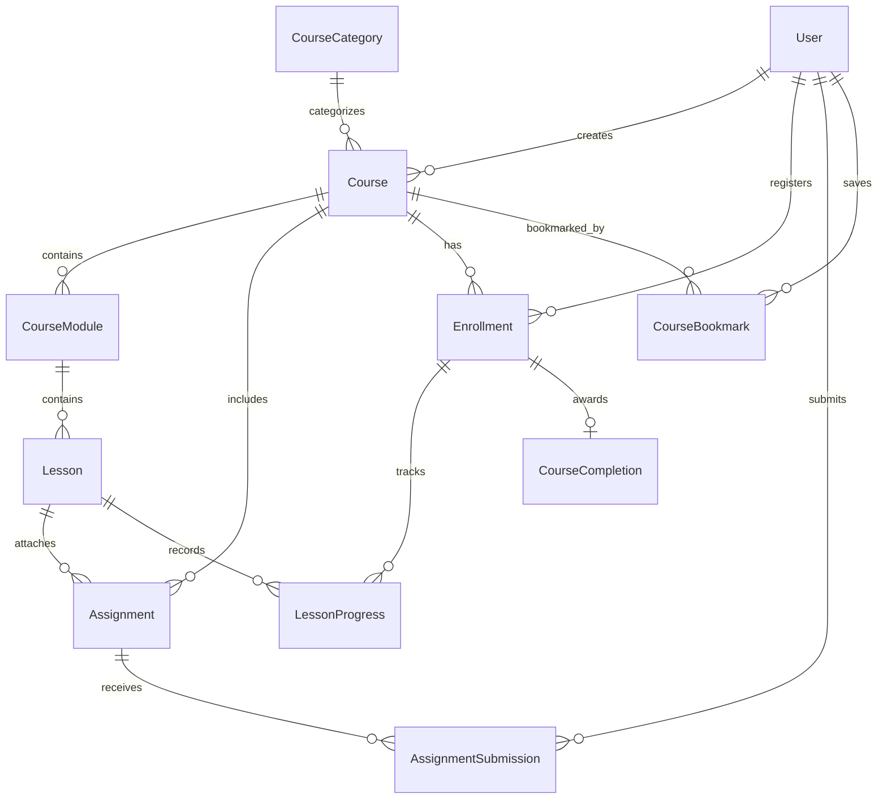

# ENQUEbet Academy — System Architecture & Technical Blueprint

## 1. Executive Summary

ENQUEbet Academy is an integrated, project-first educational ecosystem engineered for builders, students, and engineers. It transforms passive video/tutorial watching into an active cycle:

```
┌───────────────────────────────────────────────────────────────┐
│                      LEARNING LIFECYCLE                       │
│                                                               │
│   [1. LEARN] ──────> [2. PRACTICE] ─────> [3. BUILD]          │
│   Curriculum          Code Walkthroughs   Practical Projects  │
│   Video & Articles    Guided Tasks        Starter Templates   │
│                                                   │           │
│   [5. GROW]  <────── [4. PROVE]   <───────────────┘           │
│   Network             Peer Review                             │
│   Reputation          Proof of Work (Workspaces)              │
└───────────────────────────────────────────────────────────────┘
```

### Essential Separation of Concerns:
- **Course Completion (`CourseCompletion`):** An educational record certifying that a learner completed all mandatory lessons and passed course assignments.
- **Proof of Work (`apps.collaboration.ProofOfWork`):** A cryptographic, tamper-evident credential minted **only** when an accepted team/individual project deliverable is verified through ENQUEbet's workspace review pipeline.
- **Reputation (`apps.collaboration.ReputationEvent`):** Cannot be minted or inflated by course completion alone. Learners must take their learned skills into real projects, submit deliverables, and receive verified approval.

---

## 2. Information Architecture & Route Hierarchy

```
frontend/app/
├── courses/
│   ├── page.tsx                          # Academy Discovery & Catalog
│   │                                     # (Search, Categories, Difficulty, Pathways, My Learning)
│   ├── [slug]/
│   │   ├── page.tsx                      # Course Detail & Syllabus Overview
│   │   │                                 # (Outcomes, Project Specs, Curriculum Accordion, Enroll CTA)
│   │   ├── lessons/
│   │   │   └── [lessonId]/
│   │   │       └── page.tsx              # Focused Distraction-Free Lesson Player
│   │   │                                 # (Video/Markdown/Code, Progress Sync, Next/Prev, Assignment link)
│   │   └── assignments/
│   │       └── [assignmentId]/
│   │           └── page.tsx              # Practical Assignment Workbench & Bridge
│   │                                     # (Criteria, Submission Form, Review Status, "Launch Project" CTA)
```

---

## 3. Data Domain Architecture (`backend/apps/courses`)



### Core Entities:
1. **`CourseCategory`:** Taxonomy grouping (Software Engineering, AI & Data, Embedded Systems, Cloud & DevOps, Cybersecurity, Product & Design, Team Collaboration).
2. **`Course`:** Root instructional unit with metadata, learning outcomes, project outcomes, difficulty, estimated hours, and publication state (`draft`, `pending_review`, `published`, `archived`).
3. **`CourseModule`:** Sequenced curriculum chapters.
4. **`Lesson`:** Content payload supporting video, markdown articles, code walkthroughs, and practical tasks. Supports preview flags for prospective students.
5. **`Enrollment`:** Authoritative student registration with progress percent calculation and state machine (`active`, `completed`, `dropped`).
6. **`LessonProgress`:** Idempotent completion tracker storing duration and status per lesson.
7. **`Assignment`:** Real-world engineering task linked to curriculum, starter repository URLs, and acceptance criteria.
8. **`AssignmentSubmission`:** Student deliverable submission (PR URL, repo link, write-up) with review feedback state.
9. **`CourseCompletion`:** Cryptographically verifiable educational completion record (`ENQ-ACAD-XXXX`).
10. **`CourseBookmark`:** User-saved courses for quick dashboard access.

---

## 4. Learning to Project Bridge Architecture

When a student finishes a course or assignment, Academy provides a direct pipeline into ENQUEbet's project ecosystem:
1. **Starter Project Templates:** Courses provide a `project_outcome_title` and `project_outcome_description`.
2. **One-Click Squad Launch:** Learners can click "Launch Build Project" from an assignment or course completion screen.
3. **Integration:** This prefills `/collaboration` or `/create`, automatically tagging the project with the relevant skill tags (e.g. `#nextjs`, `#pytorch`, `#embedded-c`) and inviting peer squad members.
4. **Execution & Proof:** The squad works in a `Workspace`, completes tasks, attaches deliverables, passes code reviews, and receives verified `ProofOfWork` on their builder dossiers.
