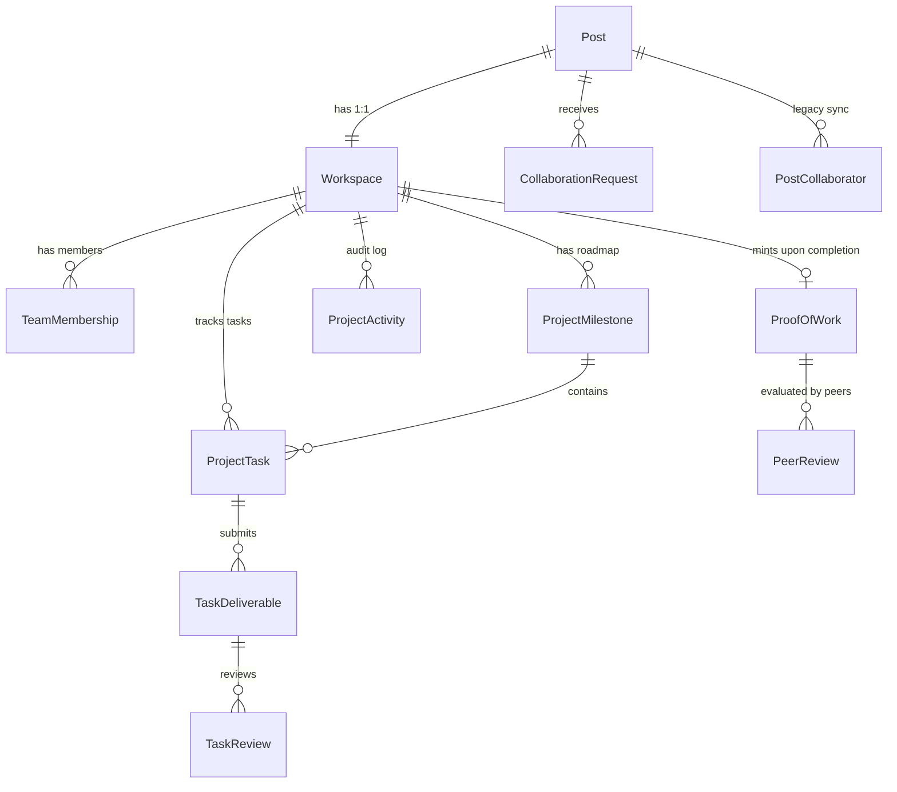
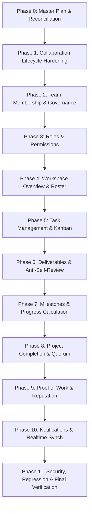

# ENQUEbet V1 — Master Architecture & Implementation Plan: Team Execution & Builder Workspace

**Document Status:** Master Plan — Active Engineering Baseline  
**Date:** 15 October 2026  
**Product:** ENQUEbet — Builder Collaboration & Reputation Platform  
**Author:** Principal Software Architect & Technical Lead  
**Scope:** Synthesis of Subagents A through F into a single coherent, phased implementation execution plan.

---

## 1. Executive Summary & Architectural Reconciliation

ENQUEbet is a **Builder Collaboration and Project Execution Platform**.
The core value loop is:
$$\text{Builder Identity} \longrightarrow \text{Discovery} \longrightarrow \text{Collaboration Request} \longrightarrow \mathbf{Team\ Membership} \longrightarrow \mathbf{Workspace\ Execution} \longrightarrow \mathbf{Verified\ Proof\ of\ Work} \longrightarrow \mathbf{Reputation}$$

Previous phases established:
- **Phase 1:** Builder profiles, skill proficiency levels, and profile completeness.
- **Phase 2:** Personalized feed algorithm (For You & Following) with moderation and privacy enforcement.
- **Phase 3:** Unified Search & Builder Discovery Engine with facet filtering and zero N+1 queries.

This Master Plan orchestrates the core engine of ENQUEbet: turning accepted collaboration requests into legitimate teams, providing structured workspaces with task execution and deliverable peer review, and generating immutable Proof of Work credentials that feed an un-gameable reputation ledger.

### Subagent Reconciliation Summary:
- **Subagent A (Existing System Auditor):** Identified that `Post` is the publication unit, `AcceptCollaborationRequestView` lacked `@transaction.atomic` (creating orphaned states and 500 errors on repeat acceptance), and group chats currently act as a fragile surrogate for workspaces.
- **Subagent B (Product & Workflow Architect):** Established the multi-tier role hierarchy (`OWNER`, `LEAD`, `CONTRIBUTOR`), strict anti-self-approval guards on deliverables, automated orphaned-task reassignment on member departure, and a consensus quorum completion engine.
- **Subagent C (Database & API Architect):** Designed additive models (`Workspace`, `TeamMembership`, `ProjectTask`, `TaskDeliverable`, `TaskReview`, `ProjectMilestone`, `ProofOfWork`, `PeerReview`, `ProjectActivity`) linked 1:1 with `Post` and preserving backward compatibility with legacy `PostCollaborator`.
- **Subagent D (Security & Threat Reviewer):** Established universal BOLA query scoping via `IsActiveWorkspaceMember`, real-time WebSocket channel eviction on member removal, SSRF-safe link fetchers, and append-only database constraints on `ProjectActivity`.
- **Subagent E (Test & Quality Engineer):** Formulated an end-to-end 9-phase testing matrix with automated concurrency tests and anti-tampering assertions.
- **Subagent F (Frontend UX Architect):** Designed a high-density, accessible Linear/Vercel-inspired workspace experience (`/workspace/[id]`) with a 6-column Kanban board, task detail drawers, member management, and consensus completion modals.

---

## 2. Canonical Data Architecture & Schema Specification

All new entities will be housed additively in `backend/apps/collaboration/` to maintain clean domain boundaries and reuse existing migrations and routing without bloating `INSTALLED_APPS`.

### Models & Invariants:
1. **`Workspace` (`workspaces` table):**
   - `id`: UUID (PK)
   - `post`: `OneToOneField('posts.Post', on_delete=models.CASCADE, related_name='workspace')`
   - `status`: `'active'`, `'completion_pending'`, `'completed'`, `'paused'`, `'cancelled'` (default `'active'`)
   - `progress_percentage`: Integer `[0, 100]` (calculated from completed/active tasks)
   - `max_members`: Integer (default 10)
   - `repo_url`, `demo_url`, `documentation_url`: URLs
   - `completed_at`, `created_at`, `updated_at`
2. **`TeamMembership` (`team_memberships` table):**
   - `workspace`: `ForeignKey(Workspace, on_delete=models.CASCADE, related_name='memberships')`
   - `user`: `ForeignKey(settings.AUTH_USER_MODEL, on_delete=models.CASCADE, related_name='team_memberships')`
   - `role`: `'owner'`, `'lead'`, `'contributor'`, `'viewer'` (default `'contributor'`)
   - `role_title`: CharField(max 100, e.g. "Frontend Architect", "Rust Engineer")
   - `status`: `'active'`, `'left'`, `'removed'`, `'completed'` (default `'active'`)
   - `joined_at`, `left_at`, `removal_reason`
   - Constraint: `models.UniqueConstraint(fields=['workspace', 'user'], condition=Q(status='active'), name='unique_active_workspace_membership')`
3. **`ProjectMilestone` (`project_milestones` table):**
   - `workspace`: `ForeignKey(Workspace, on_delete=models.CASCADE, related_name='milestones')`
   - `title`, `description`, `order`: Integer, `due_date`, `status` (`'planned'`, `'active'`, `'completed'`)
4. **`ProjectTask` (`project_tasks` table):**
   - `workspace`: `ForeignKey(Workspace, on_delete=models.CASCADE, related_name='tasks')`
   - `milestone`: `ForeignKey(ProjectMilestone, null=True, blank=True, on_delete=models.SET_NULL, related_name='tasks')`
   - `title`, `description`
   - `creator`: FK User, `assignee`: FK User (nullable, blank)
   - `reviewer`: FK User (nullable, blank)
   - `status`: `'backlog'`, `'assigned'`, `'in_progress'`, `'in_review'`, `'changes_requested'`, `'completed'`, `'blocked'`, `'cancelled'`
   - `priority`: `'urgent'`, `'high'`, `'medium'`, `'low'` (default `'medium'`)
   - `due_date`, `completed_at`, `created_at`, `updated_at`
5. **`TaskDeliverable` (`task_deliverables` table):**
   - `task`: `ForeignKey(ProjectTask, on_delete=models.CASCADE, related_name='deliverables')`
   - `submitted_by`: FK User
   - `title`, `description`, `pr_url`, `file_attachment`, `file_type`, `version`: Integer
   - `created_at`
6. **`TaskReview` (`task_reviews` table):**
   - `deliverable`: `ForeignKey(TaskDeliverable, on_delete=models.CASCADE, related_name='reviews')`
   - `reviewer`: FK User
   - `verdict`: `'approved'`, `'changes_requested'`, `'rejected'`
   - `feedback`: TextField
   - `created_at`
7. **`ProofOfWork` (`proof_of_works` table):**
   - `workspace`: `OneToOneField(Workspace, on_delete=models.PROTECT, related_name='proof_of_work')`
   - `verification_code`: CharField (unique, e.g. `'ENQ-2026-A1B2C3'`)
   - `summary`: TextField, `metadata_snapshot`: JSONField, `content_hash`: CharField (SHA-256)
   - `is_verified`: BooleanField(default=True)
   - `minted_at`: DateTimeField(auto_now_add=True)
8. **`PeerReview` (`peer_reviews` table):**
   - `proof`: `ForeignKey(ProofOfWork, on_delete=models.CASCADE, related_name='peer_reviews')`
   - `reviewer`: FK User, `reviewee`: FK User
   - `execution_score`, `collaboration_score`, `reliability_score`: Integer (1-5)
   - `feedback`: TextField (optional)
   - Constraint: `unique_together = ['proof', 'reviewer', 'reviewee']`
9. **`ProjectActivity` (`project_activities` table):**
   - `workspace`: `ForeignKey(Workspace, on_delete=models.CASCADE, related_name='activities')`
   - `actor`: FK User (nullable for system events)
   - `event_type`: CharField(max 50)
   - `description`: CharField(max 255)
   - `metadata`: JSONField(default=dict)
   - `created_at`: DateTimeField(auto_now_add=True)

---

## 3. Phased Implementation Roadmap

We execute autonomously through the 11 phases in strict sequential order:

### Phase Breakdown & Exit Gates:
* **Phase 1: Collaboration Request Lifecycle Hardening**
  - Fix `@transaction.atomic` in request acceptance.
  - Fix duplicate collaborator and group chat race conditions.
  - Implement request cancellation and re-requesting after decline.
  - Capacity enforcement (`max_members`).
  - *Exit Gate:* 100% automated tests passing for join request operations.
* **Phase 2: Team Membership & Governance**
  - Implement `TeamMembership` model & migrations.
  - Add voluntary leave, owner removal with mandatory justification, rejoining.
  - Implement atomic ownership transfer.
  - Synchronize legacy `PostCollaborator` for 100% backward compatibility.
  - *Exit Gate:* Role updates, leave, remove, and transfer tests pass.
* **Phase 3: Roles and Object-Level Authorization**
  - Implement `IsWorkspaceOwner`, `IsWorkspaceLead`, `IsActiveWorkspaceMember`.
  - Enforce permission guards across sensitive actions.
  - *Exit Gate:* Unauthorized access tests fail with 403/404; BOLA tests pass.
* **Phase 4: Project Workspace Foundation**
  - Implement `Workspace` model, auto-initialization on project creation/acceptance.
  - Workspace REST endpoints (`/api/v1/workspaces/`).
  - Frontend `/workspace/[id]` with Overview, Team roster, and Activity timeline.
  - *Exit Gate:* Workspace loads cleanly; non-members receive 404/403.
* **Phase 5: Task Management Engine**
  - Implement `ProjectTask` model & endpoints (`/api/v1/workspaces/:id/tasks/`).
  - Kanban columns: Backlog, Assigned, In Progress, In Review, Completed, Blocked.
  - Automated departure reassignment: orphaned tasks revert to backlog.
  - Frontend task board and creation/assignment modal.
  - *Exit Gate:* Task transition tests pass; non-member assignments rejected.
* **Phase 6: Deliverables & Peer Review**
  - Implement `TaskDeliverable` and `TaskReview`.
  - Anti-self-review enforcement (`task.assignee != reviewer`).
  - Deliverable submission drawer with URL validation.
  - *Exit Gate:* Self-approval blocked; review approval transitions task to completed.
* **Phase 7: Milestones & Deterministic Progress**
  - Implement `ProjectMilestone` and automated task ratio progress recalculation.
  - Frontend Milestones tab with visual progress bars.
  - *Exit Gate:* Progress percentage calculated deterministically without division errors.
* **Phase 8: Project Completion Engine**
  - Verification of completion prerequisites (all tasks completed/resolved).
  - Multi-sign consensus confirmation flow.
  - Controlled reopening flow.
  - *Exit Gate:* Incomplete tasks block completion; consensus triggers completion.
* **Phase 9: Proof of Work & Reputation Integration**
  - Mint `ProofOfWork` with unique code (`ENQ-YYYY-XXXXXX`) and cryptographic content hash.
  - Double-blind peer ratings.
  - Public proof verification page (`/proof/[code]`).
  - *Exit Gate:* Minted proof is immutable; reputation event is idempotent.
* **Phase 10: Real-time Notifications & Chat Synchronization**
  - Real-time notification hooks for assignments, reviews, removals, and completion.
  - WebSocket eviction upon member removal.
  - *Exit Gate:* Removal closes socket; notifications delivered to active members.
* **Phase 11: Security, Regression & Final Verification**
  - Full backend regression suite (`users`, `posts`, `search`, `collaboration`).
  - Frontend typecheck (`tsc --noEmit`) and production build (`npm run build`).
  - Final Verification Report.

---

## 4. Execution Readiness

Phase 0 (Baseline Audit & Product Reconciliation) is officially complete.
Proceeding immediately to **Phase 1: Collaboration Request Lifecycle Hardening**.
