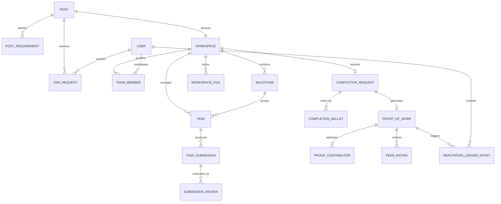
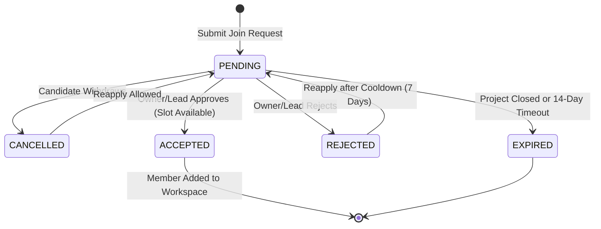
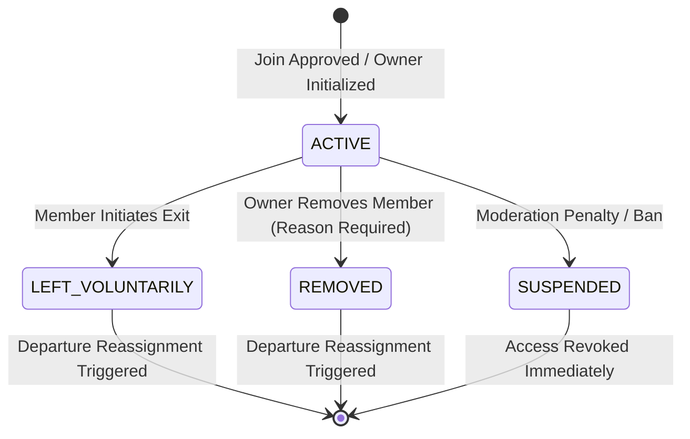
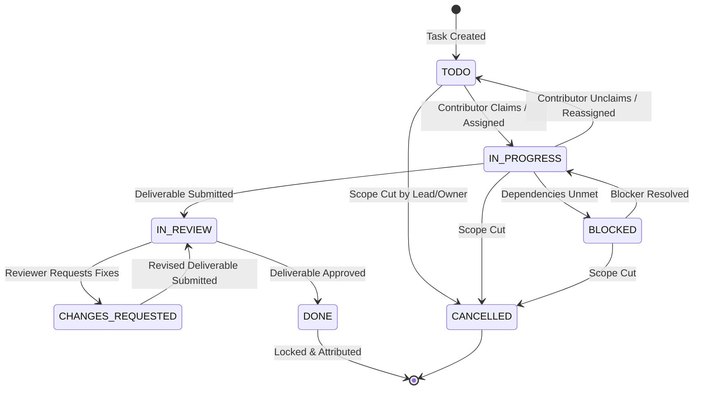
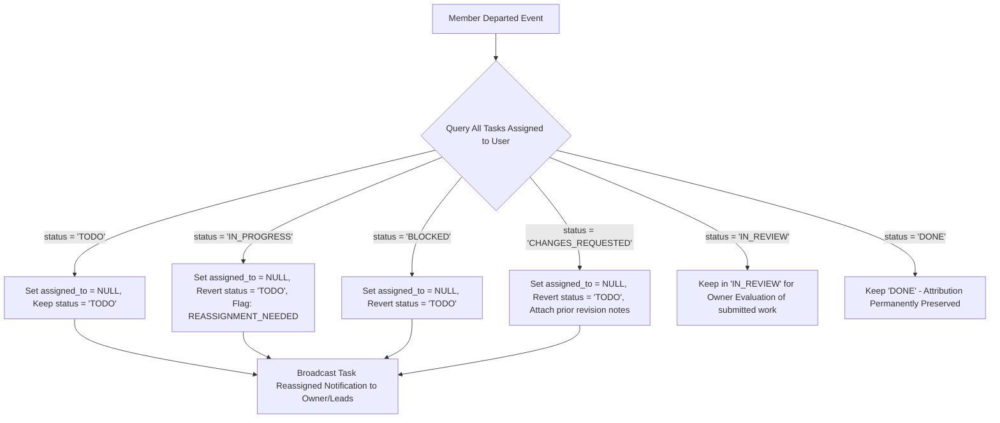
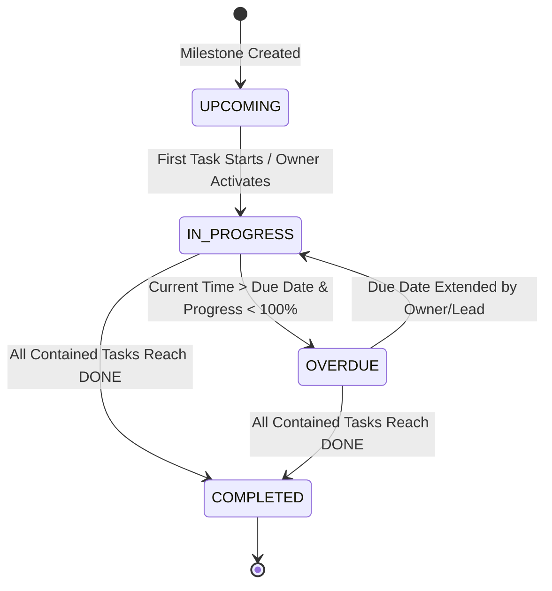
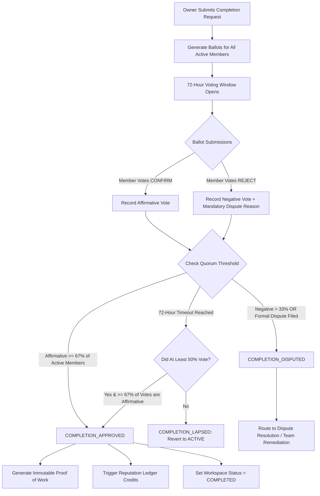
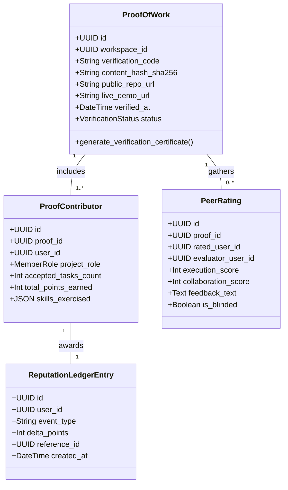
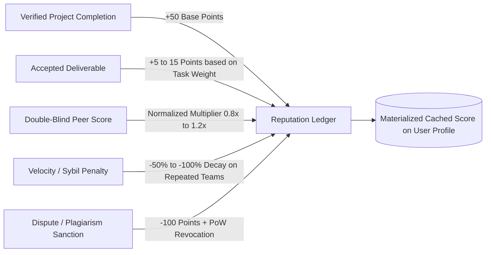

# ENQUEbet Builder Collaboration & Project Execution: Product Workflows & State Transitions Specification

- **Document Version:** 1.0.0
- **Status:** Approved Architecture Specification
- **System Area:** Team Execution & Builder Collaboration Engine (Phases 4–9)
- **Target File:** `docs/implementation/team-execution/02-product-workflows.md`
- **Related Blueprint:** `docs/ENQUEbet_Master_Product_Blueprint_Gap_Analysis.md`

---

## Executive Summary

ENQUEbet is a **Builder Reputation Platform**, not a social network. The primary objective of the platform is the **structured, verifiable completion of collaborative projects**. Reputation and Proof of Work (PoW) cannot be based on unsubstantiated user assertions, vanity followers, or unverified chat logs; they must derive exclusively from auditable, multi-party verified execution milestones and accepted deliverables.

This document establishes the canonical specifications for seven core execution workflows:
1. **Team Joining & Capacity Enforcement**
2. **Membership Governance & Lifecycle Management**
3. **Task Lifecycle & Self-Claiming with Departure Reassignment Hooks**
4. **Deliverable Submission & Multi-Party Review**
5. **Milestone Scheduling, Progress Calculation & Blocker Propagation**
6. **Project Completion, Quorum Verification & Controlled Reopening**
7. **Proof of Work Generation & Non-Gameable Reputation Engine**

---

## 1. Domain Architecture & System State Taxonomy

### 1.1 Canonical Entity Relationship Topology

The diagram below outlines the structural relationships between the opportunity root, workspace execution entities, governance structures, and the verifiable trust layer:



---

## 2. Workflow 1: Team Joining & Capacity Enforcement

### 2.1 Context & Objective
A project originates from a `Post` that publishes a collaboration opportunity with specific role requirements (`PostRequirement`) and a defined team capacity limit (`max_members`). Candidate builders discover the project and apply to join.

The joining workflow must guarantee:
1. **Strict Idempotency:** A user cannot have multiple simultaneous pending applications for the same project.
2. **Atomic Capacity Enforcement:** Two simultaneous acceptance actions cannot exceed `max_members`.
3. **Role Specificity:** Applicants apply either for an open `PostRequirement` or as a general contributor.
4. **Clean Retraction:** Candidates may withdraw their request prior to an acceptance decision.

### 2.2 Join Request State Machine



### 2.3 State Definitions

| State | Description | Permitted Next States |
|---|---|---|
| `PENDING` | Request submitted by candidate; awaiting review by Owner or Lead. | `ACCEPTED`, `REJECTED`, `CANCELLED`, `EXPIRED` |
| `ACCEPTED` | Terminal request state. Candidate is added to `TeamMember` and team chat. | None |
| `REJECTED` | Request declined with optional structured feedback. | `PENDING` (after cooldown) |
| `CANCELLED` | Candidate withdrew application before review. | `PENDING` |
| `EXPIRED` | Request lapsed due to project closure, deadline, or timeout. | None |

### 2.4 Detailed Workflow Step-by-Step

#### Step 1.1: Request Submission
- **Actor:** Candidate Builder (`USER`)
- **Pre-conditions:**
  - Candidate is authenticated and email-verified.
  - Candidate is NOT the project creator (`post.user_id != user.id`).
  - Candidate is NOT already an `ACTIVE` member of this project.
  - No `PENDING` join request exists for this `(post_id, user_id)` tuple.
  - Cooldown check: If previously `REJECTED`, at least 7 days have elapsed.
  - Project status is `OPEN` (not `COMPLETED`, `CANCELLED`, or `ARCHIVED`).
- **Inputs:**
  - `post_id` (UUID)
  - `target_requirement_id` (UUID, optional: specific role applied for)
  - `application_pitch` (Text: 50–1000 characters)
  - `portfolio_links` (List of URLs, optional)
- **Validation & Business Logic:**
  - Verify project `active_members_count < max_members`.
  - Validate role availability if `target_requirement_id` is supplied.
- **Database Action (Atomic Transaction):**
  - Create `JoinRequest` record:
    ```sql
    INSERT INTO join_requests (id, post_id, applicant_id, requirement_id, pitch, status, created_at, updated_at)
    VALUES (gen_random_uuid(), :post_id, :applicant_id, :req_id, :pitch, 'PENDING', NOW(), NOW());
    ```
- **Side Effects:**
  - Dispatch in-app and push notification to Project Owner and all active Project Leads: `NEW_JOIN_REQUEST`.
  - Log audit event: `JOIN_REQUEST_CREATED`.

#### Step 1.2: Candidate Withdrawal (Cancellation)
- **Actor:** Candidate Builder (`USER`)
- **Pre-conditions:**
  - Request is currently in `PENDING` state.
  - Initiating user matches `applicant_id`.
- **Database Action:**
  - Update status to `CANCELLED`:
    ```sql
    UPDATE join_requests
    SET status = 'CANCELLED', updated_at = NOW()
    WHERE id = :request_id AND applicant_id = :user_id AND status = 'PENDING';
    ```
- **Side Effects:**
  - Dismiss pending actionable notification on Owner's inbox.

#### Step 1.3: Request Acceptance (Atomic Capacity Protection)
- **Actor:** Project Owner or Project Lead (`USER`)
- **Pre-conditions:**
  - Request status is `PENDING`.
  - Actor holds `OWNER` or `LEAD` role in the associated `Workspace`.
- **Concurrency & Race Condition Guard:**
  - Acceptance MUST execute inside an isolated transaction with pessimistic row-level locking on the parent `Workspace` / `Post`:
    ```sql
    -- Step A: Lock Workspace record for update
    SELECT id, active_members_count, max_members 
    FROM workspaces 
    WHERE post_id = :post_id 
    FOR UPDATE;
    
    -- Step B: Assert capacity constraint
    IF active_members_count >= max_members THEN
        RAISE EXCEPTION 'WORKSPACE_CAPACITY_EXCEEDED';
    END IF;
    
    -- Step C: Transition Join Request
    UPDATE join_requests 
    SET status = 'ACCEPTED', reviewed_by = :reviewer_id, updated_at = NOW()
    WHERE id = :request_id AND status = 'PENDING';
    
    -- Step D: Insert TeamMember
    INSERT INTO team_members (id, workspace_id, user_id, role, state, requirement_id, joined_at)
    VALUES (gen_random_uuid(), :workspace_id, :applicant_id, 'CONTRIBUTOR', 'ACTIVE', :req_id, NOW());
    
    -- Step E: Increment active count
    UPDATE workspaces 
    SET active_members_count = active_members_count + 1, updated_at = NOW()
    WHERE id = :workspace_id;
    ```
- **Side Effects:**
  - Synchronize team chat: Add `applicant_id` to the workspace's conversation channel.
  - Insert system message in chat: `"@username has joined the team."`
  - Send realtime notification to Candidate: `JOIN_REQUEST_ACCEPTED`.
  - If `active_members_count == max_members`, auto-update `Post.is_accepting_members = False`.

#### Step 1.4: Request Rejection
- **Actor:** Project Owner or Project Lead (`USER`)
- **Pre-conditions:**
  - Request status is `PENDING`.
  - Actor holds `OWNER` or `LEAD` role.
- **Inputs:**
  - `rejection_reason_code` (`OVER_CAPACITY`, `SKILL_MISMATCH`, `INSUFFICIENT_EXPERIENCE`, `OTHER`)
  - `rejection_note` (Text: optional, polite constructor feedback)
- **Database Action:**
  - Update status to `REJECTED`:
    ```sql
    UPDATE join_requests 
    SET status = 'REJECTED', 
        reviewed_by = :reviewer_id, 
        rejection_reason = :rejection_reason_code, 
        rejection_note = :rejection_note,
        updated_at = NOW()
    WHERE id = :request_id AND status = 'PENDING';
    ```
- **Side Effects:**
  - Dispatch notification to Candidate: `JOIN_REQUEST_DECLINED`.

---

## 3. Workflow 2: Membership Governance & Lifecycle Management

### 3.1 Role Hierarchy & Permissions Matrix

Governance within an ENQUEbet workspace recognizes three distinct tiers:

```
┌─────────────────────────────────────────────────────────────┐
│                          OWNER                              │
│   Complete sovereign control, deletion, transfers, removal   │
└──────────────────────────────┬──────────────────────────────┘
                               │ Promotes / Demotes
┌──────────────────────────────▼──────────────────────────────┐
│                           LEAD                              │
│   Task creation, assignment, deliverable review, join triage│
└──────────────────────────────┬──────────────────────────────┘
                               │ Coordinates
┌──────────────────────────────▼──────────────────────────────┐
│                        CONTRIBUTOR                          │
│   Task execution, self-claiming, deliverable submission, PoW│
└─────────────────────────────────────────────────────────────┘
```

| Permission / Action | Contributor | Lead | Owner | Platform Admin |
|---|---|---|---|---|
| View Workspace, Chat, Tasks | Yes | Yes | Yes | Yes (Audit) |
| Send Chat Messages, Upload Files | Yes | Yes | Yes | Read-Only |
| Claim Open `TODO` Task | Yes | Yes | Yes | No |
| Create New Tasks | No (Default)* | Yes | Yes | No |
| Assign / Reassign Any Task | No | Yes | Yes | No |
| Review & Approve Deliverables | No | Yes | Yes | No |
| Triage / Accept Join Requests | No | Yes | Yes | No |
| Promote Contributor to Lead | No | No | Yes | No |
| Demote Lead to Contributor | No | No | Yes | No |
| Remove Contributor from Team | No | No | Yes | Yes (Moderation) |
| Transfer Project Ownership | No | No | Yes | Yes (Dispute Esc.) |
| Submit Project Completion | No | Yes | Yes | No |
| Vote on Completion Quorum | Yes | Yes | Yes | No |
| Cancel / Delete Workspace | No | No | Yes | Yes (Policy) |

*\*Note: A workspace owner may toggle the workspace setting `allow_contributor_task_creation = True` if an open team dynamic is preferred.*

### 3.2 Membership State Machine



### 3.3 Detailed Governance Workflows

#### 3.3.1 Voluntary Departure (`LEFT_VOLUNTARILY`)
- **Actor:** Active Team Member (`USER`)
- **Guards & Constraints:**
  - An `OWNER` CANNOT leave voluntarily without first transferring ownership to an active `LEAD` or `CONTRIBUTOR`.
  - Member must submit an exit notice (`departure_reason`).
- **Execution Steps:**
  1. Set `team_members.state = 'LEFT_VOLUNTARILY'`, `left_at = NOW()`.
  2. Decrement `workspaces.active_members_count`.
  3. Revoke write permissions to Workspace, Chat, and Tasks.
  4. **Trigger Task Departure Hook** (see Section 4.5).
  5. Post system message to team chat: `"@username has stepped down from the project."`
  6. Historical contribution records prior to departure remain attributed to the member.

#### 3.3.2 Owner Removal with Mandatory Reason (`REMOVED`)
- **Anti-Griefing Protection:**
  - Problem: A malicious owner invites contributors, extracts completed code/designs, then removes them right before project completion to hoard reputation.
  - **Enforced Platform Rule:** Any deliverable that was marked `ACCEPTED` while the contributor was active **permanently preserves** the contributor's attribution on the project ledger. When the project completes, removed contributors receive pro-rata Proof of Work for their accepted deliverables unless a formal moderation claim of fraud/plagiarism is upheld.
- **Actor:** Project Owner (`USER`)
- **Pre-conditions:**
  - Target user is in `ACTIVE` state.
  - Target user is NOT the `OWNER`.
- **Mandatory Inputs:**
  - `target_user_id` (UUID)
  - `removal_reason_code` (`INACTIVITY_UNRESPONSIVE`, `MISCONDUCT_HARASSMENT`, `FAILED_DELIVERABLE_SLA`, `MUTUAL_AGREEMENT`, `SCOPE_CHANGE`)
  - `detailed_explanation` (Text: minimum 25 characters)
- **Database Action:**
  ```sql
  UPDATE team_members
  SET state = 'REMOVED', 
      removal_reason = :removal_reason_code,
      removal_notes = :detailed_explanation,
      removed_by = :owner_id,
      left_at = NOW()
  WHERE workspace_id = :workspace_id AND user_id = :target_user_id AND state = 'ACTIVE';
  ```
- **Side Effects:**
  - Decrement `workspaces.active_members_count`.
  - Trigger Departure Reassignment Hook for assigned active tasks.
  - Send explanatory notification to removed member: `REMOVED_FROM_PROJECT`.
  - Append to workspace immutable audit log.

#### 3.3.3 Ownership Transfer
- **Actor:** Current Project Owner (`USER`)
- **Pre-conditions:**
  - Target user must be an `ACTIVE` member of the project (`LEAD` or `CONTRIBUTOR`).
  - Owner must provide authenticated session confirmation (password or re-auth token).
- **Database Action (Atomic Handshake):**
  ```sql
  BEGIN;
  -- Demote current owner to LEAD
  UPDATE team_members 
  SET role = 'LEAD', updated_at = NOW() 
  WHERE workspace_id = :workspace_id AND user_id = :current_owner_id;
  
  -- Promote target member to OWNER
  UPDATE team_members 
  SET role = 'OWNER', updated_at = NOW() 
  WHERE workspace_id = :workspace_id AND user_id = :target_user_id;
  
  -- Update root post and workspace owner pointers
  UPDATE workspaces SET owner_id = :target_user_id, updated_at = NOW() WHERE id = :workspace_id;
  UPDATE posts SET user_id = :target_user_id, updated_at = NOW() WHERE id = :post_id;
  COMMIT;
  ```
- **Side Effects:**
  - Team-wide notification: `OWNERSHIP_TRANSFERRED`.
  - Audit log entry created.

---

## 4. Workflow 3: Task Management & Self-Claiming with Departure Reassignment Hooks

### 4.1 Task Schema & State Definitions

Every unit of execution in ENQUEbet is tracked via a structured `Task`.



### 4.2 State Table

| Task State | Description | Permitted Transition By |
|---|---|---|
| `TODO` | Task defined, unassigned or assigned, awaiting work start. | Anyone (Claim), Lead/Owner (Assign, Cancel) |
| `IN_PROGRESS` | Actively under development by `assigned_to`. | Assignee (Submit, Block, Unclaim), Lead/Owner |
| `BLOCKED` | Progress halted by external dependency or impediment. | Assignee, Lead/Owner |
| `IN_REVIEW` | Deliverable submitted; locked against edits during evaluation. | Reviewer (Approve, Request Changes) |
| `CHANGES_REQUESTED`| Deliverable requires revisions based on review notes. | Assignee (Resubmit) |
| `DONE` | Deliverable verified and approved; points credited. | Immutable (except admin reopening) |
| `CANCELLED` | Task dropped from scope; excluded from completion metrics. | Lead, Owner |

### 4.3 Task Creation & Direct Assignment
- **Actors:** Owner, Lead (or Contributor if workspace policy permits).
- **Attributes:**
  - `title` (String: 5–150 chars)
  - `description` (Markdown: acceptance criteria, technical requirements)
  - `milestone_id` (UUID, optional: linked milestone)
  - `priority` (`LOW`, `MEDIUM`, `HIGH`, `CRITICAL`)
  - `task_type` (`FRONTEND`, `BACKEND`, `FULLSTACK`, `DESIGN`, `RESEARCH`, `DEVOPS`, `TESTING`, `DOCS`)
  - `estimated_hours` (Integer: 1 to 100)
  - `due_date` (Timestamp with timezone, optional)
  - `assigned_to` (UUID, optional: user assigned at creation)
- **Validation:**
  - If `assigned_to` is provided, user MUST be an `ACTIVE` member of the workspace.
  - If `due_date` is provided, it cannot exceed the parent `milestone.due_date` or project target deadline.

### 4.4 Self-Claiming Workflow (Anti-Hoarding Engine)
To prevent a single member from monopolizing tasks without delivering:
- **Concurrency & Hoarding Limits:**
  - Maximum active concurrent tasks per contributor: **3 tasks** in `IN_PROGRESS` or `CHANGES_REQUESTED`.
- **Claim Action Execution:**
  ```sql
  BEGIN;
  -- Check active task count for claiming user
  SELECT COUNT(*) INTO active_count 
  FROM tasks 
  WHERE workspace_id = :workspace_id 
    AND assigned_to = :user_id 
    AND status IN ('IN_PROGRESS', 'CHANGES_REQUESTED');
    
  IF active_count >= 3 THEN
      RAISE EXCEPTION 'TASK_CONCURRENCY_LIMIT_REACHED: Maximum 3 active tasks allowed.';
  END IF;

  -- Optimistic lock to prevent race condition on claiming same task
  UPDATE tasks 
  SET assigned_to = :user_id, 
      status = 'IN_PROGRESS', 
      claimed_at = NOW(), 
      updated_at = NOW()
  WHERE id = :task_id AND status = 'TODO' AND assigned_to IS NULL;
  
  IF NOT FOUND THEN
      RAISE EXCEPTION 'TASK_ALREADY_CLAIMED_OR_STARTED';
  END IF;
  COMMIT;
  ```
- **Unclaiming (Self-Relinquishing):**
  - Contributor may unclaim a task within 24 hours of claiming if untouched.
  - Status reverts to `TODO`, `assigned_to` reset to `NULL`.
  - System logs reason to task activity audit.

### 4.5 Departure Reassignment Hooks (Member Left or Removed)
When a member departs (`LEFT_VOLUNTARILY` or `REMOVED`), the system executes the following automated cleanup hook:



- **Database Hook Implementation:**
  ```sql
  -- Automated transaction triggered on member departure
  UPDATE tasks
  SET assigned_to = NULL,
      status = 'TODO',
      reassignment_flag = TRUE,
      updated_at = NOW()
  WHERE workspace_id = :workspace_id 
    AND assigned_to = :departed_user_id 
    AND status IN ('IN_PROGRESS', 'BLOCKED', 'CHANGES_REQUESTED');

  UPDATE tasks
  SET assigned_to = NULL,
      reassignment_flag = TRUE,
      updated_at = NOW()
  WHERE workspace_id = :workspace_id 
    AND assigned_to = :departed_user_id 
    AND status = 'TODO';
  ```
- **Notification:** Owner and Leads receive an alert: `"3 tasks formerly assigned to @username require reassignment."`

---

## 5. Workflow 4: Deliverable Review & Revision Loop

### 5.1 Objective & Review Standards
A task is never marked `DONE` by self-attestation. Every completed task must submit verifiable evidence (code link, design artifact, documentation, deployment URL) and receive explicit review from an authorized reviewer (`OWNER` or `LEAD`).

### 5.2 Deliverable Review State Machine

```mermaid
sequenceDiagram
    autonumber
    actor Assignee as Task Assignee
    participant System as Workspace Engine
    actor Reviewer as Owner / Lead

    Assignee->>System: Submit Deliverable (URLs, Files, Notes)
    System->>System: Validate URLs & Files; Transition Task to IN_REVIEW
    System->>Reviewer: Dispatch Notification (REVIEW_REQUESTED)
    
    alt Reviewer Approves
        Reviewer->>System: Approve Deliverable (Rating + Audit Note)
        System->>System: Transition Task to DONE
        System->>System: Log Accepted Contribution to Project Ledger
        System->>System: Recalculate Milestone & Project Progress
        System->>Assignee: Notify Deliverable Accepted
    else Changes Requested
        Reviewer->>System: Request Changes (Structured Feedback Items)
        System->>System: Transition Task to CHANGES_REQUESTED
        System->>Assignee: Notify Changes Requested with Feedback
        Assignee->>System: Address Feedback & Resubmit (v2)
        System->>System: Increment Version, Transition to IN_REVIEW
    else Direct Rejection
        Reviewer->>System: Reject Deliverable (Invalid/Spam Submission)
        System->>System: Revert Task to IN_PROGRESS or TODO
        System->>Assignee: Notify Submission Rejected
    end
```

### 5.3 Detailed Deliverable Rules

#### Step 4.1: Submission
- **Actor:** Task Assignee (`USER`)
- **Pre-conditions:**
  - Task status is `IN_PROGRESS` or `CHANGES_REQUESTED`.
  - Authenticated user matches `task.assigned_to`.
- **Payload Requirements:**
  - `submission_type` (`GITHUB_PR`, `FIGMA_LINK`, `LIVE_DEMO_URL`, `FILE_ATTACHMENT`, `DOCUMENT_LINK`)
  - `deliverable_url` (Valid URL matching type, e.g., `https://github.com/.../pull/12`)
  - `proof_files` (Optional: Array of uploaded `WorkspaceFile` UUIDs)
  - `summary_notes` (Markdown: summary of changes, test coverage, how to test)
- **Validation:**
  - URL format and accessibility check.
  - Submission increments `submission_version` (1 for initial, 2+ for resubmissions).
- **State Transition:**
  - Create `TaskSubmission` record.
  - Update `tasks.status = 'IN_REVIEW'`.

#### Step 4.2: Anti-Self-Review Guard
- **Security Check:**
  - If a `LEAD` is assigned to a task and submits a deliverable, that lead **CANNOT** review or approve their own submission.
  - Another `LEAD` or the `OWNER` must conduct the review.
  - If the `OWNER` executes a solo project or single-person milestone, proof is deferred to final project verification quorum.

#### Step 4.3: Review Actions & Effects
1. **Approval (`APPROVE`):**
   - Reviewer records optional quality rating (1–5) and review commentary.
   - `TaskSubmission.status = 'ACCEPTED'`.
   - `tasks.status = 'DONE'`, `completed_at = NOW()`.
   - System registers contribution event:
     ```sql
     INSERT INTO contribution_ledger (id, user_id, workspace_id, task_id, submission_id, points, verified_at)
     VALUES (gen_random_uuid(), :assignee_id, :workspace_id, :task_id, :submission_id, :points, NOW());
     ```
   - Automatically re-evaluates parent Milestone completion status.
2. **Changes Requested (`REQUEST_CHANGES`):**
   - Reviewer provides mandatory structured checklist items and markdown critique.
   - `TaskSubmission.status = 'CHANGES_REQUESTED'`.
   - `tasks.status = 'CHANGES_REQUESTED'`.
   - Assignee receives high-priority notification with review remarks.
3. **Resubmission:**
   - Assignee attaches revisions; previous review notes are preserved in the submission history audit log.

---

## 6. Workflow 5: Milestones, Progress Calculation & Blocker Propagation

### 6.1 Milestone Lifecycle & Data Model
A project's roadmap consists of sequential or parallel `Milestones`.

- **Attributes:**
  - `id` (UUID)
  - `workspace_id` (UUID)
  - `title` (String: e.g., "Milestone 1: MVP Architecture & Auth")
  - `description` (Markdown)
  - `order_index` (Integer: ordering in roadmap)
  - `start_date` / `due_date` (Timestamps)
  - `status` (`UPCOMING`, `IN_PROGRESS`, `COMPLETED`, `OVERDUE`)



### 6.2 Deterministic Progress Calculation Engine

Progress is **never** entered manually as an arbitrary percentage slider; it is **computed deterministically from verified task states**.

#### Mathematical Formulation

For any Milestone $M$ containing set of tasks $T_M$:
$$ActiveTasks(M) = \{ t \in T_M \mid t.status \neq 'CANCELLED' \}$$
$$CompletedTasks(M) = \{ t \in ActiveTasks(M) \mid t.status = 'DONE' \}$$

If $|ActiveTasks(M)| = 0$:
$$Progress(M) = 100\% \quad (\text{if milestone is active})$$
Otherwise:
$$Progress(M) = \left( \frac{\sum_{t \in CompletedTasks(M)} Weight(t)}{\sum_{t \in ActiveTasks(M)} Weight(t)} \right) \times 100$$

Where $Weight(t)$ defaults to `1` (or `estimated_hours` if time-weighted tracking is enabled in workspace settings).

#### Overall Workspace Progress
For a Workspace $W$ containing all non-cancelled tasks $T_W$:
$$Progress(W) = \left( \frac{| \{ t \in T_W \mid t.status = 'DONE' \} |}{| \{ t \in T_W \mid t.status \neq 'CANCELLED' \} |} \right) \times 100$$

### 6.3 Blocker Propagation & Health Indicator
When a task is updated to `status = 'BLOCKED'`:
1. Assignee MUST specify `blocked_reason` and optional `blocking_task_id`.
2. The parent Milestone is flagged: `has_blockers = TRUE`.
3. Workspace Health status recomputes:
   - **HEALTHY:** Progress on track, no overdue tasks, zero critical blockers.
   - **AT_RISK:** Milestone due date within 48 hours with progress $< 70\%$, OR $1$ critical task blocked.
   - **CRITICAL / OVERDUE:** Due date passed with incomplete tasks, OR $\ge 2$ tasks blocked for $> 48$ hours.
4. Notifications are dispatched to Leads and Owner to resolve impediments.

---

## 7. Workflow 6: Project Completion, Quorum Verification & Controlled Reopening

### 7.1 Pre-conditions for Formal Completion Request
A project cannot enter the completion flow unless strict computational criteria are satisfied:
1. Workspace status is `ACTIVE`.
2. Overall Workspace Task Progress is **100%** (all non-cancelled tasks are `DONE`).
3. Zero tasks in `IN_PROGRESS`, `IN_REVIEW`, `BLOCKED`, or `CHANGES_REQUESTED`.
4. Minimum duration check: Project has been active for at least 48 hours (anti-sybil insta-completion defense).
5. Minimum delivery requirement: At least 3 verified accepted deliverables exist on the ledger.

### 7.2 Completion Request Submission
- **Actor:** Project Owner (`USER`)
- **Required Inputs:**
  - `public_repo_url` (Verified GitHub/GitLab repository URL)
  - `live_demo_url` (Deployment link, e.g., Vercel, Supabase, staging URL)
  - `demo_video_url` (Loom, YouTube, or MP4 walkthrough link)
  - `final_summary` (Markdown: overview of achievements against original post goals)
  - `contributor_sign_off_manifest` (Snapshot of all active and historically accepted contributors)
- **Database Action:**
  ```sql
  BEGIN;
  -- Transition Workspace
  UPDATE workspaces 
  SET status = 'COMPLETION_PENDING', 
      completion_requested_at = NOW(), 
      updated_at = NOW() 
  WHERE id = :workspace_id AND status = 'ACTIVE';

  -- Create Completion Request
  INSERT INTO completion_requests (
      id, workspace_id, requested_by, public_repo_url, live_demo_url, 
      demo_video_url, final_summary, status, expires_at, created_at
  ) VALUES (
      gen_random_uuid(), :workspace_id, :owner_id, :repo_url, :demo_url, 
      :video_url, :summary, 'PENDING_QUORUM', NOW() + INTERVAL '72 hours', NOW()
  ) RETURNING id INTO :request_id;
  
  -- Generate ballots for all eligible voters
  INSERT INTO completion_ballots (id, request_id, user_id, vote, created_at)
  SELECT gen_random_uuid(), :request_id, user_id, 'PENDING', NOW()
  FROM team_members
  WHERE workspace_id = :workspace_id AND state = 'ACTIVE';
  COMMIT;
  ```

### 7.3 Quorum Verification Engine



#### Quorum Formulation & Anti-Owner Tyranny Rule
- **Solo Projects:** If the project team consists only of the Owner, completion requires submitting external evidence and undergoes automated static analysis checks (e.g. valid repo, valid live URL status 200 OK) plus a 48-hour community dispute challenge window.
- **Multi-Member Teams:**
  - Owner vote counts as **1 vote**.
  - **Quorum Requirement:** At least **67% (two-thirds)** of all active team members must cast an affirmative `CONFIRM` vote.
  - A project **CANNOT** complete if the Owner is the only person voting yes while contributors vote no or voice an attribution dispute.
- **Dispute Filing:**
  - Any member voting `REJECT` must supply a structured dispute category (`UNATTRIBUTED_WORK`, `CODE_THEFT`, `INCOMPLETE_DELIVERABLE`, `MISREPRESENTATION`) and evidence.
  - Filing a dispute immediately halts automated completion and moves the request to `COMPLETION_DISPUTED`.

### 7.4 Controlled Reopening Protocol
Once marked `COMPLETED`, a project is normally terminal. However, real-world development may require reopening (e.g., critical security patch, scope continuation):
1. **Reopening Request:** Owner submits a `ReopenRequest` specifying reason.
2. **Approval:** Requires unanimous approval of original quorum members.
3. **Safety of Issued Proof:** Existing Proof of Work certificate `v1` remains permanently recorded in the ledger; reopening creates an audit entry and transitions workspace to `ACTIVE` with a clear label `"Phase 2 / Reopened"`.

---

## 8. Workflow 7: Proof of Work Generation & Non-Gameable Reputation Engine

### 8.1 Proof of Work (PoW) Invariants
Proof of Work on ENQUEbet is an **immutable, cryptographically verifiable record of execution**.



### 8.2 Tamper-Proof Verification Hash
Upon `COMPLETION_APPROVED`, the system synthesizes a canonical verification manifest:
```json
{
  "project_id": "0dfb8417-...",
  "title": "Autonomous Agent Workspace",
  "completed_at": "2026-10-15T15:30:00Z",
  "repo_url": "https://github.com/enquebet/core-agent",
  "demo_url": "https://agent.enquebet.com",
  "contributors": [
    {"user_id": "...", "username": "alex_dev", "role": "LEAD", "accepted_tasks": 6},
    {"user_id": "...", "username": "priya_ux", "role": "CONTRIBUTOR", "accepted_tasks": 4}
  ],
  "tasks_digest": "e3b0c44298fc1c149afbf4c8996fb92427ae41e4649b934ca495991b7852b855"
}
```
The canonical JSON is hashed using **SHA-256**, yielding `content_hash_sha256`.
A public, unguessable verification identifier is assigned:
- Format: `ENQ-YYYYMM-XXXXXX` (e.g. `ENQ-202610-8F92A1`).
- Public verification endpoint: `https://enquebet.com/verify/ENQ-202610-8F92A1`.

### 8.3 Double-Blind Peer Rating System
To prevent retaliatory ratings, extortion, or reciprocal bias:
1. Following project completion, all active members are invited to submit a `PeerRating` for each teammate.
2. Ratings evaluate two distinct axes (scale 1–5):
   - **Execution Quality:** Technical competence, reliability of deliverables.
   - **Collaboration Quality:** Communication, responsiveness, teamwork.
3. **Double-Blind Mechanism:**
   - Ratings remain strictly **BLINDED** (hidden from recipient and public profile) until:
     - Both parties have submitted ratings for each other, OR
     - The 7-day rating window has expired.
   - Once revealed, the rating is locked and cannot be edited.

### 8.4 Non-Gameable Reputation Engine & Scoring Formula



#### Scoring Rules & Anti-Gaming Invariants

1. **Ledger-Only Mutation:**
   - Under no circumstances can a REST API endpoint directly mutate `user.reputation_score`.
   - `user.reputation_score` is a read-only materialized view derived strictly from:
     $$\text{reputation\_score} = \sum \text{reputation\_ledger\_entries.delta\_points}$$

2. **Event Delta Matrix:**

| Event Type | Points Delta ($\Delta$) | Trigger Condition |
|---|---|---|
| `PROJECT_COMPLETION_BASE` | $+50$ | Granted on first 3 projects completed per season. |
| `DELIVERABLE_VERIFIED` | $+5 \text{ to } +15$ | Directly tied to task complexity points upon review acceptance. |
| `PEER_EXCELLENCE_BONUS` | $+10$ | Average peer rating $\ge 4.5$ across teammates. |
| `SPEED_EXECUTION_STREAK`| $+5$ | All assigned tasks delivered on or before original due date. |
| `REPEAT_TEAM_DEPRECIATION`| Multiplier ($0.5\times \to 0\times$) | Anti-collusion dampening for identical team pairings. |
| `DISPUTE_FAULT_PENALTY` | $-100$ | Upheld moderation claim of ghosting, plagiarism, or sabotage. |
| `POW_REVOCATION` | Entire Project Points Reversal | If repo or live demo found fraudulent post-issuance. |

3. **Sybil & Collusion Dampening (Team Velocity Decay):**
   - If User A and User B repeatedly form projects together to farm points:
     - Project 1 with same partner: $100\%$ reputation credit.
     - Project 2 within 60 days: $50\%$ reputation credit.
     - Project 3+ within 60 days: $10\%$ reputation credit (completion is certified on PoW, but reputation inflation is halted).

---

## 9. Comprehensive State Transition Reference Matrix

The following master table synthesizes all state transitions across all 6 core execution entities:

| Entity | Current State | Target State | Triggering Actor | Pre-Conditions | System Side Effects |
|---|---|---|---|---|---|
| `JoinRequest` | `(None)` | `PENDING` | Candidate | Not member, not creator, cooldown passed | Notify Owner & Leads |
| `JoinRequest` | `PENDING` | `CANCELLED` | Candidate | Request owner matches caller | Dismiss notifications |
| `JoinRequest` | `PENDING` | `ACCEPTED` | Owner / Lead | `active_count < max_members` | Create `TeamMember`, join chat |
| `JoinRequest` | `PENDING` | `REJECTED` | Owner / Lead | None | Set 7-day cooldown, notify user |
| `TeamMember` | `ACTIVE` | `LEFT_VOLUNTARILY` | Member | Not sole owner | Trigger Task Departure Hook |
| `TeamMember` | `ACTIVE` | `REMOVED` | Owner | Valid reason code + explanation | Trigger Departure Hook, notify user |
| `Task` | `(None)` | `TODO` | Owner / Lead | Workspace active | Append to backlog |
| `Task` | `TODO` | `IN_PROGRESS` | Member | User has $< 3$ active tasks | Assign user, set `claimed_at` |
| `Task` | `IN_PROGRESS` | `TODO` | Assignee / Lead | Within unclaim grace period | Clear assignment |
| `Task` | `IN_PROGRESS` | `BLOCKED` | Assignee | Reason provided | Flag milestone, notify leads |
| `Task` | `BLOCKED` | `IN_PROGRESS` | Assignee / Lead | Blocker cleared | Remove blocker flag |
| `Task` | `IN_PROGRESS` | `IN_REVIEW` | Assignee | Deliverable URLs provided | Lock task, notify reviewers |
| `Task` | `IN_REVIEW` | `CHANGES_REQUESTED` | Reviewer | Reviewer $\neq$ Assignee, notes added | Notify assignee |
| `Task` | `CHANGES_REQUESTED` | `IN_REVIEW` | Assignee | Revised deliverable attached | Update submission version |
| `Task` | `IN_REVIEW` | `DONE` | Reviewer | Reviewer $\neq$ Assignee | Credit ledger, update progress |
| `Task` | Any non-`DONE` | `CANCELLED` | Owner / Lead | Scope pruned | Recalculate progress |
| `Workspace` | `ACTIVE` | `COMPLETION_PENDING` | Owner | 100% progress, all tasks `DONE` | Issue ballots, open 72h voting |
| `Workspace` | `COMPLETION_PENDING` | `COMPLETED` | Quorum Engine | $\ge 67\%$ affirmative votes | Issue PoW, credit reputation |
| `Workspace` | `COMPLETION_PENDING` | `ACTIVE` | Quorum Engine | Quorum failed / dispute upheld | Notify team of deficiencies |
| `Workspace` | `COMPLETED` | `ACTIVE (REOPENED)` | Owner + Quorum | Unanimous approval | Log audit reopening record |

---

## 10. Audit Logging, Security & Failure Recovery

### 10.1 Immutable Audit Log Specification
Every state transition listed above MUST emit a persistent record to the `workspace_audit_log` table:
- `id` (UUID)
- `workspace_id` (UUID)
- `entity_type` (`JOIN_REQUEST`, `MEMBERSHIP`, `TASK`, `SUBMISSION`, `COMPLETION`, `POW`)
- `entity_id` (UUID)
- `actor_id` (UUID)
- `action` (String: e.g. `TASK_ASSIGNMENT`, `DELIVERABLE_ACCEPTED`)
- `previous_state` (JSON)
- `new_state` (JSON)
- `ip_address` & `user_agent`
- `created_at` (Timestamp)

### 10.2 Database Transaction Boundaries
To ensure absolute zero state drift:
1. **Join Acceptance:** Must wrap `JoinRequest.status = ACCEPTED`, `TeamMember.create`, `Workspace.active_members_count += 1`, and chat membership insertion into a single Postgres atomic transaction with `FOR UPDATE` locking.
2. **Task Departure Hook:** Must reassign all departing user's non-done tasks atomically when updating `TeamMember.state`.
3. **Completion Quorum Finalization:** Must wrap ballot aggregation, workspace status transition, Proof of Work generation, and reputation ledger inserts in a single atomic block.

---

## 11. Verification Checklist & Implementation Sign-Off

Before the backend and frontend engineers implement these workflows, verify:
- [x] All 7 required workflow specifications are completely covered without ambiguity.
- [x] Strict authorization rules defined for Owner, Lead, Contributor, and Admin.
- [x] Anti-abuse mechanics specified (anti-hoarding task limits, anti-self-review, anti-kick attribution protection, sybil velocity decay).
- [x] State machines fully defined with valid transitions, terminal states, and failure recovery.
- [x] Departure hooks specified to prevent orphaned tasks when builders leave or are removed.
- [x] Progress calculations mathematically formulated based on deterministic task states.
- [x] Proof of Work decoupled from claims, anchored to cryptographic content hash and verified deliverables.
- [x] Reputation architected as an immutable ledger with zero direct client mutation.

---
*End of Specification — `02-product-workflows.md`*
