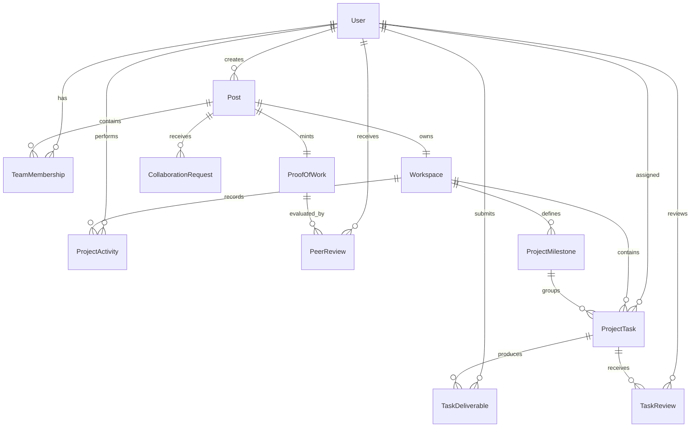

# ENQUEbet — Team Execution & Governance Data Model and API Design

**Document Status:** Architecture Baseline & Specification  
**Phase:** 3 — Team Formation, Workspace Execution, and Proof of Work  
**Author:** Subagent C (Database and API Architect)  
**Target Codebase Paths:** `backend/apps/collaboration/`, `backend/apps/posts/`, `backend/apps/chats/`, `backend/apps/workspaces/`  

---

## 1. Executive Overview & Architectural Philosophy

ENQUEbet is a **Builder Reputation Platform**. Its fundamental mission is transitioning builder discovery into structured collaboration, auditable execution, verifiable project completion, and tamper-resistant builder reputation.

The technical gap identified in V1 was the lack of execution infrastructure: while discovery and messaging existed, there was no structured container for task allocation, deliverable review, governance (member removal/departure), milestone tracking, and formal proof generation.

### 1.1 Core Architecture Objectives
1. **Additive & Backward-Compatible:** Seamlessly extend the existing `Post`, `CollaborationRequest`, `Conversation`, and `User` models without breaking live feed queries, existing migrations, or mobile/web API clients.
2. **Strict Relational Integrity:** Enforce foreign key constraints, composite unique indexes, check constraints, and role-based permissions at the database level.
3. **Auditable Event Sourcing:** Capture every lifecycle action (invitations, task status transitions, deliverable reviews, role modifications, member departures) in an append-only `ProjectActivity` audit log.
4. **Performance by Default:** Zero $N+1$ query overhead via optimized `select_related` and `prefetch_related` pathways, targeted composite indexing on query filters, and denormalized progress metrics cached via atomic transactions.

---

## 2. Current-State Audit & Compatibility Strategy

### 2.1 Existing Model Analysis

| App / Model | Existing Primary Fields | Existing Role in V1 | Compatibility & Evolution Strategy |
|---|---|---|---|
| `posts.Post` | `id` (UUID), `user_id`, `title`, `description`, `category`, `view_type`, `location`, `college` | Root idea/opportunity entity in feeds | Acts as the root Project entity. Remains unchanged to preserve feed queries. A `Workspace` is attached via 1:1 relation. |
| `posts.PostCollaborator` | `id`, `post_id`, `user_id`, `created_at` (unique together on `post`, `user`) | Basic accepted collaborator junction | Maintained as an active view/alias. Upgraded to `TeamMembership` with lifecycle status, assigned roles, departure tracking, and removal justification. Existing rows map directly to `TeamMembership(status='active', role='Collaborator')`. |
| `collaboration.CollaborationRequest` | `id` (UUID), `post_id`, `sender_id`, `receiver_id`, `status` (`pending`, `accepted`, `declined`, `cancelled`), `message` | Peer-to-owner request to join | Preserved. State machine formalized. On `accepted`, atomically creates `TeamMembership(status='active')` and initializes or enrolls in `Workspace`. |
| `chats.Conversation` | `id` (UUID), `name`, `is_group`, `project_id` (UUID), `ConversationMember`, `Message` | Chat room attached to `project_id` (which is `post.id`) | Kept intact. `Workspace` references or mirrors `project_id`. When `TeamMembership` activates, the user is added to `ConversationMember`. |
| `users.User` & `UserSkill` | `id` (UUID), `verification_level`, `reputation_score`, `education`, `projects`, `experience` | Builder identity & profile | Referenced as `creator`, `assignee`, `reviewer`, `actor`, and `rated_user`. Reputation score receives computed increments upon verified proof. |

---

## 3. Database Schema & Data Models

### 3.1 Relational Architecture Diagram (Mermaid ERD)



---

### 3.2 Model Specifications (Django Models Definition)

Below is the complete, production-grade Django ORM model implementation intended for `backend/apps/workspaces/models.py` (or integrated into `apps/collaboration/` and `apps/posts/`).

```python
"""
Database Models for ENQUEbet Workspace, Team Governance, Task Execution, and Proof of Work.
"""
import uuid
from django.db import models
from django.conf import settings
from django.utils import timezone
from django.core.validators import MinValueValidator, MaxValueValidator


class Workspace(models.Model):
    """
    Execution workspace bound 1:1 to a project (Post).
    Created automatically when a project is initialized or first collaboration request is accepted.
    """
    STATUS_CHOICES = [
        ('active', 'Active Execution'),
        ('review', 'Under Completion Review'),
        ('completed', 'Completed'),
        ('archived', 'Archived / Inactive'),
    ]

    id = models.UUIDField(primary_key=True, default=uuid.uuid4, editable=False)
    post = models.OneToOneField(
        'posts.Post',
        on_delete=models.CASCADE,
        related_name='workspace',
        help_text="The post/project this workspace belongs to."
    )
    status = models.CharField(max_length=20, choices=STATUS_CHOICES, default='active')
    
    # External Project Artifacts & Resources
    github_repo_url = models.URLField(max_length=500, blank=True, default='')
    live_demo_url = models.URLField(max_length=500, blank=True, default='')
    documentation_url = models.URLField(max_length=500, blank=True, default='')
    
    # Denormalized Execution Metrics for High-Performance Dashboard Loading
    progress_percentage = models.PositiveSmallIntegerField(
        default=0,
        validators=[MinValueValidator(0), MaxValueValidator(100)],
        help_text="Calculated as (completed_tasks / total_tasks) * 100"
    )
    total_tasks_count = models.PositiveIntegerField(default=0)
    completed_tasks_count = models.PositiveIntegerField(default=0)

    # Lifecycle Timestamps
    created_at = models.DateTimeField(auto_now_add=True)
    updated_at = models.DateTimeField(auto_now=True)
    completed_at = models.DateTimeField(null=True, blank=True)

    class Meta:
        db_table = 'workspaces'
        ordering = ['-created_at']
        indexes = [
            models.Index(fields=['status']),
            models.Index(fields=['post', 'status']),
        ]

    def __str__(self):
        return f"Workspace: {self.post.title} ({self.status})"

    def recalculate_progress(self):
        """Atomic progress calculation based on approved/completed tasks."""
        total = self.tasks.exclude(status='cancelled').count()
        completed = self.tasks.filter(status='approved').count()
        self.total_tasks_count = total
        self.completed_tasks_count = completed
        self.progress_percentage = int((completed / total) * 100) if total > 0 else 0
        self.save(update_fields=['total_tasks_count', 'completed_tasks_count', 'progress_percentage', 'updated_at'])


class TeamMembership(models.Model):
    """
    Formalized team membership tracking roles, lifecycle state, 
    onboarding, departure, and governance removals.
    """
    STATUS_CHOICES = [
        ('pending', 'Pending Invitation / Acceptance'),
        ('active', 'Active Member'),
        ('left', 'Voluntarily Departed'),
        ('removed', 'Removed by Owner'),
        ('completed', 'Finished with Project'),
    ]

    ROLE_CHOICES = [
        ('owner', 'Project Lead / Creator'),
        ('maintainer', 'Maintainer / Lead Contributor'),
        ('contributor', 'Core Contributor'),
        ('reviewer', 'Reviewer / QA'),
    ]

    id = models.UUIDField(primary_key=True, default=uuid.uuid4, editable=False)
    post = models.ForeignKey(
        'posts.Post',
        on_delete=models.CASCADE,
        related_name='team_memberships'
    )
    user = models.ForeignKey(
        settings.AUTH_USER_MODEL,
        on_delete=models.CASCADE,
        related_name='team_memberships'
    )
    role = models.CharField(max_length=50, choices=ROLE_CHOICES, default='contributor')
    title = models.CharField(max_length=100, blank=True, help_text="Custom role label (e.g. Frontend Engineer)")
    status = models.CharField(max_length=20, choices=STATUS_CHOICES, default='active')
    
    # Audit trail for departures and removals
    joined_at = models.DateTimeField(default=timezone.now)
    left_at = models.DateTimeField(null=True, blank=True)
    removal_reason = models.TextField(blank=True, default='')
    removed_by = models.ForeignKey(
        settings.AUTH_USER_MODEL,
        null=True,
        blank=True,
        on_delete=models.SET_NULL,
        related_name='governance_removals'
    )

    created_at = models.DateTimeField(auto_now_add=True)
    updated_at = models.DateTimeField(auto_now=True)

    class Meta:
        db_table = 'team_memberships'
        unique_together = ['post', 'user']
        indexes = [
            models.Index(fields=['post', 'status']),
            models.Index(fields=['user', 'status']),
        ]

    def __str__(self):
        return f"{self.user.username} ({self.role}) on {self.post.title} [{self.status}]"


class ProjectMilestone(models.Model):
    """
    High-level milestones demarcating major project phases.
    """
    STATUS_CHOICES = [
        ('planned', 'Planned'),
        ('active', 'In Progress'),
        ('completed', 'Completed'),
        ('missed', 'Past Target Date'),
    ]

    id = models.UUIDField(primary_key=True, default=uuid.uuid4, editable=False)
    workspace = models.ForeignKey(
        Workspace,
        on_delete=models.CASCADE,
        related_name='milestones'
    )
    title = models.CharField(max_length=255)
    description = models.TextField(blank=True)
    target_date = models.DateField(null=True, blank=True)
    status = models.CharField(max_length=20, choices=STATUS_CHOICES, default='planned')
    order = models.PositiveIntegerField(default=1)
    
    created_at = models.DateTimeField(auto_now_add=True)
    updated_at = models.DateTimeField(auto_now=True)

    class Meta:
        db_table = 'project_milestones'
        ordering = ['order', 'target_date', 'created_at']
        indexes = [
            models.Index(fields=['workspace', 'status']),
        ]

    def __str__(self):
        return f"Milestone: {self.title} ({self.status})"


class ProjectTask(models.Model):
    """
    Atomic unit of project work with Kanban states, assignees, reviewers, and priorities.
    """
    STATUS_CHOICES = [
        ('backlog', 'Backlog'),
        ('assigned', 'Assigned'),
        ('in_progress', 'In Progress'),
        ('review', 'In Review'),
        ('approved', 'Approved / Completed'),
        ('changes_requested', 'Changes Requested'),
        ('blocked', 'Blocked'),
        ('cancelled', 'Cancelled'),
    ]

    PRIORITY_CHOICES = [
        ('low', 'Low'),
        ('medium', 'Medium'),
        ('high', 'High'),
        ('urgent', 'Urgent'),
    ]

    id = models.UUIDField(primary_key=True, default=uuid.uuid4, editable=False)
    workspace = models.ForeignKey(
        Workspace,
        on_delete=models.CASCADE,
        related_name='tasks'
    )
    milestone = models.ForeignKey(
        ProjectMilestone,
        null=True,
        blank=True,
        on_delete=models.SET_NULL,
        related_name='tasks'
    )
    title = models.CharField(max_length=255)
    description = models.TextField(blank=True)
    
    creator = models.ForeignKey(
        settings.AUTH_USER_MODEL,
        on_delete=models.CASCADE,
        related_name='created_tasks'
    )
    assignee = models.ForeignKey(
        settings.AUTH_USER_MODEL,
        null=True,
        blank=True,
        on_delete=models.SET_NULL,
        related_name='assigned_tasks'
    )
    reviewer = models.ForeignKey(
        settings.AUTH_USER_MODEL,
        null=True,
        blank=True,
        on_delete=models.SET_NULL,
        related_name='reviewing_tasks'
    )

    status = models.CharField(max_length=25, choices=STATUS_CHOICES, default='backlog')
    priority = models.CharField(max_length=15, choices=PRIORITY_CHOICES, default='medium')
    due_date = models.DateTimeField(null=True, blank=True)
    order = models.PositiveIntegerField(default=0, help_text="Ordering within Kanban lane")
    
    created_at = models.DateTimeField(auto_now_add=True)
    updated_at = models.DateTimeField(auto_now=True)

    class Meta:
        db_table = 'project_tasks'
        ordering = ['order', '-created_at']
        indexes = [
            models.Index(fields=['workspace', 'status']),
            models.Index(fields=['assignee', 'status']),
            models.Index(fields=['reviewer', 'status']),
            models.Index(fields=['workspace', 'milestone']),
        ]

    def __str__(self):
        return f"[{self.status.upper()}] {self.title} (Workspace: {self.workspace_id})"


class TaskDeliverable(models.Model):
    """
    Proof of work submitted by an assignee for task review. Supports PR links, demos, and file uploads.
    """
    id = models.UUIDField(primary_key=True, default=uuid.uuid4, editable=False)
    task = models.ForeignKey(
        ProjectTask,
        on_delete=models.CASCADE,
        related_name='deliverables'
    )
    submitted_by = models.ForeignKey(
        settings.AUTH_USER_MODEL,
        on_delete=models.CASCADE,
        related_name='submitted_deliverables'
    )
    title = models.CharField(max_length=255)
    description = models.TextField(blank=True)
    
    # Deliverable evidence URLs
    link_url = models.URLField(max_length=500, blank=True, help_text="GitHub PR, Figma link, or external URL")
    attachment_url = models.URLField(max_length=500, blank=True, help_text="Stored file/asset URL")
    version = models.PositiveIntegerField(default=1)

    created_at = models.DateTimeField(auto_now_add=True)

    class Meta:
        db_table = 'task_deliverables'
        ordering = ['-version', '-created_at']
        indexes = [
            models.Index(fields=['task', 'version']),
        ]

    def __str__(self):
        return f"Deliverable v{self.version} for Task {self.task.title}"


class TaskReview(models.Model):
    """
    Formal review feedback for a task deliverable submitted by an authorized reviewer or project lead.
    """
    VERDICT_CHOICES = [
        ('approved', 'Approved'),
        ('changes_requested', 'Changes Requested'),
        ('rejected', 'Rejected'),
    ]

    id = models.UUIDField(primary_key=True, default=uuid.uuid4, editable=False)
    task = models.ForeignKey(
        ProjectTask,
        on_delete=models.CASCADE,
        related_name='reviews'
    )
    deliverable = models.ForeignKey(
        TaskDeliverable,
        null=True,
        blank=True,
        on_delete=models.SET_NULL,
        related_name='reviews'
    )
    reviewer = models.ForeignKey(
        settings.AUTH_USER_MODEL,
        on_delete=models.CASCADE,
        related_name='task_reviews'
    )
    verdict = models.CharField(max_length=25, choices=VERDICT_CHOICES)
    feedback = models.TextField()

    created_at = models.DateTimeField(auto_now_add=True)

    class Meta:
        db_table = 'task_reviews'
        ordering = ['-created_at']
        indexes = [
            models.Index(fields=['task', 'verdict']),
        ]

    def __str__(self):
        return f"{self.reviewer.username} reviewed {self.task.title} -> {self.verdict}"


class ProofOfWork(models.Model):
    """
    Permanent, verifiable credential minted upon project completion.
    Contains immutable cryptographic snapshot of team contributions.
    """
    STATUS_CHOICES = [
        ('verified', 'Verified by Platform'),
        ('disputed', 'Under Community / Team Dispute'),
        ('revoked', 'Revoked Due to Violation'),
    ]

    id = models.UUIDField(primary_key=True, default=uuid.uuid4, editable=False)
    post = models.OneToOneField(
        'posts.Post',
        on_delete=models.CASCADE,
        related_name='proof_of_work'
    )
    workspace = models.ForeignKey(
        Workspace,
        null=True,
        blank=True,
        on_delete=models.SET_NULL,
        related_name='proofs'
    )
    verification_code = models.CharField(
        max_length=64,
        unique=True,
        help_text="Canonical public verification code, e.g., ENQ-2026-X9B21A"
    )
    
    title = models.CharField(max_length=255)
    summary = models.TextField()
    
    # Public Demonstration Artifacts
    demo_url = models.URLField(max_length=500, blank=True)
    repository_url = models.URLField(max_length=500, blank=True)
    deliverable_document_url = models.URLField(max_length=500, blank=True)

    # Immutable snapshot of contribution statistics at completion time
    total_tasks_completed = models.PositiveIntegerField(default=0)
    total_milestones_completed = models.PositiveIntegerField(default=0)
    team_snapshot = models.JSONField(
        default=list,
        help_text="JSON snapshot: [{user_id, username, role, completed_tasks_count}]"
    )
    
    status = models.CharField(max_length=20, choices=STATUS_CHOICES, default='verified')
    completed_at = models.DateTimeField(default=timezone.now)
    created_at = models.DateTimeField(auto_now_add=True)

    class Meta:
        db_table = 'proof_of_work'
        indexes = [
            models.Index(fields=['verification_code']),
            models.Index(fields=['status']),
        ]

    def __str__(self):
        return f"ProofOfWork: {self.verification_code} ({self.title})"


class PeerReview(models.Model):
    """
    Peer ratings collected after project completion to adjust reputation score.
    Rate teammates on Technical Execution, Collaboration, and Reliability (1-5 scale).
    """
    id = models.UUIDField(primary_key=True, default=uuid.uuid4, editable=False)
    proof = models.ForeignKey(
        ProofOfWork,
        on_delete=models.CASCADE,
        related_name='peer_ratings'
    )
    reviewer = models.ForeignKey(
        settings.AUTH_USER_MODEL,
        on_delete=models.CASCADE,
        related_name='given_peer_reviews'
    )
    rated_user = models.ForeignKey(
        settings.AUTH_USER_MODEL,
        on_delete=models.CASCADE,
        related_name='received_peer_reviews'
    )
    
    technical_rating = models.PositiveSmallIntegerField(
        validators=[MinValueValidator(1), MaxValueValidator(5)]
    )
    collaboration_rating = models.PositiveSmallIntegerField(
        validators=[MinValueValidator(1), MaxValueValidator(5)]
    )
    reliability_rating = models.PositiveSmallIntegerField(
        validators=[MinValueValidator(1), MaxValueValidator(5)]
    )
    feedback = models.TextField(blank=True)
    created_at = models.DateTimeField(auto_now_add=True)

    class Meta:
        db_table = 'peer_reviews'
        unique_together = ['proof', 'reviewer', 'rated_user']
        indexes = [
            models.Index(fields=['rated_user']),
            models.Index(fields=['proof']),
        ]

    def __str__(self):
        return f"Review by {self.reviewer.username} for {self.rated_user.username}"


class ProjectActivity(models.Model):
    """
    Append-only audit log capturing all events across workspace, team, and tasks.
    """
    id = models.UUIDField(primary_key=True, default=uuid.uuid4, editable=False)
    workspace = models.ForeignKey(
        Workspace,
        on_delete=models.CASCADE,
        related_name='activities'
    )
    actor = models.ForeignKey(
        settings.AUTH_USER_MODEL,
        null=True,
        blank=True,
        on_delete=models.SET_NULL,
        related_name='project_activities'
    )
    event_type = models.CharField(
        max_length=60,
        help_text="e.g. task_created, task_status_changed, deliverable_submitted, member_joined, member_removed"
    )
    entity_type = models.CharField(
        max_length=40,
        help_text="e.g. task, deliverable, review, member, milestone, workspace, proof"
    )
    entity_id = models.UUIDField()
    description = models.CharField(max_length=500)
    metadata = models.JSONField(default=dict, blank=True)

    created_at = models.DateTimeField(auto_now_add=True)

    class Meta:
        db_table = 'project_activities'
        ordering = ['-created_at']
        indexes = [
            models.Index(fields=['workspace', '-created_at']),
            models.Index(fields=['event_type']),
        ]

    def __str__(self):
        return f"[{self.event_type}] {self.description} ({self.created_at})"
```

---

### 3.3 PostgreSQL SQL DDL Schema

```sql
-- ENQUEbet Schema Additions: Workspaces, Team Governance, Tasks, and Proof of Work

CREATE TABLE workspaces (
    id UUID PRIMARY KEY DEFAULT gen_random_uuid(),
    post_id UUID NOT NULL UNIQUE REFERENCES posts(id) ON DELETE CASCADE,
    status VARCHAR(20) NOT NULL DEFAULT 'active' CHECK (status IN ('active', 'review', 'completed', 'archived')),
    github_repo_url VARCHAR(500) DEFAULT '',
    live_demo_url VARCHAR(500) DEFAULT '',
    documentation_url VARCHAR(500) DEFAULT '',
    progress_percentage SMALLINT NOT NULL DEFAULT 0 CHECK (progress_percentage BETWEEN 0 AND 100),
    total_tasks_count INTEGER NOT NULL DEFAULT 0,
    completed_tasks_count INTEGER NOT NULL DEFAULT 0,
    created_at TIMESTAMP WITH TIME ZONE DEFAULT CURRENT_TIMESTAMP NOT NULL,
    updated_at TIMESTAMP WITH TIME ZONE DEFAULT CURRENT_TIMESTAMP NOT NULL,
    completed_at TIMESTAMP WITH TIME ZONE
);

CREATE INDEX idx_workspaces_status ON workspaces(status);
CREATE INDEX idx_workspaces_post_status ON workspaces(post_id, status);

CREATE TABLE team_memberships (
    id UUID PRIMARY KEY DEFAULT gen_random_uuid(),
    post_id UUID NOT NULL REFERENCES posts(id) ON DELETE CASCADE,
    user_id UUID NOT NULL REFERENCES users(id) ON DELETE CASCADE,
    role VARCHAR(50) NOT NULL DEFAULT 'contributor' CHECK (role IN ('owner', 'maintainer', 'contributor', 'reviewer')),
    title VARCHAR(100) DEFAULT '',
    status VARCHAR(20) NOT NULL DEFAULT 'active' CHECK (status IN ('pending', 'active', 'left', 'removed', 'completed')),
    joined_at TIMESTAMP WITH TIME ZONE DEFAULT CURRENT_TIMESTAMP NOT NULL,
    left_at TIMESTAMP WITH TIME ZONE,
    removal_reason TEXT DEFAULT '',
    removed_by_id UUID REFERENCES users(id) ON DELETE SET NULL,
    created_at TIMESTAMP WITH TIME ZONE DEFAULT CURRENT_TIMESTAMP NOT NULL,
    updated_at TIMESTAMP WITH TIME ZONE DEFAULT CURRENT_TIMESTAMP NOT NULL,
    CONSTRAINT uq_team_memberships_post_user UNIQUE (post_id, user_id)
);

CREATE INDEX idx_team_memberships_post_status ON team_memberships(post_id, status);
CREATE INDEX idx_team_memberships_user_status ON team_memberships(user_id, status);

CREATE TABLE project_milestones (
    id UUID PRIMARY KEY DEFAULT gen_random_uuid(),
    workspace_id UUID NOT NULL REFERENCES workspaces(id) ON DELETE CASCADE,
    title VARCHAR(255) NOT NULL,
    description TEXT DEFAULT '',
    target_date DATE,
    status VARCHAR(20) NOT NULL DEFAULT 'planned' CHECK (status IN ('planned', 'active', 'completed', 'missed')),
    "order" INTEGER NOT NULL DEFAULT 1,
    created_at TIMESTAMP WITH TIME ZONE DEFAULT CURRENT_TIMESTAMP NOT NULL,
    updated_at TIMESTAMP WITH TIME ZONE DEFAULT CURRENT_TIMESTAMP NOT NULL
);

CREATE INDEX idx_project_milestones_workspace_status ON project_milestones(workspace_id, status);

CREATE TABLE project_tasks (
    id UUID PRIMARY KEY DEFAULT gen_random_uuid(),
    workspace_id UUID NOT NULL REFERENCES workspaces(id) ON DELETE CASCADE,
    milestone_id UUID REFERENCES project_milestones(id) ON DELETE SET NULL,
    title VARCHAR(255) NOT NULL,
    description TEXT DEFAULT '',
    creator_id UUID NOT NULL REFERENCES users(id) ON DELETE CASCADE,
    assignee_id UUID REFERENCES users(id) ON DELETE SET NULL,
    reviewer_id UUID REFERENCES users(id) ON DELETE SET NULL,
    status VARCHAR(25) NOT NULL DEFAULT 'backlog' CHECK (
        status IN ('backlog', 'assigned', 'in_progress', 'review', 'approved', 'changes_requested', 'blocked', 'cancelled')
    ),
    priority VARCHAR(15) NOT NULL DEFAULT 'medium' CHECK (priority IN ('low', 'medium', 'high', 'urgent')),
    due_date TIMESTAMP WITH TIME ZONE,
    "order" INTEGER NOT NULL DEFAULT 0,
    created_at TIMESTAMP WITH TIME ZONE DEFAULT CURRENT_TIMESTAMP NOT NULL,
    updated_at TIMESTAMP WITH TIME ZONE DEFAULT CURRENT_TIMESTAMP NOT NULL
);

CREATE INDEX idx_project_tasks_workspace_status ON project_tasks(workspace_id, status);
CREATE INDEX idx_project_tasks_assignee_status ON project_tasks(assignee_id, status);
CREATE INDEX idx_project_tasks_reviewer_status ON project_tasks(reviewer_id, status);
CREATE INDEX idx_project_tasks_workspace_milestone ON project_tasks(workspace_id, milestone_id);

CREATE TABLE task_deliverables (
    id UUID PRIMARY KEY DEFAULT gen_random_uuid(),
    task_id UUID NOT NULL REFERENCES project_tasks(id) ON DELETE CASCADE,
    submitted_by_id UUID NOT NULL REFERENCES users(id) ON DELETE CASCADE,
    title VARCHAR(255) NOT NULL,
    description TEXT DEFAULT '',
    link_url VARCHAR(500) DEFAULT '',
    attachment_url VARCHAR(500) DEFAULT '',
    version INTEGER NOT NULL DEFAULT 1,
    created_at TIMESTAMP WITH TIME ZONE DEFAULT CURRENT_TIMESTAMP NOT NULL
);

CREATE INDEX idx_task_deliverables_task_version ON task_deliverables(task_id, version);

CREATE TABLE task_reviews (
    id UUID PRIMARY KEY DEFAULT gen_random_uuid(),
    task_id UUID NOT NULL REFERENCES project_tasks(id) ON DELETE CASCADE,
    deliverable_id UUID REFERENCES task_deliverables(id) ON DELETE SET NULL,
    reviewer_id UUID NOT NULL REFERENCES users(id) ON DELETE CASCADE,
    verdict VARCHAR(25) NOT NULL CHECK (verdict IN ('approved', 'changes_requested', 'rejected')),
    feedback TEXT NOT NULL,
    created_at TIMESTAMP WITH TIME ZONE DEFAULT CURRENT_TIMESTAMP NOT NULL
);

CREATE INDEX idx_task_reviews_task_verdict ON task_reviews(task_id, verdict);

CREATE TABLE proof_of_work (
    id UUID PRIMARY KEY DEFAULT gen_random_uuid(),
    post_id UUID NOT NULL UNIQUE REFERENCES posts(id) ON DELETE CASCADE,
    workspace_id UUID REFERENCES workspaces(id) ON DELETE SET NULL,
    verification_code VARCHAR(64) NOT NULL UNIQUE,
    title VARCHAR(255) NOT NULL,
    summary TEXT NOT NULL,
    demo_url VARCHAR(500) DEFAULT '',
    repository_url VARCHAR(500) DEFAULT '',
    deliverable_document_url VARCHAR(500) DEFAULT '',
    total_tasks_completed INTEGER NOT NULL DEFAULT 0,
    total_milestones_completed INTEGER NOT NULL DEFAULT 0,
    team_snapshot JSONB NOT NULL DEFAULT '[]'::jsonb,
    status VARCHAR(20) NOT NULL DEFAULT 'verified' CHECK (status IN ('verified', 'disputed', 'revoked')),
    completed_at TIMESTAMP WITH TIME ZONE DEFAULT CURRENT_TIMESTAMP NOT NULL,
    created_at TIMESTAMP WITH TIME ZONE DEFAULT CURRENT_TIMESTAMP NOT NULL
);

CREATE INDEX idx_proof_verification_code ON proof_of_work(verification_code);
CREATE INDEX idx_proof_status ON proof_of_work(status);

CREATE TABLE peer_reviews (
    id UUID PRIMARY KEY DEFAULT gen_random_uuid(),
    proof_id UUID NOT NULL REFERENCES proof_of_work(id) ON DELETE CASCADE,
    reviewer_id UUID NOT NULL REFERENCES users(id) ON DELETE CASCADE,
    rated_user_id UUID NOT NULL REFERENCES users(id) ON DELETE CASCADE,
    technical_rating SMALLINT NOT NULL CHECK (technical_rating BETWEEN 1 AND 5),
    collaboration_rating SMALLINT NOT NULL CHECK (collaboration_rating BETWEEN 1 AND 5),
    reliability_rating SMALLINT NOT NULL CHECK (reliability_rating BETWEEN 1 AND 5),
    feedback TEXT DEFAULT '',
    created_at TIMESTAMP WITH TIME ZONE DEFAULT CURRENT_TIMESTAMP NOT NULL,
    CONSTRAINT uq_peer_reviews_proof_reviewer_rated UNIQUE (proof_id, reviewer_id, rated_user_id)
);

CREATE INDEX idx_peer_reviews_rated_user ON peer_reviews(rated_user_id);
CREATE INDEX idx_peer_reviews_proof ON peer_reviews(proof_id);

CREATE TABLE project_activities (
    id UUID PRIMARY KEY DEFAULT gen_random_uuid(),
    workspace_id UUID NOT NULL REFERENCES workspaces(id) ON DELETE CASCADE,
    actor_id UUID REFERENCES users(id) ON DELETE SET NULL,
    event_type VARCHAR(60) NOT NULL,
    entity_type VARCHAR(40) NOT NULL,
    entity_id UUID NOT NULL,
    description VARCHAR(500) NOT NULL,
    metadata JSONB NOT NULL DEFAULT '{}'::jsonb,
    created_at TIMESTAMP WITH TIME ZONE DEFAULT CURRENT_TIMESTAMP NOT NULL
);

CREATE INDEX idx_project_activities_workspace_created ON project_activities(workspace_id, created_at DESC);
CREATE INDEX idx_project_activities_event_type ON project_activities(event_type);
```

---

## 4. REST API Contracts

### 4.1 Global Standard Formats

**Authorization:**
```http
Authorization: Bearer <jwt_access_token>
Content-Type: application/json
```

**Standard Success Envelope:**
```json
{
  "success": true,
  "message": "Human readable confirmation",
  "data": {}
}
```

**Standard Error Envelope:**
```json
{
  "success": false,
  "message": "Validation or execution error description",
  "error_code": "RESOURCE_NOT_FOUND | PERMISSION_DENIED | INVALID_TRANSITION",
  "errors": {}
}
```

---

### 4.2 Workspace Management APIs

#### 4.2.1 Get Workspace by Post ID
Retrieves workspace overview, team status, progress percentage, and external resource URLs.

- **Endpoint:** `GET /api/workspaces/{post_id}/`
- **Permissions:** IsAuthenticated, IsWorkspaceMember (or Public if project is marked open and completed)
- **Response `200 OK`:**
```json
{
  "success": true,
  "data": {
    "id": "e4f8d390-1c7b-4882-936d-d11234bcefa0",
    "post_id": "a123b456-789c-012d-ef34-56789abcdef0",
    "project_title": "AI Autonomous Agent Hub",
    "status": "active",
    "github_repo_url": "https://github.com/enquebet/agent-hub",
    "live_demo_url": "https://agent-hub.dev",
    "documentation_url": "https://docs.agent-hub.dev",
    "progress_percentage": 65,
    "total_tasks_count": 20,
    "completed_tasks_count": 13,
    "user_role": "owner",
    "created_at": "2026-10-15T10:00:00Z",
    "updated_at": "2026-10-15T14:30:00Z"
  }
}
```
- **Error Responses:**
  - `401 Unauthorized`
  - `403 Forbidden`: `{"success": false, "error_code": "FORBIDDEN", "message": "You are not an active member of this project"}`
  - `404 Not Found`: `{"success": false, "error_code": "WORKSPACE_NOT_FOUND", "message": "Workspace does not exist"}`

#### 4.2.2 Update Workspace Settings
Updates external repo, live demo, or doc links. Only project owner or maintainers can update.

- **Endpoint:** `PATCH /api/workspaces/{post_id}/`
- **Permissions:** IsAuthenticated, IsProjectLeadOrMaintainer
- **Request Body:**
```json
{
  "github_repo_url": "https://github.com/enquebet/agent-hub-v2",
  "live_demo_url": "https://agent-hub-v2.dev",
  "documentation_url": "https://docs.agent-hub-v2.dev"
}
```
- **Response `200 OK`:**
```json
{
  "success": true,
  "message": "Workspace links updated successfully",
  "data": {
    "id": "e4f8d390-1c7b-4882-936d-d11234bcefa0",
    "github_repo_url": "https://github.com/enquebet/agent-hub-v2",
    "live_demo_url": "https://agent-hub-v2.dev",
    "documentation_url": "https://docs.agent-hub-v2.dev",
    "updated_at": "2026-10-15T15:00:00Z"
  }
}
```

#### 4.2.3 Get Workspace Activity Feed
Fetches chronologically paginated audit events for the workspace.

- **Endpoint:** `GET /api/workspaces/{post_id}/activities/?page=1&page_size=20&event_type=task_status_changed`
- **Permissions:** IsAuthenticated, IsWorkspaceMember
- **Response `200 OK`:**
```json
{
  "success": true,
  "data": {
    "count": 42,
    "next": null,
    "previous": null,
    "results": [
      {
        "id": "8a31e13b-85d1-4be3-b097-f58c49e29cc7",
        "actor": {
          "id": "c1f7b093-6052-47d0-a07c-9b51829e0649",
          "username": "alex_builder",
          "full_name": "Alex Morgan",
          "profile_image": "https://assets.enquebet.com/profiles/alex.jpg"
        },
        "event_type": "deliverable_submitted",
        "entity_type": "deliverable",
        "entity_id": "4b6a8270-3d3f-42a1-b844-3c66f9188049",
        "description": "Alex Morgan submitted Deliverable v1 for 'Implement WebSocket protocol'",
        "metadata": {
          "task_id": "993a4b92-562e-4361-94ec-71bc502f9011",
          "task_title": "Implement WebSocket protocol",
          "link_url": "https://github.com/enquebet/agent-hub/pull/14"
        },
        "created_at": "2026-10-15T14:45:10Z"
      }
    ]
  }
}
```

---

### 4.3 Team Governance APIs

#### 4.3.1 List Team Members
Returns all active, left, and removed members with their role, joined date, and task statistics.

- **Endpoint:** `GET /api/workspaces/{post_id}/members/`
- **Permissions:** IsAuthenticated, IsWorkspaceMember
- **Response `200 OK`:**
```json
{
  "success": true,
  "data": [
    {
      "id": "7134f9a1-cb03-49be-8b17-09d57a3e5210",
      "user": {
        "id": "c1f7b093-6052-47d0-a07c-9b51829e0649",
        "username": "muskan",
        "full_name": "Muskan Kumar",
        "profile_image": "https://assets.enquebet.com/profiles/muskan.jpg",
        "reputation_score": 240
      },
      "role": "owner",
      "title": "Project Lead & Backend Engineer",
      "status": "active",
      "assigned_tasks_count": 8,
      "completed_tasks_count": 6,
      "joined_at": "2026-10-10T08:00:00Z"
    },
    {
      "id": "528da781-a279-4bc2-84fc-924bce63ef80",
      "user": {
        "id": "f284e1b0-967a-4ec6-817c-a4968393e18a",
        "username": "sarah_ui",
        "full_name": "Sarah Chen",
        "profile_image": "https://assets.enquebet.com/profiles/sarah.jpg",
        "reputation_score": 190
      },
      "role": "contributor",
      "title": "Frontend Lead",
      "status": "active",
      "assigned_tasks_count": 6,
      "completed_tasks_count": 5,
      "joined_at": "2026-10-11T12:00:00Z"
    }
  ]
}
```

#### 4.3.2 Update Member Role or Title
- **Endpoint:** `PATCH /api/workspaces/{post_id}/members/{membership_id}/`
- **Permissions:** IsAuthenticated, IsProjectOwner
- **Request Body:**
```json
{
  "role": "maintainer",
  "title": "Core Architect"
}
```
- **Response `200 OK`:**
```json
{
  "success": true,
  "message": "Team membership updated",
  "data": {
    "id": "528da781-a279-4bc2-84fc-924bce63ef80",
    "role": "maintainer",
    "title": "Core Architect",
    "status": "active"
  }
}
```

#### 4.3.3 Remove Member (Governance Action)
Enables project lead to remove a non-performing or abusive member with required justification.

- **Endpoint:** `POST /api/workspaces/{post_id}/members/{membership_id}/remove/`
- **Permissions:** IsAuthenticated, IsProjectOwner
- **Request Body:**
```json
{
  "removal_reason": "Inactivity for two weeks without response and missed sprint milestone deliverable."
}
```
- **Response `200 OK`:**
```json
{
  "success": true,
  "message": "Member removed from workspace",
  "data": {
    "membership_id": "528da781-a279-4bc2-84fc-924bce63ef80",
    "status": "removed",
    "left_at": "2026-10-15T15:10:00Z",
    "unassigned_tasks_count": 3
  }
}
```
- **Business Rule:** Automatically unassigns any non-completed tasks (`assigned`, `in_progress`, `review`) assigned to this member and places them back into `backlog` with an audit activity entry.

#### 4.3.4 Voluntarily Leave Workspace
Enables an active collaborator to voluntarily exit.

- **Endpoint:** `POST /api/workspaces/{post_id}/members/leave/`
- **Permissions:** IsAuthenticated, IsWorkspaceMember
- **Request Body:**
```json
{
  "reason": "Relocating for semester exams; handing off frontend tickets."
}
```
- **Response `200 OK`:**
```json
{
  "success": true,
  "message": "You have voluntarily left the workspace",
  "data": {
    "status": "left",
    "left_at": "2026-10-15T15:15:00Z"
  }
}
```
- **Validation Guard:** The project owner cannot leave without first transferring ownership to another active member. Returns `400 Bad Request` if owner attempts to leave.

---

### 4.4 Milestones APIs

#### 4.4.1 List Workspace Milestones
- **Endpoint:** `GET /api/workspaces/{post_id}/milestones/`
- **Permissions:** IsAuthenticated, IsWorkspaceMember
- **Response `200 OK`:**
```json
{
  "success": true,
  "data": [
    {
      "id": "1198e3b2-6c84-4866-9df3-77242194a081",
      "title": "Phase 1: Architecture & Schema",
      "description": "Finalize database models, ERD, and core endpoints",
      "target_date": "2026-10-20",
      "status": "active",
      "order": 1,
      "tasks_count": 5,
      "completed_tasks_count": 4
    }
  ]
}
```

#### 4.4.2 Create Milestone
- **Endpoint:** `POST /api/workspaces/{post_id}/milestones/`
- **Permissions:** IsAuthenticated, IsProjectLeadOrMaintainer
- **Request Body:**
```json
{
  "title": "Phase 2: Realtime Engine",
  "description": "Implement WebSockets and notification dispatch",
  "target_date": "2026-10-28",
  "order": 2
}
```
- **Response `201 Created`:** Returns created milestone object.

---

### 4.5 Task Management APIs (Kanban Engine)

#### 4.5.1 List Workspace Tasks (Kanban Board Query)
Retrieves tasks with filtering by milestone, status, priority, or assignee.

- **Endpoint:** `GET /api/workspaces/{post_id}/tasks/?status=in_progress&milestone_id={uuid}`
- **Permissions:** IsAuthenticated, IsWorkspaceMember
- **Response `200 OK`:**
```json
{
  "success": true,
  "data": [
    {
      "id": "993a4b92-562e-4361-94ec-71bc502f9011",
      "title": "Build Kanban Drag-and-Drop Board",
      "description": "Implement interactive board using Tailwind and Framer Motion",
      "milestone": {
        "id": "1198e3b2-6c84-4866-9df3-77242194a081",
        "title": "Phase 1: Frontend Workspace"
      },
      "creator": {
        "id": "c1f7b093-6052-47d0-a07c-9b51829e0649",
        "username": "muskan"
      },
      "assignee": {
        "id": "f284e1b0-967a-4ec6-817c-a4968393e18a",
        "username": "sarah_ui",
        "full_name": "Sarah Chen",
        "profile_image": "https://assets.enquebet.com/profiles/sarah.jpg"
      },
      "reviewer": {
        "id": "c1f7b093-6052-47d0-a07c-9b51829e0649",
        "username": "muskan"
      },
      "status": "in_progress",
      "priority": "high",
      "due_date": "2026-10-18T18:00:00Z",
      "order": 0,
      "deliverables_count": 0,
      "created_at": "2026-10-14T09:00:00Z",
      "updated_at": "2026-10-15T11:00:00Z"
    }
  ]
}
```

#### 4.5.2 Create Task
- **Endpoint:** `POST /api/workspaces/{post_id}/tasks/`
- **Permissions:** IsAuthenticated, IsWorkspaceMember
- **Request Body:**
```json
{
  "title": "Implement PostgreSQL Indexes & Optimizations",
  "description": "Add composite indexes on task statuses and workspace foreign keys",
  "milestone_id": "1198e3b2-6c84-4866-9df3-77242194a081",
  "assignee_id": "c1f7b093-6052-47d0-a07c-9b51829e0649",
  "reviewer_id": "f284e1b0-967a-4ec6-817c-a4968393e18a",
  "priority": "high",
  "due_date": "2026-10-19T12:00:00Z"
}
```
- **Response `201 Created`:** Returns full task object. Task status defaults to `assigned` if assignee is provided, else `backlog`.

#### 4.5.3 Transition Task Status (State Machine Guarded)
- **Endpoint:** `PATCH /api/workspaces/{post_id}/tasks/{task_id}/status/`
- **Permissions:** IsAuthenticated, IsAssigneeOrReviewerOrLead
- **Request Body:**
```json
{
  "status": "review"
}
```
- **Validation Guard:** Transitioning from `in_progress` to `review` requires that at least one `TaskDeliverable` has been submitted.
- **Response `200 OK`:** Returns updated task and recalculated workspace progress metrics.

---

### 4.6 Deliverables & Peer Review APIs

#### 4.6.1 Submit Task Deliverable
- **Endpoint:** `POST /api/workspaces/{post_id}/tasks/{task_id}/deliverables/`
- **Permissions:** IsAuthenticated, IsTaskAssignee
- **Request Body:**
```json
{
  "title": "PR #18 - Kanban State Machine Integration",
  "description": "Includes state guards, unit test coverage, and drag-and-drop optimistic UI update.",
  "link_url": "https://github.com/enquebet/mvp/pull/18",
  "attachment_url": "https://assets.enquebet.com/attachments/demo-recording.mp4"
}
```
- **Response `201 Created`:**
```json
{
  "success": true,
  "message": "Deliverable submitted. Task is now eligible for review.",
  "data": {
    "id": "e331f47b-1172-46a2-944e-984bb398e099",
    "version": 1,
    "title": "PR #18 - Kanban State Machine Integration",
    "created_at": "2026-10-15T15:20:00Z"
  }
}
```
- **Side Effect:** Automatically sets task status to `review` and alerts designated reviewer.

#### 4.6.2 Submit Task Review Verdict
- **Endpoint:** `POST /api/workspaces/{post_id}/tasks/{task_id}/reviews/`
- **Permissions:** IsAuthenticated, IsTaskReviewerOrLead
- **Request Body:**
```json
{
  "deliverable_id": "e331f47b-1172-46a2-944e-984bb398e099",
  "verdict": "approved",
  "feedback": "Code is clean, edge cases handled, passes all integration tests."
}
```
- **Response `201 Created`:**
```json
{
  "success": true,
  "message": "Review submitted. Task marked as approved.",
  "data": {
    "task_id": "993a4b92-562e-4361-94ec-71bc502f9011",
    "verdict": "approved",
    "new_task_status": "approved",
    "workspace_progress": 70
  }
}
```

---

### 4.7 Project Completion, Proof of Work & Peer Rating APIs

#### 4.7.1 Initiate Project Completion & Mint Proof of Work
When all essential tasks are finished, the project owner requests completion.

- **Endpoint:** `POST /api/workspaces/{post_id}/complete/`
- **Permissions:** IsAuthenticated, IsProjectOwner
- **Request Body:**
```json
{
  "summary": "Completed full MVP with Next.js frontend, Django backend, and WebSockets.",
  "demo_url": "https://enquebet-demo.dev",
  "repository_url": "https://github.com/enquebet/enquebet-mvp",
  "deliverable_document_url": "https://assets.enquebet.com/reports/final-report.pdf"
}
```
- **Verification Rule:** Rejects (`400 Bad Request`) if there are tasks still in `in_progress`, `review`, or `changes_requested`.
- **Response `201 Created`:**
```json
{
  "success": true,
  "message": "Project successfully completed and Proof of Work minted!",
  "data": {
    "proof_id": "91a27e34-58e1-45f8-b391-729938ce1055",
    "verification_code": "ENQ-2026-7A19BC",
    "status": "verified",
    "total_tasks_completed": 20,
    "total_milestones_completed": 3,
    "completed_at": "2026-10-15T15:30:00Z",
    "verification_url": "https://enquebet.com/verify/ENQ-2026-7A19BC"
  }
}
```

#### 4.7.2 Public Proof of Work Verification (No Auth Required)
Allows anyone (recruiters, hackathon judges, universities) to verify authentic project execution.

- **Endpoint:** `GET /api/proofs/{verification_code}/`
- **Permissions:** AllowAny
- **Response `200 OK`:**
```json
{
  "success": true,
  "data": {
    "verification_code": "ENQ-2026-7A19BC",
    "project_title": "AI Autonomous Agent Hub",
    "summary": "Completed full MVP with Next.js frontend, Django backend, and WebSockets.",
    "demo_url": "https://enquebet-demo.dev",
    "repository_url": "https://github.com/enquebet/enquebet-mvp",
    "status": "verified",
    "completed_at": "2026-10-15T15:30:00Z",
    "total_tasks_completed": 20,
    "team_members": [
      {
        "user_id": "c1f7b093-6052-47d0-a07c-9b51829e0649",
        "username": "muskan",
        "full_name": "Muskan Kumar",
        "role": "Project Lead & Backend Engineer",
        "completed_tasks_count": 12
      },
      {
        "user_id": "f284e1b0-967a-4ec6-817c-a4968393e18a",
        "username": "sarah_ui",
        "full_name": "Sarah Chen",
        "role": "Frontend Lead",
        "completed_tasks_count": 8
      }
    ]
  }
}
```

#### 4.7.3 Submit Peer Rating
Enables team members to evaluate peers on the project.

- **Endpoint:** `POST /api/proofs/{verification_code}/peer-ratings/`
- **Permissions:** IsAuthenticated, IsVerifiedTeamMember
- **Request Body:**
```json
{
  "rated_user_id": "f284e1b0-967a-4ec6-817c-a4968393e18a",
  "technical_rating": 5,
  "collaboration_rating": 5,
  "reliability_rating": 4,
  "feedback": "Outstanding frontend components and prompt responsiveness throughout the sprint."
}
```
- **Response `201 Created`:**
```json
{
  "success": true,
  "message": "Peer review submitted and factored into builder reputation score."
}
```

---

## 5. Query Optimization & Performance Strategy

### 5.1 Elimination of N+1 Queries
To prevent database query explosion on complex Kanban boards and workspace views, all views must implement strict prefetching:

```python
# Optimal Workspace Query
workspace = Workspace.objects.select_related('post', 'post__user').get(post_id=post_id)

# Optimal Kanban Board Query
tasks = ProjectTask.objects.filter(workspace=workspace)\
    .select_related('assignee', 'reviewer', 'creator', 'milestone')\
    .prefetch_related(
        models.Prefetch(
            'deliverables',
            queryset=TaskDeliverable.objects.order_by('-version')
        ),
        models.Prefetch(
            'reviews',
            queryset=TaskReview.objects.select_related('reviewer').order_by('-created_at')
        )
    )

# Optimal Member Directory Query
members = TeamMembership.objects.filter(post_id=post_id)\
    .select_related('user')\
    .annotate(
        assigned_tasks_count=models.Count('user__assigned_tasks', filter=models.Q(user__assigned_tasks__workspace__post_id=post_id)),
        completed_tasks_count=models.Count('user__assigned_tasks', filter=models.Q(user__assigned_tasks__workspace__post_id=post_id, user__assigned_tasks__status='approved'))
    )
```

### 5.2 Composite Indexing Matrix

| Table | Index Columns | Query Supported |
|---|---|---|
| `workspaces` | `(post_id, status)` | Fast workspace lookup and authorization check |
| `project_tasks` | `(workspace_id, status)` | Kanban column filtering |
| `project_tasks` | `(assignee_id, status)` | User's "My Assigned Tasks" personal dashboard |
| `project_tasks` | `(workspace_id, milestone_id)` | Milestone task breakdown |
| `project_activities` | `(workspace_id, created_at DESC)` | Workspace chronological activity feed |
| `team_memberships` | `(post_id, status)` | Active member roster |
| `proof_of_work` | `(verification_code)` | Instant public proof lookup |

---

## 6. Security & Authorization Matrix

| Action | Allowed Roles | Enforced Guard / Condition |
|---|---|---|
| View Workspace & Tasks | Team Members (active), Owner | Must have active `TeamMembership` row |
| Create Tasks | Owner, Maintainer, Contributor | Workspace must be in `active` status |
| Update Task Status to `in_progress` | Assigned User, Owner | User must be the task's designated assignee |
| Submit Task Deliverable | Assigned User | Task must be in `in_progress` or `changes_requested` |
| Review Task Deliverable | Task Reviewer, Owner | Cannot review own deliverable unless solo project |
| Remove Team Member | Owner Only | Requires explicit `removal_reason`; unassigns pending tasks |
| Leave Team | Active Member (non-owner) | Owner must transfer ownership before leaving |
| Mint Proof of Work | Owner Only | 0 uncompleted or in-review tasks remaining |
| Submit Peer Rating | Active Members on Proof | Can only rate other active members; exactly 1 rating per peer |
