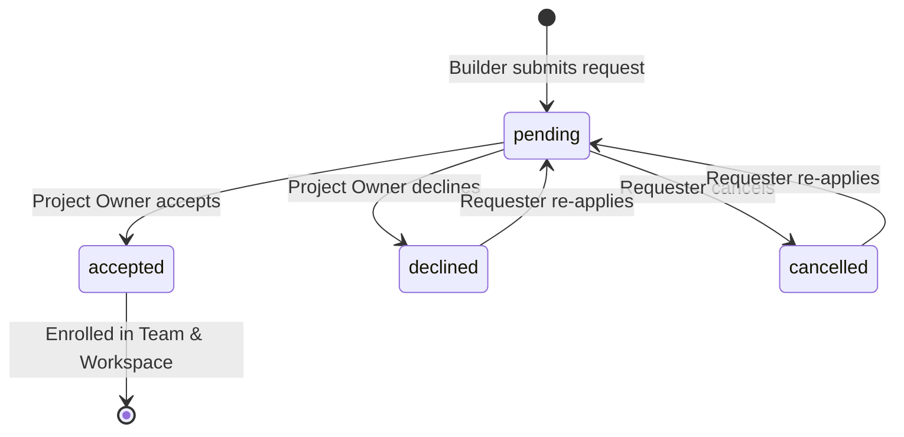
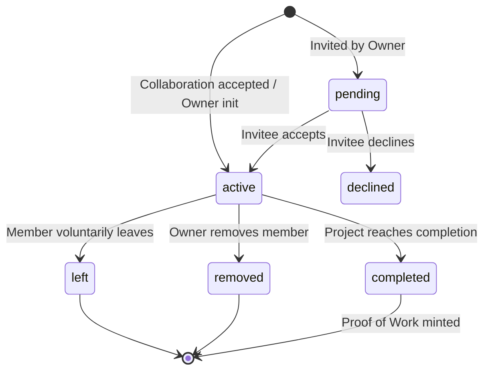
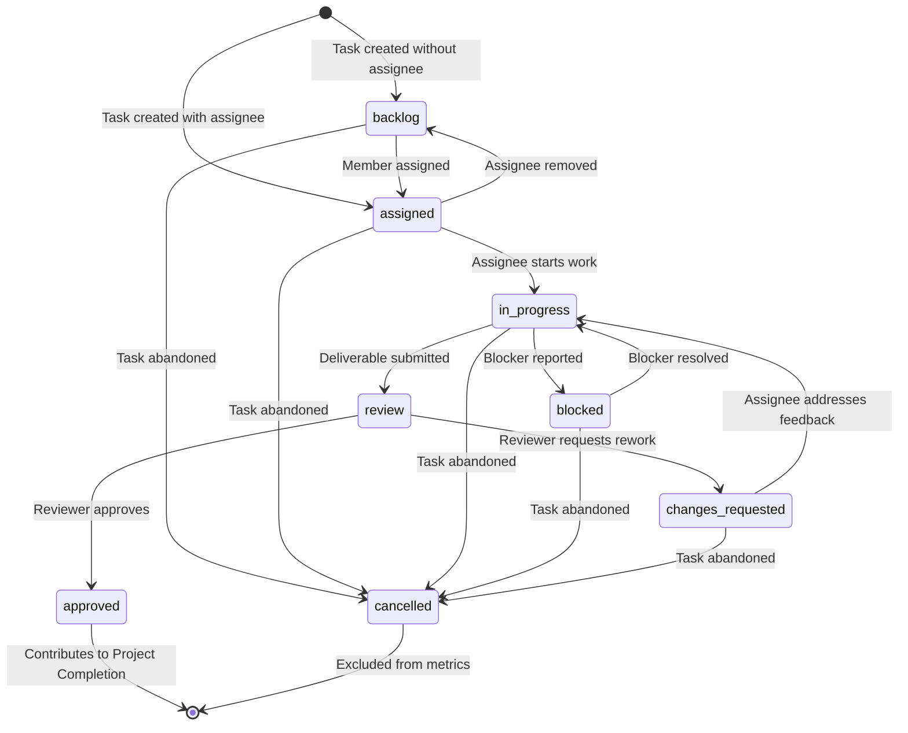
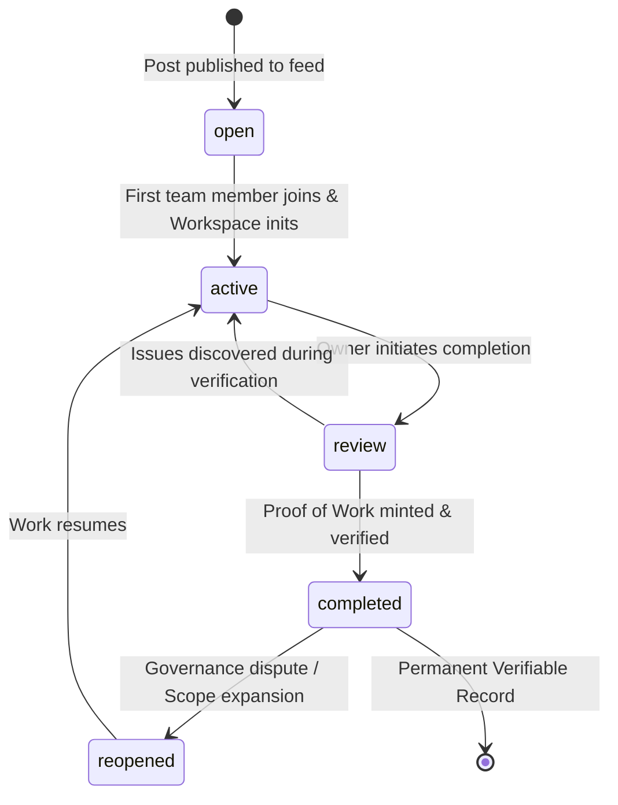

# ENQUEbet — Team Execution, Governance & Task State Machines

**Document Status:** Architecture Baseline & Specification  
**Phase:** 3 — Team Formation, Workspace Execution, and Proof of Work  
**Author:** Subagent C (Database and API Architect)  
**Target Codebase Paths:** `backend/apps/collaboration/`, `backend/apps/posts/`, `backend/apps/workspaces/`  

---

## 1. Executive Summary & Design Principles

State machines in ENQUEbet are the backbone of **proof-based builder trust**. By enforcing strict, auditable state transitions, the system guarantees that:
1. Work cannot be fabricated or self-certified without peer verification.
2. Every lifecycle transition has an authorized actor, verified preconditions, and immutable audit logging.
3. Edge cases (member departures, task rejections, project reopening) are deterministically handled without corrupting workspace progress or team reputation.

---

## 2. State Machine 1: CollaborationRequest Lifecycle

The `CollaborationRequest` governs the gateway between builder discovery and team formation.

### 2.1 State Diagram



### 2.2 Transition Specifications

| Transition | Trigger / Event | Actor | Guards & Preconditions | Side Effects & Actions |
|---|---|---|---|---|
| `[*] -> pending` | `POST /api/collaboration/request/` | Authenticated Builder (Sender) | 1. Sender $\neq$ Post Owner.<br>2. Post status = `open` / `active`.<br>3. Sender has no other `pending` or `active` request for this post.<br>4. Team max capacity not exceeded. | 1. Create `CollaborationRequest(status='pending')`.<br>2. Dispatch `Notification` to Post Owner.<br>3. Send real-time WebSocket alert. |
| `pending -> accepted` | `POST /api/collaboration/request/{id}/accept/` | Post Owner (Receiver) | 1. Request status must be `pending`.<br>2. Team capacity not exceeded.<br>3. `select_for_update` lock acquired on post and request. | 1. Set request `status='accepted'`.<br>2. Atomically create or activate `TeamMembership(user=sender, post=post, status='active')`.<br>3. Auto-create `Workspace` if not yet existing.<br>4. Auto-enroll in group chat (`ConversationMember`).<br>5. Post system welcome message in team chat.<br>6. Create `Notification(type='collaboration_accepted')`.<br>7. Log `ProjectActivity(event_type='member_joined')`. |
| `pending -> declined` | `POST /api/collaboration/request/{id}/decline/` | Post Owner (Receiver) | Request status must be `pending`. | 1. Set request `status='declined'`.<br>2. Create `Notification(type='collaboration_declined')`.<br>3. Update request `updated_at`. |
| `pending -> cancelled` | `POST /api/collaboration/request/{id}/cancel/` | Requester (Sender) | Request status must be `pending`. | 1. Set request `status='cancelled'`.<br>2. Remove pending notification for Post Owner. |
| `declined / cancelled -> pending` | `POST /api/collaboration/request/` | Requester (Sender) | Previous request was `declined` or `cancelled`. | 1. Update existing row `status='pending'` with new message.<br>2. Dispatch notification to Post Owner. |

---

## 3. State Machine 2: TeamMembership Lifecycle

The `TeamMembership` model manages contributor lifecycle within a project, role assignments, voluntary departures, and governance removals.

### 3.1 State Diagram



### 3.2 Transition Specifications

| Transition | Trigger / Event | Actor | Guards & Preconditions | Side Effects & Actions |
|---|---|---|---|---|
| `[*] -> active` | Request Accepted / Post Published | System / Owner | Valid Post and User. | 1. Create `TeamMembership(status='active', role='owner'|'contributor')`.<br>2. Ensure `ConversationMember` exists.<br>3. Log `ProjectActivity(event_type='member_joined')`. |
| `[*] -> pending` | `POST /api/workspaces/{id}/members/invite/` | Project Owner | User not already a team member. | 1. Create `TeamMembership(status='pending')`.<br>2. Send invitation notification to user. |
| `pending -> active` | `POST /api/workspaces/invites/{id}/accept/` | Invited User | Membership status is `pending`. | 1. Update status to `active`, set `joined_at=now()`.<br>2. Add to team chat `ConversationMember`.<br>3. Log `ProjectActivity(event_type='member_joined')`. |
| `pending -> declined` | `POST /api/workspaces/invites/{id}/decline/` | Invited User | Membership status is `pending`. | 1. Delete or set status to `declined`.<br>2. Notify owner. |
| `active -> left` | `POST /api/workspaces/{id}/members/leave/` | Active Contributor | 1. User must NOT be the project `owner` (owner must first transfer ownership).<br>2. Project is not in locked `review` phase. | 1. Set `status='left'`, `left_at=now()`.<br>2. Unassign active tasks: all tasks assigned to user in `assigned`, `in_progress`, or `review` revert to `backlog` (unassigned).<br>3. Deactivate or mute from team chat.<br>4. Recalculate workspace progress.<br>5. Log `ProjectActivity(event_type='member_left', description='User left team')`. |
| `active -> removed` | `POST /api/workspaces/{id}/members/{id}/remove/` | Project Owner | 1. Target member $\neq$ Owner.<br>2. Mandatory non-empty `removal_reason` provided.<br>3. Project not yet `completed`. | 1. Set `status='removed'`, `left_at=now()`, save `removal_reason`.<br>2. Revert uncompleted tasks back to `backlog`.<br>3. Remove from team chat.<br>4. Send notification with reason to removed user.<br>5. Log `ProjectActivity(event_type='member_removed', metadata={'reason': removal_reason})`. |
| `active -> completed` | `POST /api/workspaces/{id}/complete/` | System (Project Finalized) | Project passes all completion checks and mints Proof of Work. | 1. Update `status='completed'`.<br>2. Snapshot member contributions into `proof_of_work.team_snapshot`.<br>3. Unlock eligibility for Peer Ratings. |

---

## 4. State Machine 3: ProjectTask Lifecycle (Kanban & Review Loop)

The `ProjectTask` state machine controls the complete work lifecycle from inception to peer/lead review and completion.

### 4.1 State Diagram



### 4.2 Transition Specifications

| Current State | Next State | Trigger / Event | Authorized Actor | Guards & Preconditions | Side Effects & Actions |
|---|---|---|---|---|---|
| `[*]` | `backlog` | Create Task | Any Team Member | `assignee_id` is null. | 1. Create `ProjectTask(status='backlog')`.<br>2. Log activity `task_created`.<br>3. Update `workspace.total_tasks_count`. |
| `[*]` | `assigned` | Create Task with Assignee | Any Team Member | `assignee_id` belongs to an active team member. | 1. Create `ProjectTask(status='assigned')`.<br>2. Notify assignee.<br>3. Log activity `task_assigned`. |
| `backlog` | `assigned` | Assign Task | Project Owner / Maintainer / Self | Assignee is active team member. | 1. Set `assignee_id`, update `status='assigned'`.<br>2. Notify assignee.<br>3. Log activity `task_assigned`. |
| `assigned` | `in_progress` | Start Task | Designated Assignee or Owner | User must be designated assignee or project owner. | 1. Set `status='in_progress'`.<br>2. Log activity `task_status_changed`. |
| `in_progress` | `blocked` | Flag Blocker | Designated Assignee | Blocker reason provided. | 1. Set `status='blocked'`.<br>2. Notify project lead.<br>3. Log activity `task_blocked`. |
| `blocked` | `in_progress` | Unblock Task | Assignee or Lead | Blocker marked resolved. | 1. Set `status='in_progress'`.<br>2. Log activity `task_unblocked`. |
| `in_progress` | `review` | Submit Deliverable | Designated Assignee | **Strict Guard:** At least one `TaskDeliverable` must be submitted for this task version. | 1. Set `status='review'`.<br>2. Set deliverable version.<br>3. Notify designated `reviewer` (or owner if reviewer is null).<br>4. Log activity `deliverable_submitted`. |
| `review` | `approved` | Submit Review Verdict (`approved`) | Designated Reviewer or Project Lead | **Anti-Slop Guard:** Assignee cannot approve their own deliverable unless project is solo. | 1. Set `status='approved'`.<br>2. Create `TaskReview(verdict='approved')`.<br>3. Recalculate `workspace.recalculate_progress()`.<br>4. Check if all tasks in milestone are approved; if so, update milestone `status='completed'`.<br>5. Notify assignee.<br>6. Log activity `task_approved`. |
| `review` | `changes_requested` | Submit Review Verdict (`changes_requested`) | Designated Reviewer or Project Lead | Mandatory feedback text provided. | 1. Set `status='changes_requested'`.<br>2. Create `TaskReview(verdict='changes_requested', feedback=...)`.<br>3. Notify assignee with feedback.<br>4. Log activity `changes_requested`. |
| `changes_requested` | `in_progress` | Resume Rework | Designated Assignee | None. | 1. Set `status='in_progress'`.<br>2. Log activity `task_status_changed`. |
| Any (except `approved`) | `cancelled` | Cancel Task | Project Lead / Creator | Task is obsolete or cancelled. | 1. Set `status='cancelled'`.<br>2. Recalculate `workspace.total_tasks_count` and `workspace.progress_percentage`.<br>3. Log activity `task_cancelled`. |

---

## 5. State Machine 4: ProjectLifecycle & Completion Confirmation

The `ProjectLifecycle` governs the transition from open recruitment into active team execution, completion verification, and permanent Proof of Work minting.

### 5.1 State Diagram



### 5.2 Transition Specifications

| State Transition | Trigger / API Call | Actor | Verification Criteria & Guards | Side Effects & Actions |
|---|---|---|---|---|
| `open -> active` | Auto-triggered when first team member is accepted | System / Post Owner | At least 1 collaborator accepted. | 1. Initialize `Workspace(status='active')`.<br>2. Set post execution state to active.<br>3. Log `ProjectActivity(event_type='workspace_activated')`. |
| `active -> review` | `POST /api/workspaces/{id}/complete/` | Project Owner | 1. Zero tasks in `in_progress`, `review`, `changes_requested`, or `blocked`.<br>2. At least 1 approved task.<br>3. Working demo URL and repository URL provided. | 1. Set `workspace.status='review'`.<br>2. Broadcast completion review notification to all active team members.<br>3. Log `ProjectActivity(event_type='completion_initiated')`. |
| `review -> completed` | Team Confirmation / Sign-Off Period Expires | System / Owner | 1. No active disputes filed by team members.<br>2. All active members verified. | 1. Set `workspace.status='completed'`.<br>2. Set `workspace.completed_at=now()`.<br>3. Transition all active `TeamMembership` to `status='completed'`.<br>4. Generate unique verification code `ENQ-YYYY-XXXXXX`.<br>5. Snapshot team metrics to `proof_of_work.team_snapshot`.<br>6. Mint permanent `ProofOfWork` row.<br>7. Dispatch Peer Review prompts to all team members.<br>8. Increment participants' `reputation_score` based on contribution weight.<br>9. Log `ProjectActivity(event_type='proof_minted')`. |
| `review -> active` | Rejection of Completion / Bug Found | Project Owner or Maintainer | Blocker identified before proof minting. | 1. Revert `workspace.status='active'`.<br>2. Notify team.<br>3. Log `ProjectActivity(event_type='completion_cancelled')`. |
| `completed -> reopened` | `POST /api/workspaces/{id}/reopen/` | Project Owner | Requires verified dispute resolution or official platform admin approval. | 1. Set `workspace.status='active'`.<br>2. Mark existing Proof of Work under audit / updated version.<br>3. Notify team.<br>4. Log `ProjectActivity(event_type='project_reopened')`. |

---

## 6. Cross-State Machine Synchronization Matrix

The following table demonstrates how actions in one subsystem dynamically trigger state transitions and calculations in related subsystems:

| Trigger Action | Primary State Transition | Synchronized Secondary Transitions | Database Invariants Maintained |
|---|---|---|---|
| Owner accepts collaboration request | `CollaborationRequest`: `pending` $\rightarrow$ `accepted` | 1. `TeamMembership`: `[*] -> active`<br>2. `ConversationMember`: enrolled in group chat<br>3. `Workspace`: `[*] -> active` (if not exists) | Total active team members $\le$ `post.max_members`. |
| Active member leaves or is removed | `TeamMembership`: `active` $\rightarrow$ `left` or `removed` | 1. All member's unfinished tasks: `[assigned/in_progress/review]` $\rightarrow$ `backlog`<br>2. `ConversationMember`: removed / muted<br>3. `Workspace.recalculate_progress()` | No orphaned tasks assigned to inactive users. |
| Assignee submits task deliverable | `TaskDeliverable`: `created` (v+1) | `ProjectTask`: `in_progress` $\rightarrow$ `review` | Task cannot enter `review` without deliverable link or attachment. |
| Reviewer approves task deliverable | `TaskReview`: `verdict='approved'` | 1. `ProjectTask`: `review` $\rightarrow$ `approved`<br>2. `Workspace.recalculate_progress()`<br>3. If all milestone tasks approved: `ProjectMilestone` $\rightarrow$ `completed` | Progress percentage strictly reflects ratio of approved tasks. |
| Owner mints completion proof | `Workspace`: `active` $\rightarrow$ `completed` | 1. `TeamMembership`: `active` $\rightarrow$ `completed`<br>2. `ProofOfWork`: `minted`<br>3. User profiles: updated with verified credential & reputation | Zero tasks left in incomplete state. Immutable snapshot frozen in JSONB. |

---

## 7. Concurrency & Idempotency Rules

### 7.1 Row-Level Locking (`select_for_update`)
To prevent double-accepting applicants or concurrent conflicting task reviews:
- `AcceptCollaborationRequestView`: Acquires row lock on `Post` and `CollaborationRequest` to prevent race conditions exceeding team limits.
- `TaskStatusTransitionView`: Acquires row lock on `ProjectTask` to prevent concurrent contradictory reviews from multiple leads.

### 7.2 Idempotent API Execution
- All state transition endpoints check the current state against allowed transitions.
- Attempting an invalid transition returns `409 Conflict` with the current state and valid next states:
```json
{
  "success": false,
  "error_code": "INVALID_STATE_TRANSITION",
  "message": "Cannot transition task from 'approved' to 'in_progress'. Use reopen flow.",
  "current_state": "approved",
  "allowed_next_states": ["cancelled"]
}
```
