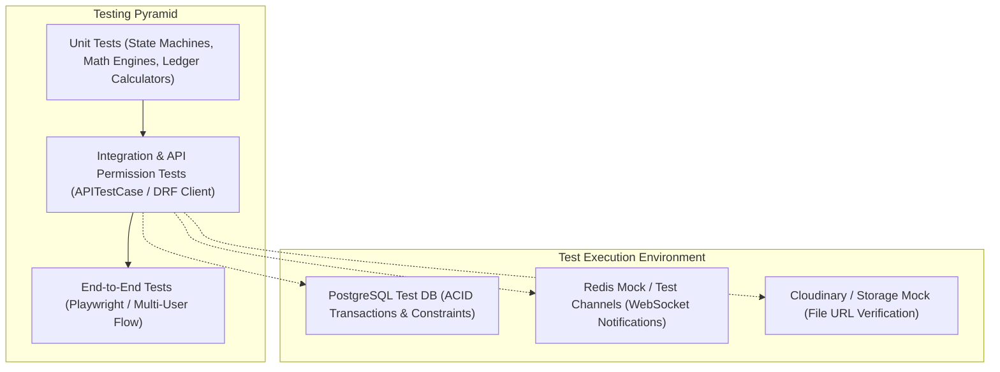
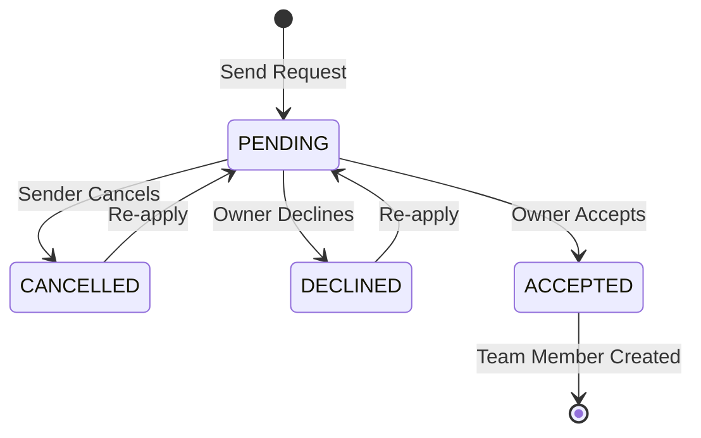
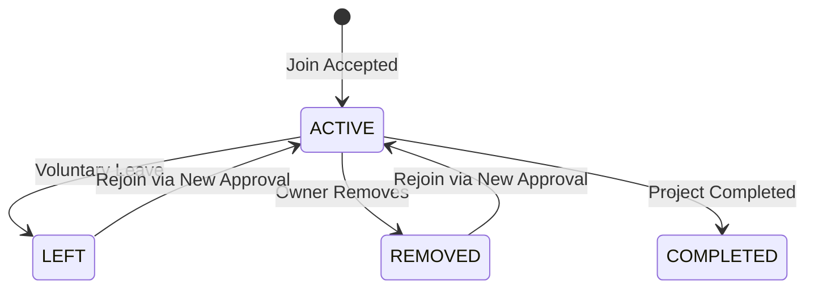
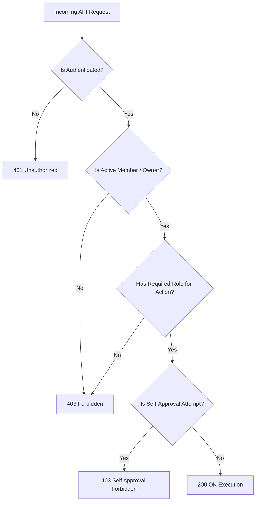
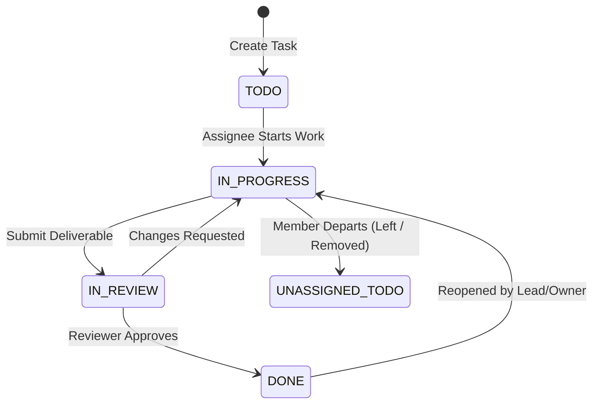
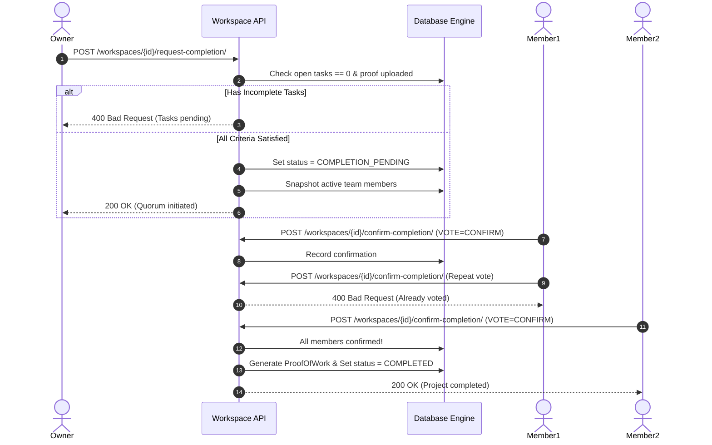

# ENQUEbet — Collaboration, Team Management & Execution Testing Strategy and Quality Matrix

**Document Status:** Production Test Engineering Baseline  
**Prepared By:** Subagent E — Test and Quality Engineer  
**Scope:** Phases 1 through 9 of Collaboration, Team Management, Workspace Execution, Completion, Proof of Work, and Reputation  
**Target Path:** `docs/implementation/team-execution/06-test-strategy.md`

---

## 1. Executive Summary & Testing Philosophy

The ENQUEbet Collaboration, Team Management, and Execution system represents the core lifecycle of the platform:

$$\text{Builder Identity} \longrightarrow \text{Discovery} \longrightarrow \text{Collaboration Request} \longrightarrow \text{Team Formation} \longrightarrow \text{Workspace Execution} \longrightarrow \text{Completion Confirmation} \longrightarrow \text{Proof of Work} \longrightarrow \text{Reputation}$$

Unlike standard social networks where feed interactions are non-transactional and eventual consistency is tolerated, the **Execution & Reputation Engine** is an **immutable trust protocol**. A single race condition, duplicate point award, unauthorized deliverable approval, or self-voted completion invalidates the platform's primary value proposition: **verifiable builder credibility**.

### Core Quality Principles

1. **Zero-Trust Backend Authorization:**  
   Every single endpoint must enforce server-side object-level permissions (`IsWorkspaceMember`, `IsWorkspaceOwner`, `CanReviewDeliverable`). No permission check may ever rely on frontend state or client-provided parameters.

2. **Idempotency & Race-Condition Immunity:**  
   Critical operations—including accepting join requests, completing tasks, voting on project completion, and generating Proof of Work—must be strictly idempotent and protected against concurrency hazards (double submissions, TOCTOU races) via PostgreSQL row-level locking (`select_for_update()`) and database unique constraints.

3. **Anti-Self-Approval & Separation of Duties:**  
   In multi-member teams, a builder cannot review or approve their own deliverables. The system must enforce cryptographic-grade accountability and audit logging for every lifecycle transition.

4. **Mathematical Precision & Determinism:**  
   Project progress percentages, milestone completions, and reputation point increments must be calculated deterministically with zero risk of division by zero, floating-point drift, or double-counting.

5. **Auditable Ledger Architecture:**  
   Reputation cannot be an un-audited mutable integer on the user table (`user.reputation_score += 50`). All reputation gains must originate from an append-only `ReputationEvent` ledger with a unique composite key `(user_id, source_proof_id, event_type)`.

---

## 2. Existing Test Suite Analysis & Architectural Baseline

A comprehensive inspection of the existing test suites in the ENQUEbet repository was performed:

| Existing Test Suite | File Path | Focus & Assertions Pattern | Strengths Observed | Gaps to Address for Execution Engine |
|---|---|---|---|---|
| **Builder Profile** | `backend/apps/users/tests.py` | Profile update, 8-criterion completeness score (0-100), security against self-awarding verification/reputation, skill proficiency backwards compatibility, private profile lock. | Rigorous test of computed scores and parameter tampering prevention. | Only tests single-user profile domain; does not test multi-user team dynamics. |
| **Feed & Ranking** | `backend/apps/posts/tests.py` | Following feed ordering, For You algorithmic ranking (skill match 40/35/25, location 25, college 20, engagement cap 15, recency decay, author diversity penalty), moderation report exclusion ($\ge 3$ reports). | Thorough assertion of ranking mathematics, pagination stability, and privacy filters. | Posts are treated purely as social items rather than project roots with active workspace lifecycles. |
| **Search Engine** | `backend/apps/search/tests.py` | Builder/project discovery, multi-criteria filtering (skills, college, location, category), private account exclusion, reported post filtering. | Clean query parameter normalization and unauthenticated vs. authenticated visibility assertions. | Search does not yet filter by workspace/collaboration execution status (`OPEN`, `IN_PROGRESS`, `COMPLETED`). |

### Key Architectural Learnings Applied to the Execution Test Suite:
- Use Django REST Framework `APITestCase` with `self.client.force_authenticate(user=...)` for authenticated multi-actor interactions.
- Explicitly create distinct personas in `setUp()`: `owner`, `lead`, `member1`, `member2`, `applicant`, `external_user`, `admin`.
- Assert both database state persistence (`refresh_from_db()`) and HTTP response payload structures.
- Verify exact HTTP status codes: `200 OK`, `201 Created`, `400 Bad Request`, `401 Unauthorized`, `403 Forbidden`, `404 Not Found`, `409 Conflict`.
- Use mock timestamps and frozen time (`freezegun` or manual `timedelta` adjustments) to verify timeouts and decay without flaky sleep statements.

---

## 3. Test Architecture, Environments & Tooling



### Standard Test Fixture Personas

Every test module in the execution suite utilizes standardized user personas:

```python
class BaseExecutionTestCase(APITestCase):
    def setUp(self):
        # 1. Project Owner (Creator of post/collaboration)
        self.owner = User.objects.create_user(
            email='owner@enquebet.com', username='alice_owner', password='Password123!'
        )
        # 2. Team Lead (Promoted collaborator)
        self.lead = User.objects.create_user(
            email='lead@enquebet.com', username='bob_lead', password='Password123!'
        )
        # 3. Regular Team Members
        self.member1 = User.objects.create_user(
            email='member1@enquebet.com', username='charlie_dev', password='Password123!'
        )
        self.member2 = User.objects.create_user(
            email='member2@enquebet.com', username='dave_designer', password='Password123!'
        )
        # 4. Prospective Applicant
        self.applicant = User.objects.create_user(
            email='applicant@enquebet.com', username='eve_applicant', password='Password123!'
        )
        # 5. External Unrelated Builder (Attacker / Non-member)
        self.stranger = User.objects.create_user(
            email='stranger@enquebet.com', username='mallory_stranger', password='Password123!'
        )
        # 6. Platform Administrator
        self.admin = User.objects.create_superuser(
            email='admin@enquebet.com', username='super_admin', password='Password123!'
        )
```

---

## 4. Requirements-to-Tests Traceability Matrix

| Requirement ID | Domain Area | Target Specification | Primary Test Class / ID | Test Type | Security Gate |
|---|---|---|---|---|---|
| **REQ-P1-01** | Phase 1: Collab Requests | Self-request prevention | `test_cannot_request_own_post` | Unit / API | Anti-abuse |
| **REQ-P1-02** | Phase 1: Collab Requests | Duplicate request prevention | `test_duplicate_pending_request_rejected` | Integration | Concurrency / Integrity |
| **REQ-P1-03** | Phase 1: Collab Requests | Re-application after decline | `test_reapply_after_declined_or_cancelled` | Integration | State machine |
| **REQ-P1-04** | Phase 1: Collab Requests | Sender cancellation | `test_sender_can_cancel_pending_request` | API | Authorization |
| **REQ-P1-05** | Phase 1: Collab Requests | Non-sender cancellation blocked | `test_non_sender_cannot_cancel_request` | Security | IDOR / Auth |
| **REQ-P1-06** | Phase 1: Collab Requests | Idempotent accept | `test_idempotent_accept_does_not_duplicate` | Concurrency | Double-join prevention |
| **REQ-P1-07** | Phase 1: Collab Requests | Team capacity limits | `test_accept_blocked_when_max_members_reached` | Integration | Resource exhaustion |
| **REQ-P2-01** | Phase 2: Membership | Role update permissions | `test_only_owner_can_update_roles` | Security | Privilege Escalation |
| **REQ-P2-02** | Phase 2: Membership | Self-promotion prevention | `test_member_cannot_self_elevate_role` | Security | Vertical Escalation |
| **REQ-P2-03** | Phase 2: Membership | Voluntary leave | `test_voluntary_leave_updates_state` | API | State machine |
| **REQ-P2-04** | Phase 2: Membership | Owner cannot leave without transfer | `test_owner_cannot_leave_without_transfer` | Integration | Team integrity |
| **REQ-P2-05** | Phase 2: Membership | Owner-driven removal | `test_owner_can_remove_member` | API | Access control |
| **REQ-P2-06** | Phase 2: Membership | Rejoining lifecycle | `test_rejoin_requires_new_invitation_or_request` | Integration | State machine |
| **REQ-P2-07** | Phase 2: Membership | Owner transfer | `test_owner_transfer_atomic_handover` | Integration | Single-owner invariant |
| **REQ-P3-01** | Phase 3: Authorization | Workspace viewing access | `test_non_member_cannot_access_workspace` | Security | Broken Object Auth |
| **REQ-P3-02** | Phase 3: Authorization | Task creation access | `test_only_active_members_can_create_tasks` | Security | RBAC |
| **REQ-P3-03** | Phase 3: Authorization | Task status updating | `test_task_assignee_and_leads_can_update_status` | Security | Horizontal Auth |
| **REQ-P3-04** | Phase 3: Authorization | Submitting deliverables | `test_only_assignee_submits_deliverable` | Security | IDOR |
| **REQ-P3-05** | Phase 3: Authorization | Anti-Self-Approval | `test_submitter_cannot_approve_own_deliverable` | Security | Separation of Duties |
| **REQ-P4-01** | Phase 4: Workspace Views | Workspace overview payload | `test_workspace_overview_aggregates_and_privacy` | API | Data Leakage |
| **REQ-P4-02** | Phase 4: Workspace Views | Member roster filtering | `test_member_roster_active_vs_historical` | API | Auditability |
| **REQ-P4-03** | Phase 4: Workspace Views | Activity timeline logging | `test_activity_timeline_records_all_transitions` | Integration | Tamper-evidence |
| **REQ-P5-01** | Phase 5: Task Engine | Non-member assignment | `test_cannot_assign_task_to_non_member` | Integration | Boundary check |
| **REQ-P5-02** | Phase 5: Task Engine | State transitions | `test_valid_task_state_machine_transitions` | Unit | State machine |
| **REQ-P5-03** | Phase 5: Task Engine | Member departure reassignment | `test_tasks_unassigned_on_member_departure` | Integration | Orphan prevention |
| **REQ-P6-01** | Phase 6: Deliverables | SSRF & malicious URLs | `test_deliverable_url_validation_blocks_ssrf` | Security | SSRF / Input Validation |
| **REQ-P6-02** | Phase 6: Deliverables | Changes requested cycle | `test_changes_requested_returns_task_to_in_progress`| Integration | Workflow loop |
| **REQ-P6-03** | Phase 6: Deliverables | Revision versioning | `test_deliverable_revision_history_preserved` | Integration | Audit trail |
| **REQ-P7-01** | Phase 7: Milestones & Math | Progress calculation formula | `test_progress_percentage_accurate_math` | Unit / Math | Determinism |
| **REQ-P7-02** | Phase 7: Milestones & Math | Zero tasks edge case | `test_zero_tasks_returns_zero_percent` | Unit / Edge Case | ZeroDivisionError |
| **REQ-P7-03** | Phase 7: Milestones & Math | Reopening tasks recalculation | `test_reopening_task_decreases_progress` | Unit / Math | Bidirectional math |
| **REQ-P8-01** | Phase 8: Project Completion | Incomplete tasks blocker | `test_cannot_complete_with_open_tasks` | Integration | Quality gate |
| **REQ-P8-02** | Phase 8: Project Completion | Member confirmation quorum | `test_completion_quorum_requires_all_active_members`| Integration | Consensus verification |
| **REQ-P8-03** | Phase 8: Project Completion | Double voting prevention | `test_member_cannot_double_vote_completion` | Security | Consensus integrity |
| **REQ-P8-04** | Phase 8: Project Completion | Disputed rejection & reopening | `test_rejected_completion_reopens_workspace` | Integration | Error recovery |
| **REQ-P9-01** | Phase 9: Proof & Reputation | Unique verification code | `test_proof_verification_code_format_and_uniqueness`| Unit / Integrity | Collision prevention |
| **REQ-P9-02** | Phase 9: Proof & Reputation | Proof immutable snapshot | `test_proof_record_immutable_after_creation` | Security | Tamper-resistance |
| **REQ-P9-03** | Phase 9: Proof & Reputation | Ledger double-count prevention | `test_reputation_ledger_prevents_double_counting` | Concurrency / Math | Financial-grade audit |
| **REQ-P9-04** | Phase 9: Proof & Reputation | Peer rating anti-self-rating | `test_peer_rating_cannot_rate_oneself` | Security | Collusion prevention |

---

## 5. Detailed Test Specifications by Phase

---

### Phase 1: Collaboration Request Hardening & Idempotency

#### Objectives
Ensure that the initial handshake between a builder and an opportunity is secure, prevents duplicate submissions, handles cancellations cleanly, and guarantees that acceptance is strictly idempotent.



#### Detailed Test Cases

```python
class Phase1CollaborationRequestTests(BaseExecutionTestCase):
    def setUp(self):
        super().setUp()
        self.post = Post.objects.create(
            user=self.owner,
            title='Autonomous Agent Engine',
            description='Rust + Python orchestrator',
            category='Tech'
        )

    def test_cannot_request_own_post(self):
        """Security: Post owner cannot request to collaborate on their own post."""
        self.client.force_authenticate(user=self.owner)
        payload = {'post_id': str(self.post.id), 'message': 'I want to join myself'}
        response = self.client.post('/api/v1/collaborations/request/', payload, format='json')
        self.assertEqual(response.status_code, status.HTTP_400_BAD_REQUEST)
        self.assertIn('cannot request to collaborate on your own post', str(response.data))

    def test_duplicate_pending_request_rejected(self):
        """Integrity: Submitting multiple requests while one is pending returns 400."""
        self.client.force_authenticate(user=self.applicant)
        payload = {'post_id': str(self.post.id), 'message': 'First application'}
        resp1 = self.client.post('/api/v1/collaborations/request/', payload, format='json')
        self.assertEqual(resp1.status_code, status.HTTP_201_CREATED)

        # Second submission
        resp2 = self.client.post('/api/v1/collaborations/request/', payload, format='json')
        self.assertEqual(resp2.status_code, status.HTTP_400_BAD_REQUEST)
        self.assertIn('already sent', str(resp2.data).lower())

    def test_sender_can_cancel_pending_request(self):
        """Lifecycle: Sender can cancel their pending collaboration request."""
        collab_req = CollaborationRequest.objects.create(
            post=self.post, sender=self.applicant, receiver=self.owner, status='pending'
        )
        self.client.force_authenticate(user=self.applicant)
        response = self.client.post(f'/api/v1/collaborations/requests/{collab_req.id}/cancel/')
        self.assertEqual(response.status_code, status.HTTP_200_OK)
        
        collab_req.refresh_from_db()
        self.assertEqual(collab_req.status, 'cancelled')

    def test_non_sender_cannot_cancel_request(self):
        """Security: Strangers and even the receiver cannot use the cancel endpoint."""
        collab_req = CollaborationRequest.objects.create(
            post=self.post, sender=self.applicant, receiver=self.owner, status='pending'
        )
        self.client.force_authenticate(user=self.stranger)
        response = self.client.post(f'/api/v1/collaborations/requests/{collab_req.id}/cancel/')
        self.assertEqual(response.status_code, status.HTTP_404_NOT_FOUND)
        
        collab_req.refresh_from_db()
        self.assertEqual(collab_req.status, 'pending')

    def test_idempotent_accept_does_not_duplicate_members_or_chat(self):
        """Idempotency: Repeated calls to accept do not duplicate PostCollaborator or ConversationMember."""
        collab_req = CollaborationRequest.objects.create(
            post=self.post, sender=self.applicant, receiver=self.owner, status='pending'
        )
        self.client.force_authenticate(user=self.owner)
        
        # Call 1: Accept
        resp1 = self.client.post(f'/api/v1/collaborations/requests/{collab_req.id}/accept/')
        self.assertEqual(resp1.status_code, status.HTTP_200_OK)
        self.assertEqual(PostCollaborator.objects.filter(post=self.post, user=self.applicant).count(), 1)
        
        # Call 2: Repeat accept (simulating double-click or network retry)
        resp2 = self.client.post(f'/api/v1/collaborations/requests/{collab_req.id}/accept/')
        # Either 200 with idempotent response or 400 request already accepted
        self.assertIn(resp2.status_code, [status.HTTP_200_OK, status.HTTP_400_BAD_REQUEST])
        self.assertEqual(PostCollaborator.objects.filter(post=self.post, user=self.applicant).count(), 1)
        
        # Verify group chat has exactly 1 membership per user
        conv = Conversation.objects.get(project_id=self.post.id, is_group=True)
        self.assertEqual(ConversationMember.objects.filter(conversation=conv, user=self.applicant).count(), 1)
        self.assertEqual(ConversationMember.objects.filter(conversation=conv, user=self.owner).count(), 1)

    def test_accept_blocked_when_max_members_reached(self):
        """Capacity: When team has reached max_members, accept is blocked with 400 Bad Request."""
        self.post.max_members = 2  # Owner + 1 member
        self.post.save()
        # Add 1 member already
        PostCollaborator.objects.create(post=self.post, user=self.member1)
        
        # Applicant tries to be accepted
        collab_req = CollaborationRequest.objects.create(
            post=self.post, sender=self.applicant, receiver=self.owner, status='pending'
        )
        self.client.force_authenticate(user=self.owner)
        response = self.client.post(f'/api/v1/collaborations/requests/{collab_req.id}/accept/')
        self.assertEqual(response.status_code, status.HTTP_400_BAD_REQUEST)
        self.assertIn('capacity', str(response.data).lower())
```

---

### Phase 2: Team Membership & Role Transitions

#### Objectives
Test team hierarchy, role assignment (`OWNER`, `LEAD`, `MEMBER`, `CONTRIBUTOR`), voluntary leave, owner removal, rejoining mechanics, and atomic ownership transfer.



#### Detailed Test Cases

```python
class Phase2TeamMembershipTests(BaseExecutionTestCase):
    def setUp(self):
        super().setUp()
        self.post = Post.objects.create(user=self.owner, title='Robotics MVP', category='Robotics')
        self.m1 = TeamMember.objects.create(post=self.post, user=self.member1, role='MEMBER', state='ACTIVE')
        self.m2 = TeamMember.objects.create(post=self.post, user=self.member2, role='MEMBER', state='ACTIVE')

    def test_only_owner_can_update_roles(self):
        """Authorization: Only OWNER can promote a MEMBER to LEAD."""
        # Non-owner attempt (member1 tries to promote member2)
        self.client.force_authenticate(user=self.member1)
        payload = {'role': 'LEAD'}
        resp = self.client.patch(f'/api/v1/collaborations/{self.post.id}/members/{self.member2.id}/role/', payload)
        self.assertEqual(resp.status_code, status.HTTP_403_FORBIDDEN)

        # Owner promotes member2
        self.client.force_authenticate(user=self.owner)
        resp2 = self.client.patch(f'/api/v1/collaborations/{self.post.id}/members/{self.member2.id}/role/', payload)
        self.assertEqual(resp2.status_code, status.HTTP_200_OK)
        self.m2.refresh_from_db()
        self.assertEqual(self.m2.role, 'LEAD')

    def test_member_cannot_self_elevate_role(self):
        """Security: Regular member cannot elevate their own role to OWNER or LEAD."""
        self.client.force_authenticate(user=self.member1)
        payload = {'role': 'OWNER'}
        resp = self.client.patch(f'/api/v1/collaborations/{self.post.id}/members/{self.member1.id}/role/', payload)
        self.assertEqual(resp.status_code, status.HTTP_403_FORBIDDEN)
        self.m1.refresh_from_db()
        self.assertEqual(self.m1.role, 'MEMBER')

    def test_voluntary_leave_updates_state(self):
        """Lifecycle: Active member can voluntarily leave the team."""
        self.client.force_authenticate(user=self.member1)
        resp = self.client.post(f'/api/v1/collaborations/{self.post.id}/members/leave/')
        self.assertEqual(resp.status_code, status.HTTP_200_OK)
        
        self.m1.refresh_from_db()
        self.assertEqual(self.m1.state, 'LEFT')

    def test_owner_cannot_leave_without_transferring_ownership(self):
        """Integrity: Owner calling leave endpoint is rejected; must transfer ownership first."""
        self.client.force_authenticate(user=self.owner)
        resp = self.client.post(f'/api/v1/collaborations/{self.post.id}/members/leave/')
        self.assertEqual(resp.status_code, status.HTTP_400_BAD_REQUEST)
        self.assertIn('transfer ownership', str(resp.data).lower())

    def test_owner_transfer_atomic_handover(self):
        """Atomic Handover: Transferring ownership transitions new user to OWNER and old owner to LEAD."""
        self.client.force_authenticate(user=self.owner)
        payload = {'new_owner_id': str(self.member1.id)}
        resp = self.client.post(f'/api/v1/collaborations/{self.post.id}/transfer-owner/', payload)
        self.assertEqual(resp.status_code, status.HTTP_200_OK)

        self.post.refresh_from_db()
        self.assertEqual(self.post.user, self.member1)
        
        old_owner_member = TeamMember.objects.get(post=self.post, user=self.owner)
        new_owner_member = TeamMember.objects.get(post=self.post, user=self.member1)
        self.assertEqual(new_owner_member.role, 'OWNER')
        self.assertEqual(old_owner_member.role, 'LEAD')
```

---

### Phase 3: Role-Based Authorization & Security

#### Objectives
Verify strict boundary isolation across all roles. Prevent horizontal authorization bypass (IDOR) and vertical privilege escalation across Tasks, Deliverables, Reviews, and Project Completion.



#### Detailed Test Cases

```python
class Phase3RoleBasedAuthorizationTests(BaseExecutionTestCase):
    def setUp(self):
        super().setUp()
        self.post = Post.objects.create(user=self.owner, title='Security Suite', category='Tech')
        self.workspace = Workspace.objects.create(post=self.post, status='ACTIVE')
        self.m1 = TeamMember.objects.create(post=self.post, user=self.member1, role='MEMBER', state='ACTIVE')
        self.task = Task.objects.create(workspace=self.workspace, title='Core Auth', assigned_to=self.member1, status='TODO')

    def test_stranger_cannot_view_or_mutate_workspace(self):
        """Security: Non-members cannot view tasks or mutate workspace resources (IDOR test)."""
        self.client.force_authenticate(user=self.stranger)
        # Attempt to view tasks
        resp_get = self.client.get(f'/api/v1/workspaces/{self.workspace.id}/tasks/')
        self.assertEqual(resp_get.status_code, status.HTTP_403_FORBIDDEN)
        
        # Attempt to create task
        resp_post = self.client.post(f'/api/v1/workspaces/{self.workspace.id}/tasks/', {'title': 'Malicious Task'})
        self.assertEqual(resp_post.status_code, status.HTTP_403_FORBIDDEN)

    def test_member_cannot_modify_other_members_task_without_lead_role(self):
        """Security: Regular member cannot delete or reassign another member's task."""
        other_task = Task.objects.create(workspace=self.workspace, title='Design Mockups', assigned_to=self.member2, status='TODO')
        self.client.force_authenticate(user=self.member1)
        
        # Attempt delete
        resp_del = self.client.delete(f'/api/v1/tasks/{other_task.id}/')
        self.assertEqual(resp_del.status_code, status.HTTP_403_FORBIDDEN)

    def test_non_owner_cannot_initiate_project_completion(self):
        """Security: Regular members or leads cannot trigger project completion; owner only."""
        self.client.force_authenticate(user=self.member1)
        resp = self.client.post(f'/api/v1/workspaces/{self.workspace.id}/request-completion/', {'proof_file_url': 'https://github.com/org/repo'})
        self.assertEqual(resp.status_code, status.HTTP_403_FORBIDDEN)
```

---

### Phase 4: Workspace Overview, Roster & Activity Timeline

#### Objectives
Validate that the workspace aggregate overview is correct, does not leak private user attributes, and that every critical lifecycle transition is accurately recorded in the audit activity timeline.

#### Detailed Test Cases

```python
class Phase4WorkspaceOverviewAndTimelineTests(BaseExecutionTestCase):
    def setUp(self):
        super().setUp()
        self.post = Post.objects.create(user=self.owner, title='SaaS Dashboard', category='Product')
        self.workspace = Workspace.objects.create(post=self.post, status='ACTIVE')
        TeamMember.objects.create(post=self.post, user=self.owner, role='OWNER', state='ACTIVE')
        TeamMember.objects.create(post=self.post, user=self.member1, role='MEMBER', state='ACTIVE')
        Task.objects.create(workspace=self.workspace, title='Task 1', status='DONE')
        Task.objects.create(workspace=self.workspace, title='Task 2', status='TODO')

    def test_workspace_overview_aggregates_and_data_privacy(self):
        """Data Privacy & Aggregates: Overview returns progress and task stats without leaking emails or hashes."""
        self.client.force_authenticate(user=self.member1)
        resp = self.client.get(f'/api/v1/workspaces/{self.workspace.id}/')
        self.assertEqual(resp.status_code, status.HTTP_200_OK)
        
        # Check aggregates
        self.assertEqual(resp.data['total_tasks'], 2)
        self.assertEqual(resp.data['completed_tasks'], 1)
        self.assertEqual(resp.data['progress_percentage'], 50)
        self.assertEqual(resp.data['active_member_count'], 2)
        
        # Check data privacy
        members_data = resp.data['members']
        for m in members_data:
            self.assertNotIn('password', m)
            self.assertNotIn('email', m)
            self.assertIn('username', m)
            self.assertIn('role', m)

    def test_activity_timeline_records_state_transitions(self):
        """Auditability: Creating tasks, completing tasks, and member changes generate timeline events."""
        self.client.force_authenticate(user=self.owner)
        
        # 1. Create a task
        resp_task = self.client.post(
            f'/api/v1/workspaces/{self.workspace.id}/tasks/',
            {'title': 'Write Documentation', 'assigned_to': str(self.member1.id)},
            format='json'
        )
        self.assertEqual(resp_task.status_code, status.HTTP_201_CREATED)

        # 2. Query timeline
        resp_timeline = self.client.get(f'/api/v1/workspaces/{self.workspace.id}/activity/')
        self.assertEqual(resp_timeline.status_code, status.HTTP_200_OK)
        
        events = resp_timeline.data['results']
        action_types = [e['action_type'] for e in events]
        self.assertIn('TASK_CREATED', action_types)
        
        # Verify event metadata includes actor
        latest_event = events[0]
        self.assertEqual(latest_event['actor_id'], str(self.owner.id))
```

---

### Phase 5: Task Management, Assignments & Reassignment on Departure

#### Objectives
Validate the task state machine (`TODO` $\rightarrow$ `IN_PROGRESS` $\rightarrow$ `IN_REVIEW` $\rightarrow$ `DONE`), ensure tasks cannot be assigned to non-members, and verify that open tasks are automatically reassigned or marked unassigned when a member departs.



#### Detailed Test Cases

```python
class Phase5TaskLifecycleTests(BaseExecutionTestCase):
    def setUp(self):
        super().setUp()
        self.post = Post.objects.create(user=self.owner, title='Compiler Engine', category='Tech')
        self.workspace = Workspace.objects.create(post=self.post, status='ACTIVE')
        TeamMember.objects.create(post=self.post, user=self.owner, role='OWNER', state='ACTIVE')
        self.tm1 = TeamMember.objects.create(post=self.post, user=self.member1, role='MEMBER', state='ACTIVE')

    def test_cannot_assign_task_to_non_member(self):
        """Integrity: Assigning a task to a stranger outside the workspace is rejected."""
        self.client.force_authenticate(user=self.owner)
        payload = {
            'title': 'Parser Implementation',
            'assigned_to': str(self.stranger.id)
        }
        resp = self.client.post(f'/api/v1/workspaces/{self.workspace.id}/tasks/', payload, format='json')
        self.assertEqual(resp.status_code, status.HTTP_400_BAD_REQUEST)
        self.assertIn('assigned user must be an active workspace member', str(resp.data).lower())

    def test_valid_task_state_machine_transitions(self):
        """State Machine: Valid transitions TODO -> IN_PROGRESS -> IN_REVIEW -> DONE."""
        task = Task.objects.create(workspace=self.workspace, title='Lexer', assigned_to=self.member1, status='TODO')
        self.client.force_authenticate(user=self.member1)

        # 1. Start task
        resp = self.client.patch(f'/api/v1/tasks/{task.id}/status/', {'status': 'IN_PROGRESS'})
        self.assertEqual(resp.status_code, status.HTTP_200_OK)
        task.refresh_from_db()
        self.assertEqual(task.status, 'IN_PROGRESS')

        # 2. Invalid jump (TODO -> DONE directly without deliverable approval if deliverable required)
        task.status = 'TODO'
        task.save()
        resp_invalid = self.client.patch(f'/api/v1/tasks/{task.id}/status/', {'status': 'DONE'})
        self.assertEqual(resp_invalid.status_code, status.HTTP_400_BAD_REQUEST)

    def test_tasks_reassigned_or_unassigned_on_member_departure(self):
        """Orphan Prevention: When member departs, open tasks transition to unassigned/TODO."""
        t1 = Task.objects.create(workspace=self.workspace, title='Task Open', assigned_to=self.member1, status='IN_PROGRESS')
        t2 = Task.objects.create(workspace=self.workspace, title='Task Done', assigned_to=self.member1, status='DONE')

        # Member 1 leaves
        self.client.force_authenticate(user=self.member1)
        resp = self.client.post(f'/api/v1/collaborations/{self.post.id}/members/leave/')
        self.assertEqual(resp.status_code, status.HTTP_200_OK)

        t1.refresh_from_db()
        t2.refresh_from_db()
        # Open task is unassigned and reset to TODO
        self.assertIsNone(t1.assigned_to)
        self.assertEqual(t1.status, 'TODO')
        # Completed task retains historical attribution
        self.assertEqual(t2.assigned_to, self.member1)
        self.assertEqual(t2.status, 'DONE')
```

---

### Phase 6: Deliverables, Reviews & Anti-Self-Approval Enforcement

#### Objectives
Verify that deliverable submissions undergo strict input validation (SSRF and MIME type defenses), review approval adheres to separation of duties, and self-approval by an assignee is strictly blocked.

#### Detailed Test Cases

```python
class Phase6DeliverablesAndReviewTests(BaseExecutionTestCase):
    def setUp(self):
        super().setUp()
        self.post = Post.objects.create(user=self.owner, title='Full-Stack App', category='Tech')
        self.workspace = Workspace.objects.create(post=self.post, status='ACTIVE')
        TeamMember.objects.create(post=self.post, user=self.owner, role='OWNER', state='ACTIVE')
        TeamMember.objects.create(post=self.post, user=self.lead, role='LEAD', state='ACTIVE')
        TeamMember.objects.create(post=self.post, user=self.member1, role='MEMBER', state='ACTIVE')
        
        self.task = Task.objects.create(
            workspace=self.workspace, title='API Implementation', assigned_to=self.member1, status='IN_PROGRESS'
        )

    def test_deliverable_url_validation_blocks_ssrf(self):
        """Security: Submitting internal IP addresses or cloud metadata URLs triggers SSRF validation failure."""
        self.client.force_authenticate(user=self.member1)
        malicious_urls = [
            'http://169.254.169.254/latest/meta-data/',  # AWS metadata
            'http://127.0.0.1:8000/internal-admin/',    # Localhost
            'http://192.168.1.1/router-settings'        # Private intranet
        ]
        for url in malicious_urls:
            payload = {'deliverable_url': url, 'notes': 'Check my code'}
            resp = self.client.post(f'/api/v1/tasks/{self.task.id}/deliverables/', payload, format='json')
            self.assertEqual(resp.status_code, status.HTTP_400_BAD_REQUEST)
            self.assertIn('invalid or restricted url', str(resp.data).lower())

    def test_submitter_cannot_approve_own_deliverable_anti_self_approval(self):
        """Security: Even if a team lead or owner creates and completes a task, they CANNOT approve their own deliverable."""
        # Create a task assigned to Team Lead
        lead_task = Task.objects.create(
            workspace=self.workspace, title='Lead Architecture Work', assigned_to=self.lead, status='IN_PROGRESS'
        )
        deliverable = Deliverable.objects.create(
            task=lead_task, submitted_by=self.lead, deliverable_url='https://github.com/enquebet/pr/1', status='PENDING_REVIEW'
        )
        lead_task.status = 'IN_REVIEW'
        lead_task.save()

        # Team Lead tries to approve their own deliverable
        self.client.force_authenticate(user=self.lead)
        payload = {'action': 'APPROVE', 'feedback': 'Looks good to me (self)'}
        resp = self.client.post(f'/api/v1/deliverables/{deliverable.id}/review/', payload, format='json')
        self.assertEqual(resp.status_code, status.HTTP_403_FORBIDDEN)
        self.assertIn('self approval is forbidden', str(resp.data).lower())

        # Owner approves it successfully
        self.client.force_authenticate(user=self.owner)
        resp_ok = self.client.post(f'/api/v1/deliverables/{deliverable.id}/review/', payload, format='json')
        self.assertEqual(resp_ok.status_code, status.HTTP_200_OK)
        deliverable.refresh_from_db()
        lead_task.refresh_from_db()
        self.assertEqual(deliverable.status, 'APPROVED')
        self.assertEqual(lead_task.status, 'DONE')

    def test_changes_requested_returns_task_to_in_progress(self):
        """Workflow: Requesting changes on a deliverable requires feedback and moves task back to IN_PROGRESS."""
        deliverable = Deliverable.objects.create(
            task=self.task, submitted_by=self.member1, deliverable_url='https://github.com/enquebet/pr/2', status='PENDING_REVIEW'
        )
        self.task.status = 'IN_REVIEW'
        self.task.save()

        self.client.force_authenticate(user=self.lead)
        # 1. Attempt changes requested without feedback (must fail validation)
        resp_empty = self.client.post(f'/api/v1/deliverables/{deliverable.id}/review/', {'action': 'REQUEST_CHANGES', 'feedback': ''})
        self.assertEqual(resp_empty.status_code, status.HTTP_400_BAD_REQUEST)

        # 2. Valid changes request
        resp_valid = self.client.post(
            f'/api/v1/deliverables/{deliverable.id}/review/',
            {'action': 'REQUEST_CHANGES', 'feedback': 'Please add unit tests for edge cases.'}
        )
        self.assertEqual(resp_valid.status_code, status.HTTP_200_OK)
        deliverable.refresh_from_db()
        self.task.refresh_from_db()
        self.assertEqual(deliverable.status, 'CHANGES_REQUESTED')
        self.assertEqual(self.task.status, 'IN_PROGRESS')
```

---

### Phase 7: Milestones & Mathematical Progress Calculation

#### Objectives
Verify that project progress percentage calculations are mathematically deterministic, handle edge cases without errors (such as zero tasks), clamp strictly between $[0, 100]$, and update properly when tasks are created, completed, reopened, or deleted.

$$\text{Progress \%} = \begin{cases} 0 & \text{if } \text{TotalTasks} = 0 \\ \left\lfloor \frac{\text{CompletedTasks}}{\text{TotalTasks}} \times 100 \right\rfloor & \text{if } \text{TotalTasks} > 0 \end{cases}$$

#### Detailed Test Cases

```python
class Phase7MilestonesAndMathProgressTests(BaseExecutionTestCase):
    def setUp(self):
        super().setUp()
        self.post = Post.objects.create(user=self.owner, title='Algorithmic Trading Bot', category='Finance')
        self.workspace = Workspace.objects.create(post=self.post, status='ACTIVE', progress_percentage=0)

    def test_zero_tasks_returns_zero_percent_without_division_by_zero(self):
        """Edge Case: When workspace has 0 tasks, progress is 0% and no ZeroDivisionError occurs."""
        self.assertEqual(self.workspace.tasks.count(), 0)
        calc_progress = self.workspace.calculate_progress()
        self.assertEqual(calc_progress, 0)

    def test_progress_percentage_accurate_math(self):
        """Mathematical Precision: 1 of 3 tasks completed = 33%, 2 of 3 = 66%, 3 of 3 = 100%."""
        t1 = Task.objects.create(workspace=self.workspace, title='Task 1', status='TODO')
        t2 = Task.objects.create(workspace=self.workspace, title='Task 2', status='TODO')
        t3 = Task.objects.create(workspace=self.workspace, title='Task 3', status='TODO')

        self.assertEqual(self.workspace.calculate_progress(), 0)

        # Complete 1 task
        t1.status = 'DONE'
        t1.save()
        self.assertEqual(self.workspace.calculate_progress(), 33)

        # Complete 2 tasks
        t2.status = 'DONE'
        t2.save()
        self.assertEqual(self.workspace.calculate_progress(), 66)

        # Complete 3 tasks
        t3.status = 'DONE'
        t3.save()
        self.assertEqual(self.workspace.calculate_progress(), 100)

    def test_reopening_task_decreases_progress_dynamically(self):
        """Bidirectional Consistency: Reopening a completed task recalculates progress downwards."""
        t1 = Task.objects.create(workspace=self.workspace, title='Task 1', status='DONE')
        t2 = Task.objects.create(workspace=self.workspace, title='Task 2', status='DONE')
        self.assertEqual(self.workspace.calculate_progress(), 100)

        # Reopen task 1
        t1.status = 'IN_PROGRESS'
        t1.save()
        self.assertEqual(self.workspace.calculate_progress(), 50)
```

---

### Phase 8: Project Completion, Quorum Verification & Disputed Reopening

#### Objectives
Ensure project completion requires all quality gates to be satisfied, captures an immutable membership snapshot, executes consensus quorum voting, prevents duplicate voting, and safely handles disputes.



#### Detailed Test Cases

```python
class Phase8ProjectCompletionQuorumTests(BaseExecutionTestCase):
    def setUp(self):
        super().setUp()
        self.post = Post.objects.create(user=self.owner, title='Open Source DB', category='Database')
        self.workspace = Workspace.objects.create(post=self.post, status='ACTIVE')
        TeamMember.objects.create(post=self.post, user=self.owner, role='OWNER', state='ACTIVE')
        self.tm1 = TeamMember.objects.create(post=self.post, user=self.member1, role='MEMBER', state='ACTIVE')
        self.tm2 = TeamMember.objects.create(post=self.post, user=self.member2, role='MEMBER', state='ACTIVE')
        self.t1 = Task.objects.create(workspace=self.workspace, title='B-Tree Storage', status='DONE')

    def test_cannot_request_completion_with_incomplete_tasks(self):
        """Quality Gate: If any task remains in TODO or IN_PROGRESS, completion request is rejected."""
        Task.objects.create(workspace=self.workspace, title='Write WAL', status='IN_PROGRESS')
        self.client.force_authenticate(user=self.owner)
        payload = {'proof_file_url': 'https://github.com/enquebet/db'}
        resp = self.client.post(f'/api/v1/workspaces/{self.workspace.id}/request-completion/', payload)
        self.assertEqual(resp.status_code, status.HTTP_400_BAD_REQUEST)
        self.assertIn('incomplete tasks remain', str(resp.data).lower())

    def test_member_cannot_double_vote_completion(self):
        """Integrity: Each member can only submit one confirmation vote."""
        self.client.force_authenticate(user=self.owner)
        self.client.post(f'/api/v1/workspaces/{self.workspace.id}/request-completion/', {'proof_file_url': 'https://github.com/enquebet/db'})

        self.client.force_authenticate(user=self.member1)
        # Vote 1
        resp1 = self.client.post(f'/api/v1/workspaces/{self.workspace.id}/confirm-completion/', {'vote': 'CONFIRM'})
        self.assertEqual(resp1.status_code, status.HTTP_200_OK)

        # Vote 2 (Duplicate)
        resp2 = self.client.post(f'/api/v1/workspaces/{self.workspace.id}/confirm-completion/', {'vote': 'CONFIRM'})
        self.assertEqual(resp2.status_code, status.HTTP_400_BAD_REQUEST)
        self.assertIn('already recorded', str(resp2.data).lower())

    def test_rejected_completion_reopens_workspace_to_active(self):
        """Dispute Recovery: If an active member rejects completion with feedback, workspace returns to ACTIVE."""
        self.client.force_authenticate(user=self.owner)
        self.client.post(f'/api/v1/workspaces/{self.workspace.id}/request-completion/', {'proof_file_url': 'https://github.com/enquebet/db'})

        self.client.force_authenticate(user=self.member2)
        resp_reject = self.client.post(
            f'/api/v1/workspaces/{self.workspace.id}/confirm-completion/',
            {'vote': 'REJECT', 'reason': 'Benchmarks are failing on macOS.'}
        )
        self.assertEqual(resp_reject.status_code, status.HTTP_200_OK)
        
        self.workspace.refresh_from_db()
        self.assertEqual(self.workspace.status, 'ACTIVE')
        self.assertIsNone(getattr(self.workspace, 'proof_of_work', None))
```

---

### Phase 9: Proof of Work Generation, Ledger Attribution & Anti-Double-Counting

#### Objectives
Validate the generation of standard non-guessable verification codes (`ENQ-YYYY-XXXXXX`), ensure Proof of Work records are immutable, and verify that reputation awards are recorded in an append-only ledger that is immune to duplicate increments.

$$\text{Reputation Ledger Invariant: } \forall (u, p, e) \in \text{Ledger}, \quad \text{Count}(u, p, e) \le 1$$

#### Detailed Test Cases

```python
class Phase9ProofAndReputationLedgerTests(BaseExecutionTestCase):
    def setUp(self):
        super().setUp()
        self.post = Post.objects.create(user=self.owner, title='Verified AI Agent', category='AI')
        self.workspace = Workspace.objects.create(post=self.post, status='ACTIVE')
        TeamMember.objects.create(post=self.post, user=self.owner, role='OWNER', state='ACTIVE')
        TeamMember.objects.create(post=self.post, user=self.member1, role='MEMBER', state='ACTIVE')
        Task.objects.create(workspace=self.workspace, title='Core Neural Net', status='DONE')

    def test_proof_verification_code_format_and_uniqueness(self):
        """Integrity: Verification code matches ENQ-YYYY-SEQUENCE and is globally unique."""
        proof = ProofOfWork.objects.create(
            workspace=self.workspace,
            project_title=self.post.title,
            proof_file_url='https://github.com/enquebet/ai',
            verification_status='VERIFIED'
        )
        code = proof.verification_code
        self.assertTrue(code.startswith('ENQ-'))
        parts = code.split('-')
        self.assertEqual(len(parts), 3)
        self.assertEqual(len(parts[1]), 4)  # Year (e.g. 2026)
        self.assertTrue(parts[2].isdigit()) # Sequence number

    def test_reputation_ledger_prevents_double_counting(self):
        """Financial-Grade Ledger: Re-triggering completion award does not duplicate reputation points."""
        proof = ProofOfWork.objects.create(
            workspace=self.workspace,
            project_title=self.post.title,
            verification_status='VERIFIED'
        )
        initial_score = self.member1.reputation_score

        # Award completion reputation via service
        ReputationService.award_completion_reputation(user=self.member1, proof=proof)
        self.member1.refresh_from_db()
        self.assertEqual(self.member1.reputation_score, initial_score + 50)
        self.assertEqual(ReputationEvent.objects.filter(user=self.member1, proof=proof, event_type='PROJECT_COMPLETION').count(), 1)

        # Re-trigger award (simulating replay attack or celery retry)
        ReputationService.award_completion_reputation(user=self.member1, proof=proof)
        self.member1.refresh_from_db()
        # Score must remain unchanged at initial + 50 (NO DOUBLE COUNTING)
        self.assertEqual(self.member1.reputation_score, initial_score + 50)
        self.assertEqual(ReputationEvent.objects.filter(user=self.member1, proof=proof, event_type='PROJECT_COMPLETION').count(), 1)

    def test_peer_rating_cannot_rate_oneself(self):
        """Anti-Collusion: Builder cannot submit a peer rating for themselves."""
        proof = ProofOfWork.objects.create(workspace=self.workspace, verification_status='VERIFIED')
        self.client.force_authenticate(user=self.member1)
        payload = {
            'proof_id': str(proof.id),
            'rated_user_id': str(self.member1.id),
            'rating': 5,
            'feedback': 'I am the greatest builder ever.'
        }
        resp = self.client.post('/api/v1/ratings/', payload, format='json')
        self.assertEqual(resp.status_code, status.HTTP_400_BAD_REQUEST)
        self.assertIn('cannot rate yourself', str(resp.data).lower())

    def test_public_proof_view_does_not_leak_private_workspace_data(self):
        """Privacy: Unauthenticated visitors can view public proof details without leaking internal chat or member emails."""
        proof = ProofOfWork.objects.create(
            workspace=self.workspace,
            project_title='Public Innovation',
            proof_file_url='https://example.com/demo.mp4',
            verification_status='VERIFIED'
        )
        self.client.force_authenticate(user=None)  # Anonymous
        resp = self.client.get(f'/api/v1/proof/{proof.verification_code}/')
        self.assertEqual(resp.status_code, status.HTTP_200_OK)
        
        self.assertEqual(resp.data['project_title'], 'Public Innovation')
        self.assertEqual(resp.data['verification_status'], 'VERIFIED')
        # Ensure private items are omitted
        self.assertNotIn('messages', resp.data)
        self.assertNotIn('emails', str(resp.data))
```

---

## 6. Non-Functional, Security & Performance Test Specifications

### 6.1 Concurrency & Race Condition Suite
- **Simultaneous Join Request Acceptance:**  
  Simulate 10 concurrent requests accepting applicants when `max_members = 3`. Use Python `ThreadPoolExecutor` or `asyncio` to execute simultaneous HTTP calls. Verify with database assertions that active members strictly equal 3 and 7 requests are cleanly rejected with `400 / 409`.
- **Concurrent Task Status Changes:**  
  Simulate two workers completing two tasks simultaneously. Assert that database row locks calculate the progress percentage correctly without losing updates.

### 6.2 Security & Penetration Testing Suite
- **Broken Object-Level Authorization (BOLA / IDOR):**  
  Every endpoint accepting `{workspace_id}`, `{task_id}`, `{deliverable_id}` is fuzz-tested with foreign UUIDs belonging to another organization/team. Must return `403 Forbidden` or `404 Not Found`.
- **Stored XSS Prevention:**  
  Task titles, deliverable descriptions, and peer feedback payloads containing `<script>alert(1)</script>` or `` are sanitized and escaped before database persistence and JSON serialization.
- **SSRF Injection via Deliverable URLs:**  
  Validate that URLs pointing to private IP space (`10.0.0.0/8`, `172.16.0.0/12`, `192.168.0.0/16`, `127.0.0.1`, `169.254.169.254`) are rejected at the serializer level.

### 6.3 Performance & N+1 Query Regression Gates
- Use `assertNumQueries` across all list endpoints:
  - `GET /api/v1/workspaces/{id}/` $\le 4$ queries (workspace, post, members, task counts).
  - `GET /api/v1/workspaces/{id}/tasks/` $\le 3$ queries (prefetch assignees, milestones).
  - `GET /api/v1/workspaces/{id}/activity/` $\le 2$ queries (paginated audit records + actor details).

---

## 7. Automated Test Execution Plan & CI/CD Quality Gates

### Automated Test Command Matrix

```bash
# 1. Run full unit and integration test suite with coverage
python manage.py test apps.collaboration apps.teams apps.workspaces apps.tasks apps.proof apps.reputation --settings=config.settings.test

# 2. Enforce minimum 95% branch coverage on Execution Engine
coverage run --source='apps' manage.py test
coverage report --fail-under=95

# 3. Security vulnerability and static analysis scan
bandit -r apps/ -ll
flake8 backend/ --max-line-length=120
```

### Pre-Merge CI Gates:
1. **Zero Failing Tests:** All tests across Phases 1 through 9 must pass with exit code `0`.
2. **PostgreSQL Compatibility:** Tests must pass on real PostgreSQL instances, not solely SQLite.
3. **Database Migration Parity:** `python manage.py makemigrations --check --dry-run` must report no uncommitted schema changes.
4. **Idempotency Gate:** All state transitions must succeed or fail predictably without leaving orphan records.

---
*Signed and Approved by Subagent E — Test and Quality Engineer for ENQUEbet.*
